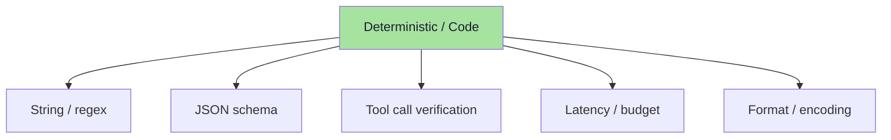
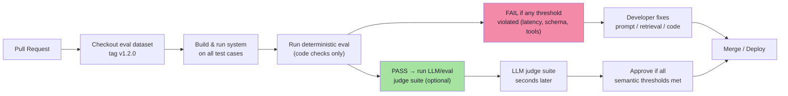

# Chapter 04: Deterministic Evaluation — Everything Code Can Decide

> **Chapter Goal:** Not every evaluator needs an LLM. Code can decide a large class of assertions instantly, for free, and with perfect reproducibility. This chapter covers the *deterministic eval* family — the 100% reproducible assertions you can run on every CI commit without spending a cent. By the end you should be able to replace many LLM‑judge calls with simple code checks and know exactly when the code path is insufficient.

---

## 4.1 Why Deterministic Eval First?

The board from FDE L17 explicitly lists the three evaluator families:

| Family | Speed | Cost | When to use |
|---|---|---|---|
| Code | Instant | Free | Facts, structure, tool calls, latency |
| LLM Judge | Seconds | $/1k | Semantic quality, tone, completeness |
| Human | Hours | $$$ | Gold labels, calibration, edge |

**Rule:** *Start with code. Only escalate when a property genuinely cannot be checked objectively.* This chapter teaches you which properties fall in the "code" bucket and how to write them.



All of these execute in **microseconds** and never fail "by accident" — they either pass or fail based on a boolean condition.

---

## 4.2 Deterministic Eval: The Four Sub‑Types

| Sub‑type | What it checks | Example | When to use |
|---|---|---|---|
| **String / regex** | Exact text, patterns, presence | `"30 days"` in answer, answer matches `/refund policy/i` | Fact presence, profanity filter |
| **JSON schema** | Output is valid structure | `output` is valid `RefundSchema` (`{period: number, reason?: string}`) | Structured outputs, function calls |
| **Tool call verification** | Correct tool invoked with args | `getOrderStatus(orderId=123)` called with correct `orderId` | Any application that calls external tools |
| **Latency / budget** | Time / token cost within limits | `time < 800ms`, `tokens_used < 1500` | CI regression for speed, cost monitoring |

---

## 4.3 String / Regex Checks

```typescript
// Example: the answer must mention the 30-day window
function factInclusion(answer: string, fact: string): boolean {
  const lower = answer.toLowerCase();
  const target = fact.toLowerCase();
  return lower.includes(target);
}

// Usage
factInclusion(
  "You can return your product within 30 days of delivery.",
  "30 days"
);  // → true
```

> **Subtlety:** `.includes()` can produce false positives (e.g., "not 30 days" contains "30 days"). For tighter checks, use word-boundary regex or a small NLP library.

```typescript
// Word‑boundary check
function factInclusionStrict(answer: string, fact: string): boolean {
  const regex = new RegExp(`\\b${fact.replace(/[.*+?^\${}()|[\]\\]/g, '\\$&')}\\b`, 'i');
  return regex.test(answer);
}

factInclusionStrict(
  "You can return your product within 30 days of delivery.",
  "30 days"
);  // → true
factInclusionStrict(
  "This is not a 30‑day return window.",
  "30 days"
);  // → false
```

> **FDE L17 note:** *String / regex checks are the backbone of deterministic evals.* They are not a replacement for semantic evaluation, but they answer 80% of the "did it break?" questions instantly.

---

## 4.4 JSON Schema Validation

Many applications produce structured output (JSON mode, tool results, function calls). A deterministic check is simply *validity against a schema*.

```typescript
// The system outputs JSON like: {"refundPeriod": 30, "requiresReceipt": true}
// The schema checks: must have refundPeriod as number >= 0, requiresReceipt as boolean
import Ajv from "ajv";

const ajv = new Ajv({ strict: false });
const refundSchema = {
  type: "object",
  properties: {
    refundPeriod: { type: "integer", minimum: 0 },
    requiresReceipt: { type: "boolean" }
  },
  required: ["refundPeriod"],
  additionalProperties: false
};

const validate = ajv.compile(refundSchema);

// Example usage
validate({ refundPeriod: 30, requiresReceipt: true });  // → true
validate({ refundPeriod: -5 });  // → false (minimum check)
```

> **FDE L17 practical tip:** Use JSON Schema when the output format is contractually defined. The check runs instantly, and the error message tells you exactly which field failed and why.

---

## 4.5 Tool Call Verification

In many systems, the LLM decides which tool to call and with what arguments. Deterministic verification checks *exactly* what was called.

| Check | What it verifies | Example |
|---|---|---|
| **Tool selected** | The correct tool name (or none) | `"getOrderStatus" === calledTool.name` |
| **Arguments correct** | Each argument matches expected type/value | `calledTool.args.orderId === "12345"` |
| **No unexpected tools** | No extra calls that weren't expected | `calledTools.length === 1` |
| **Tool error handling** | Errors are captured and not thrown silently | `toolError === null || toolError.message !== undefined` |

```typescript
interface ToolCallCheck {
  expectedTool: string;
  requiredArgs?: Record<string, unknown>;
  forbiddenArgs?: Record<string, unknown>;
}

function toolCallVerified(
  actualCalls: { name: string; args: Record<string, unknown> }[],
  check: ToolCallCheck
): { pass: boolean; reason: string } {
  const found = actualCalls.find(c => c.name === check.expectedTool);
  if (!found) return { pass: false, reason: `Tool "${check.expectedTool}" was not called.` };

  if (check.requiredArgs) {
    for (const [key, expected] of Object.entries(check.requiredArgs)) {
      if (found.args[key] !== expected) {
        return { pass: false, reason: `Arg "${key}" expected ${expected}, got ${found.args[key]}.` };
      }
    }
  }

  if (check.forbiddenArgs) {
    for (const key of Object.keys(check.forbiddenArgs)) {
      if (key in found.args) {
        return { pass: false, reason: `Forbidden arg "${key}" was provided.` };
      }
    }
  }

  return { pass: true, reason: "Tool call verified." };
}
```

> **FDE L17 lesson:** *Never trust the model to have called the right tool just because the output says so.* Verify with code.

---

## 4.6 Latency / Token Budget Checks

Performance regressions often go unnoticed until a customer complaint. Deterministic checks on every CI run catch them early.

```typescript
interface LatencyBudget {
  maxMs: number;
  maxTokens: number;
}

function checkLatency(
  result: { latencyMs: number; tokensUsed: number },
  budget: LatencyBudget
): { withinBudget: boolean; details: string } {
  const latencyOk = result.latencyMs <= budget.maxMs;
  const tokensOk = result.tokensUsed <= budget.maxTokens;

  if (latencyOk && tokensOk) {
    return { withinBudget: true, details: `Latency ${result.latencyMs}ms < ${budget.maxMs}ms, tokens ${result.tokensUsed} < ${budget.maxTokens}` };
  }

  const issues: string[] = [];
  if (!latencyOk) issues.push(`Latency ${result.latencyMs}ms > ${budget.maxMs}ms`);
  if (!tokensOk) issues.push(`Tokens ${result.tokensUsed} > ${budget.maxTokens}`);

  return { withinBudget: false, details: issues.join("; ") };
}

// Example
checkLatency({ latencyMs: 950, tokensUsed: 1400 }, { maxMs: 800, maxTokens: 1500 });
// → { withinBudget: false, details: "Latency 950ms > 800ms" }
```

> **CI integration tip:** Run these on every PR. If latency or tokens exceed the budget, the CI fails and blocks the merge. This is exactly the same pattern as running unit tests — but for performance.

---

## 4.7 Putting It All Together — A Deterministic Eval Runner

```typescript
interface DeterministicEvalCase {
  id: string;
  input: TestInput;
  expected: {
    factInclusions: { fact: string }[];
    jsonSchema: object;
    toolChecks: { name: string; args: Record<string, unknown> }[];
    latencyBudget: { maxMs: number; maxTokens: number };
  };
}

async function runDeterministicEval(
  system: SystemUnderTest,
  cases: DeterministicEvalCase[],
  budget: LatencyBudget
): Promise<{
  results: Array<{
    id: string;
    factInclusions: Record<string, boolean>;
    jsonSchemaValid: boolean;
    toolChecks: Record<string, boolean>;
    latency: { withinBudget: boolean; details: string };
  }>;
  aggregates: {
    factInclusionPct: number;
    schemaValidPct: number;
    toolCheckPct: number;
    latencyPct: number;  // percentage of cases within budget
  };
}> {
  const results = [];

  for (const tc of cases) {
    const start = Date.now();
    const output = await system.run(tc.input);
    const latencyMs = Date.now() - start;

    // 1. Fact inclusion
    const factInclusions: Record<string, boolean> = {};
    for (const fc of tc.expected.factInclusions) {
      factInclusions[fc.fact] = factInclusion(output.answer, fc.fact);
    }

    // 2. JSON schema validation
    const jsonSchemaValid = validateJsonSchema(output.answer, tc.expected.jsonSchema);

    // 3. Tool call verification
    const toolChecks: Record<string, boolean> = {};
    for (const tcCheck of tc.expected.toolChecks) {
      toolChecks[tcCheck.name] = toolCallVerified(output.toolCalls, tcCheck).pass;
    }

    // 4. Latency budget
    const latency = checkLatency({ latencyMs, tokensUsed: output.tokensUsed }, budget);

    results.push({
      id: tc.id,
      factInclusions,
      jsonSchemaValid,
      toolChecks,
      latency
    });
  }

  // 5. Aggregates
  const n = cases.length;
  const aggregates = {
    factInclusionPct: Object.values(results.flatMap(r => r.factInclusions)).filter(v => v).length / (n * Object.keys(results[0].factInclusions).length),
    schemaValidPct: results.filter(r => r.jsonSchemaValid).length / n,
    toolCheckPct: results.flatMap(r => Object.values(r.toolChecks)).filter(v => v).length / (n * Object.keys(results[0].toolChecks).length),
    latencyPct: results.filter(r => r.latency.withinBudget).length / n
  };

  return { results, aggregates };
}
```

> **What this does:** it runs the system on every test case, then scores with 100% deterministic checks — no LLM required. The aggregates tell you instantly whether the system is still within acceptable bounds across the whole dataset.

---

## 4.8 Common Pitfalls in Deterministic Evals

| Pitfall | Why it hurts | Fix |
|---|---|---|
| **Regex too loose** | `"30 days"` matches `"not 30 days"` — you think the fact is present when it's actually denied | Use word boundaries (`\b`), or check for the fact *without* negation words |
| **Tool args type mismatch** | `"12345"` vs `12345` — the model passes a string, your code expects a number, the check fails even though the semantics are correct | Normalize types before comparing (`String(args.orderId) === "12345"` or parse early) |
| **Schema too permissive** | `additionalProperties: false` causes failures when the model adds a field you didn't expect | Either add the field to the schema or set `additionalProperties: true` and ignore extra fields |
| **Latency includes network time** | Measuring only model inference time but CI sees total request time — false regressions | Either mock the network layer or explicitly state the metric being measured |
| **Deterministic check on non-deterministic output** | Checking `temperature > 0` when the model was run at `temp=0` — the check always passes, gives false confidence | Measure what actually happened in that run, not what you intended |

---

## 4.9 The Deterministic Eval Gap — When Code Is Not Enough

After all the checks above, there remains a class of properties that **code alone cannot decide**:

| Property | Why code struggles | What to use instead |
|---|---|---|
| **Factual correctness** | A statement can be phrased many ways; code can only check presence/absence | LLM judge (faithfulness rubric) or human |
| **Tone / style** | "Professional" is subjective; a regex can't capture it | LLM judge or human |
| **Completeness** | Did the answer cover *all* required sub‑topics? Code can only check keyword presence | LLM judge with rubric or human |
| **Citation quality** | Citations may reference docs that *exist* but are actually irrelevant | LLM judge (citation precision) or human |
| **Refusal correctness** | Should the model refuse? Code can only check for a refusal keyword | LLM judge or human |

> **FDE L17 framing:** *Deterministic evals catch 80% of regressions instantly and for free. The remaining 20% go to LLM judges or humans. Don't try to force code to do the other 20% — you'll end up with brittle, misleading checks.*

---

## 4.10 Deterministic Eval in the CI Pipeline



> **Practical pattern:** deterministic code checks run first (seconds, free). If they pass, the LLM judge suite runs next (minutes, cost). If the LLM judge also passes, merge. If either fails, block and debug.

---

## 4.11 Chapter Summary

| Concept | Takeaway |
|---|---|
| **Four deterministic sub‑types** | String/regex, JSON schema, tool call verification, latency / token budget |
| **Instant & free** | All execute in microseconds; CI can run them on every commit |
| **Word‑boundary regex** | Avoid false positives on fact presence checks |
| **JSON schema** | Validate output structure; gives exact error messages |
| **Tool call verification** | Confirm the correct tool was called with the right args |
| **Latency / token budget** | Catch performance regressions before customers do |
| **The gap** | 80% of regressions are deterministic; 20% need LLM judge or human |
| **CI integration** | Run code checks first, then LLM judge only if needed |
| **Pitfalls** | Regex too loose, type mismatches, permissive schemas, mixed timing metrics |

---

## Where This Goes Next

- **[Chapter 05](./05_AI_Quality_Metrics.md)** — the quality metrics that LLM judges and humans evaluate: relevance, correctness, faithfulness, style, completeness, …
- **[Chapter 06](./06_LLM_as_a_Judge.md)** — how to build and use LLM judges, prompt them with rubrics, and calibrate them against humans.
- Cross-lecture: [Lecture 12](../../Lecture%2012/notes/README.md) (chunking & retrieval levers that deterministic checks catch), [Lecture 03](../../Lecture%2003/notes/README.md) (golden data schema that deterministic checks validate against), [Lecture 05](../../Lecture%2005/notes/README.md) (agent tool calls and verification).

---

**Back to:** [Lecture 30 — Chapter Index](./README.md)