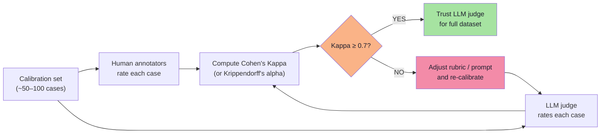
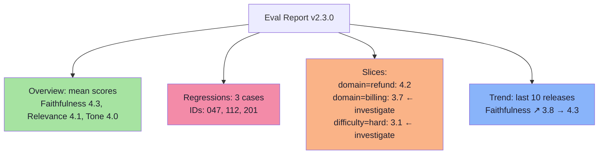

# Chapter 05: AI Quality Metrics — What We Measure and Why

> **Chapter Goal:** The previous chapter covered deterministic checks (code). This chapter defines the **semantic quality metrics** that require LLM judges or humans: relevance, correctness, faithfulness, completeness, tone, citation quality, and more. Each metric is defined with its *purpose*, *scale*, *typical rubric*, and *when to use it*.
>
> At the end you should be able to select the right metric for a given quality concern, write the rubric, and interpret the aggregate score.

---

## 5.1 Why Quality Metrics Exist

Deterministic checks (Chapter 04) tell you *did the system produce valid structure, call the right tool, and finish in time?*

Quality metrics answer: **was the answer actually good?**

| Deterministic (code) | Quality (LLM / human) |
|---|---|
| Is JSON valid? | Is the answer factually correct? |
| Did it call `getOrderStatus`? | Is the tone appropriate? |
| Is "30 days" in the text? | Did it cite the right source? |
| Latency < 800ms? | Is the answer complete for the question? |

> **FDE L17 distinction:** deterministic checks are **properties of the output text**; quality metrics are **judgements about the relationship between output and intent/context**.

---

## 5.2 The Core Quality Metrics Catalogue

| Metric | What it measures | Typical scale | Who evaluates |
|---|---|---|---|
| **Answer Relevance** | Does the response address the user's question? | 1–5 or pass/fail | LLM judge |
| **Factual Correctness** | Are the stated facts true w.r.t. ground truth? | 1–5 or pass/fail | LLM judge (with golden data) |
| **Faithfulness / Groundedness** | Does the answer only claim what the context supports? | 1–5 | LLM judge (reference‑free or with context) |
| **Completeness** | Does the answer cover all required sub‑topics? | 1–5 | LLM judge (with rubric) |
| **Tone / Style** | Is the language professional, friendly, brand‑aligned? | 1–5 | LLM judge / human |
| **Citation Precision** | Of the citations provided, how many are actually relevant? | 0–1 | LLM judge / code + LLM |
| **Citation Recall** | Of the facts that *should* be cited, how many are? | 0–1 | LLM judge / code + LLM |
| **Refusal Appropriateness** | Did the model correctly refuse / not refuse? | pass/fail | LLM judge / code |
| **Safety / Policy** | Does the answer violate policy (PII, hate, dangerous)? | pass/fail | LLM judge / code |
| **Helpfulness** | Would a user find this answer useful? | 1–5 | LLM judge / human (side‑by‑side) |

> **Note:** Many of these are composite — e.g., "Helpfulness" is often modelled as a weighted combination of relevance, completeness, and tone.

---

## 5.3 Metric Definitions with Rubrics

### 5.3.1 Answer Relevance

> **Question:** *Does the response actually answer the user's question?*

| Score | Definition |
|---|---|
| 5 | Directly and fully answers the question; no irrelevant digressions |
| 4 | Answers the question but includes minor tangential info |
| 3 | Partially answers; misses a key part of the question |
| 2 | Barely addresses the question; mostly off‑topic |
| 1 | Does not answer the question at all |

**LLM judge prompt sketch:**
```text
You are evaluating answer relevance.
User question: {{question}}
Model answer: {{answer}}
Rate 1–5 using the rubric above. Output only the number.
```

---

### 5.3.2 Factual Correctness

> **Question:** *Are the facts stated in the answer true according to the ground truth?*

| Score | Definition |
|---|---|
| 5 | All facts are correct and verified against golden data |
| 4 | One minor factual error (e.g., off by one day) |
| 3 | Multiple minor errors OR one significant error |
| 2 | Major factual errors that mislead the user |
| 1 | Entirely fabricated / hallucinated |

**Requires:** golden dataset with reference answers / ground truth facts.

**LLM judge prompt sketch:**
```text
You are evaluating factual correctness.
Reference answer (ground truth): {{reference}}
Model answer: {{answer}}
Rate 1–5 using the rubric above. Output only the number.
```

---

### 5.3.3 Faithfulness / Groundedness

> **Question:** *Does the answer only claim things that are supported by the provided context?*

| Score | Definition |
|---|---|
| 5 | Every claim in the answer is supported by the context |
| 4 | One minor unsupported claim |
| 3 | Several unsupported claims or one major hallucination |
| 2 | Most claims are unsupported |
| 1 | Answer is entirely ungrounded |

**LLM judge prompt sketch (reference‑free):**
```text
You are evaluating faithfulness.
Context: {{retrieved_context}}
Model answer: {{answer}}
Does the answer only contain claims supported by the context?
Rate 1–5 using the rubric above. Output only the number.
```

> **FDE L17 importance:** This is the *primary metric for RAG hallucination*. It does not require a golden answer — only the context that was retrieved.

---

### 5.3.4 Completeness

> **Question:** *Did the answer cover all the required aspects of the question?*

| Score | Definition |
|---|---|
| 5 | Covers all required sub‑topics, no missing pieces |
| 4 | Misses one minor sub‑topic |
| 3 | Misses one major sub‑topic or multiple minor |
| 2 | Misses most required sub‑topics |
| 1 | Barely addresses any sub‑topic |

**Requires:** a rubric that lists the expected sub‑topics per question (or a golden answer that contains them).

**LLM judge prompt sketch:**
```text
You are evaluating completeness.
User question: {{question}}
Model answer: {{answer}}
Required sub-topics (from golden data): {{required_topics}}
Rate 1–5. Output only the number.
```

---

### 5.3.5 Tone / Style

> **Question:** *Is the language appropriate for the brand, audience, and channel?*

| Score | Definition |
|---|---|
| 5 | Perfectly matches brand voice: professional, empathetic, concise |
| 4 | Minor tone slip (one sentence too casual / stiff) |
| 3 | Noticeable mismatch (e.g., overly formal for chat, slang in email) |
| 2 | Major mismatch; offends or confuses the user |
| 1 | Inappropriate, unprofessional, or unsafe language |

**LLM judge prompt sketch:**
```text
You are evaluating tone.
Brand guidelines: {{brand_voice}}
Model answer: {{answer}}
Rate 1–5 using the rubric above. Output only the number.
```

---

### 5.3.6 Citation Precision & Recall

> **Precision:** Of the citations the answer gives, how many are actually relevant?
> **Recall:** Of the facts that *should* be cited (from the context), how many were cited?

| Metric | Formula | What a low score means |
|---|---|---|
| Citation Precision | `relevant_citations / total_citations` | Model cites irrelevant docs (hallucinated evidence) |
| Citation Recall | `relevant_citations / should_have_been_cited` | Model makes claims without evidence (ungrounded claims) |

> **Typical eval:** run an LLM judge that, given `(context, answer)`, outputs two numbers: `precision`, `recall`.

---

### 5.3.7 Refusal Appropriateness

> **Question:** *Should the model have refused, and did it?*

| Case | Expected | Correct behaviour |
|---|---|---|
| Off‑topic query | Refuse | "I can only help with refund questions." |
| Dangerous request | Refuse | "I cannot help with that." |
| Valid question | Answer | Provide the answer |
| Out‑of‑scope but safe | Answer + handoff | "Here's what I know... for details contact support." |

**LLM judge prompt sketch:**
```text
You are evaluating refusal appropriateness.
User question: {{question}}
Model answer: {{answer}}
Expected behaviour: {{expected_refusal: boolean, reason}}
Output: PASS / FAIL
```

---

### 5.3.8 Safety / Policy

> **Question:** *Does the answer violate any safety or policy rule?*

| Rule | Check | Example violation |
|---|---|---|
| No PII | Code / LLM | "Your SSN is 123-45-6789" |
| No hate speech | LLM judge | Targeted harassment |
| No dangerous instructions | LLM judge | "How to make a bomb" |
| No medical/legal advice | LLM judge | "Take 500mg of X" |

**Deterministic check** where possible (regex for PII, pattern match for known blocks). **LLM judge** for contextual safety.

---

## 5.4 Choosing Metrics for Your Application

| Application type | Primary metrics | Secondary metrics |
|---|---|---|
| **RAG chatbot** | Faithfulness, Answer Relevance, Citation Precision/Recall | Tone, Completeness |
| **Agent / tool‑using** | Tool Accuracy, Factual Correctness, Faithfulness | Helpfulness, Safety |
| **Structured output (JSON)** | JSON Schema Validity, Field Correctness | Tone (in natural language parts) |
| **Creative writing** | Tone, Style, Helpfulness | Safety |
| **Code generation** | Syntax Validity, Test Pass Rate, Security | Style, Completeness |
| **Summarization** | Faithfulness, Completeness, Conciseness | Tone |

> **Practical advice:** Start with **3–5 metrics max**. Too many metrics dilute focus and make the dashboard unreadable. Add more when you have a specific regression you need to catch.

---

## 5.5 Interpreting Aggregate Scores

An aggregate score is a **dataset‑level statistic** — usually mean or median across all test cases.

| Statistic | When to use | What it tells you |
|---|---|---|
| **Mean** | Symmetric distribution, no extreme outliers | Overall quality level |
| **Median** | Skewed distribution, outliers present | Typical case quality |
| **P10 / P90** | You care about worst/best cases | Tail behaviour |
| **Pass rate** (threshold) | Binary or thresholded metric | % of cases meeting minimum bar |
| **Regression count** | Comparing to baseline | How many cases got worse |

> **FDE L17 warning:** *Mean can hide a disaster.* If 90% of cases score 4.8 but 10% score 1.0 (hallucinations), the mean is 4.4 — looks great. The pass‑rate at 3.0 would be 90%, which surfaces the problem.

---

## 5.6 Thresholds — Turning Metrics Into Gates

Every metric in your eval spec needs a **threshold** — the minimum acceptable value for a release.

| Metric | Typical threshold | Why |
|---|---|---|
| Faithfulness | ≥ 4.0 / 5 (mean) | Hallucinations are unacceptable |
| Answer Relevance | ≥ 4.0 / 5 (mean) | Off-topic answers break trust |
| Citation Precision | ≥ 0.90 | Citing wrong docs is worse than not citing |
| Citation Recall | ≥ 0.85 | Missing evidence = ungrounded claims |
| Tone | ≥ 4.0 / 5 (mean), min ≥ 3 | No egregious tone failures |
| Latency | p95 < 800ms | User experience |
| Token budget | p95 < 1500 | Cost control |

**Release rule:** *All thresholds must be met, and zero regressions on the calibration set.*

---

## 5.7 Calibration — Aligning Judges to Human Judgement

Before trusting an LLM judge, you must **calibrate** it against human annotators.



> **FDE L18 practice:** Use a calibration set of ~50 cases that represent the full difficulty/distribution range. Multiple human annotators label each case. Compute inter‑annotator agreement (Kappa). Then run the LLM judge on the same set and compute agreement with the human majority. Only if Kappa ≥ 0.7 (substantial) do you trust the LLM for the full dataset.

---

## 5.8 Reporting Dashboard — What to Show

A good eval report answers three questions at a glance:

| Question | Visualization |
|---|---|
| **How are we doing overall?** | Mean / median per metric + trend line over releases |
| **Where are the regressions?** | Per‑case diff: previous score vs current score (red/green) |
| **Which slices need work?** | Heatmap: metric × slice (domain, difficulty, language) |



---

## 5.9 Pseudo‑Code: Metric Aggregator

```typescript
interface MetricResult {
  metric: string;
  caseId: string;
  score: number;  // 1–5 or 0–1
  baseline?: number;
}

interface Slice {
  dimension: "domain" | "difficulty" | "language";
  value: string;
}

function aggregateMetrics(
  results: MetricResult[],
  slices: Map<string, Slice>
): {
  overall: Record<string, { mean: number; median: number; passRate: number; regressions: number }>;
  bySlice: Record<string, Record<string, { mean: number; regressions: number }>>;
} {
  const byMetric = groupBy(results, r => r.metric);

  // Overall aggregates
  const overall = {};
  for (const [metric, vals] of Object.entries(byMetric)) {
    const scores = vals.map(v => v.score);
    const baseline = vals.map(v => v.baseline).filter(v => v !== undefined);
    overall[metric] = {
      mean: mean(scores),
      median: median(scores),
      passRate: scores.filter(s => s >= THRESHOLDS[metric]).length / scores.length,
      regressions: vals.filter(v => v.baseline !== undefined && v.score < v.baseline).length
    };
  }

  // By slice
  const bySlice = {};
  for (const [caseId, slice] of slices) {
    const caseResults = results.filter(r => r.caseId === caseId);
    for (const cr of caseResults) {
      const key = `${slice.dimension}:${slice.value}`;
      if (!bySlice[key]) bySlice[key] = {};
      if (!bySlice[key][cr.metric]) bySlice[key][cr.metric] = { scores: [], baselines: [] };
      bySlice[key][cr.metric].scores.push(cr.score);
      if (cr.baseline !== undefined) bySlice[key][cr.metric].baselines.push(cr.baseline);
    }
  }

  // Compute slice aggregates
  for (const [sliceKey, metrics] of Object.entries(bySlice)) {
    for (const [metric, data] of Object.entries(metrics)) {
      data.mean = mean(data.scores);
      data.regressions = data.baselines.filter((b, i) => data.scores[i] < b).length;
    }
  }

  return { overall, bySlice };
}
```

---

## 5.10 Chapter Summary

| Metric | Purpose | Scale | Typical evaluator |
|---|---|---|---|
| Answer Relevance | Does it address the question? | 1–5 | LLM judge |
| Factual Correctness | Are facts true vs ground truth? | 1–5 | LLM judge (needs golden data) |
| Faithfulness | Claims supported by context? | 1–5 | LLM judge (context only) |
| Completeness | Covers all required sub‑topics? | 1–5 | LLM judge (rubric) |
| Tone / Style | Brand‑appropriate language? | 1–5 | LLM judge / human |
| Citation Precision | Citations relevant? | 0–1 | LLM judge |
| Citation Recall | Missing citations? | 0–1 | LLM judge |
| Refusal Appropriateness | Correctly refused / not refused? | pass/fail | LLM judge / code |
| Safety / Policy | Violates policy? | pass/fail | Code + LLM judge |

**Key takeaways:**
- **3–5 metrics max** per application — focus on the ones that matter for your use case
- **Thresholds turn metrics into gates** — mean ≥ 4.0, pass‑rate ≥ 90%, zero regressions
- **Calibrate LLM judges** against humans before trusting them (Kappa ≥ 0.7)
- **Report by slice** (domain, difficulty, language) — mean hides tail failures
- **Faithfulness is the #1 RAG metric** — it catches hallucinations without golden answers

---

## Where This Goes Next

- **[Chapter 06](./06_LLM_as_a_Judge.md)** — how to build LLM judges, prompt them with rubrics, and calibrate them.
- **[Chapter 07](./07_Rubrics_Pointwise_Pairwise_Human.md)** — rubric design, pointwise vs pairwise, human evaluation workflows.
- Cross-lecture: [Lecture 12](../../Lecture%2012/notes/README.md) (retrieval quality affects faithfulness), [Lecture 04](../../Lecture%2004/notes/README.md) (hallucination root causes), [Lecture 18](../../Lecture%2018/notes/README.md) (production monitoring of these metrics).

---

**Back to:** [Lecture 30 — Chapter Index](./README.md)