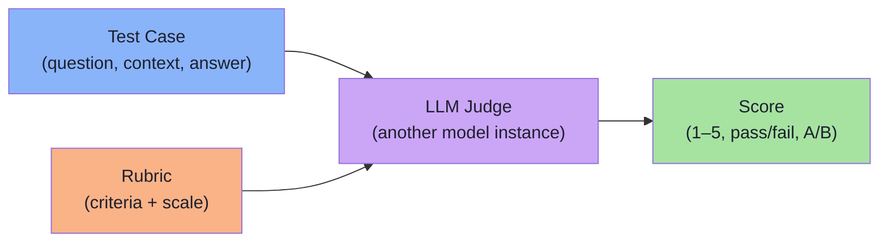
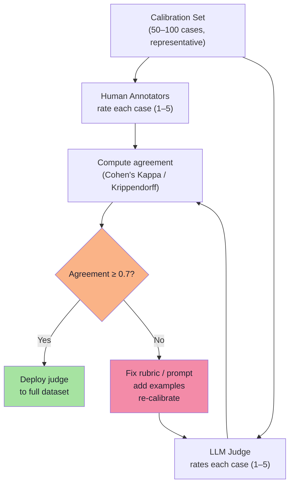
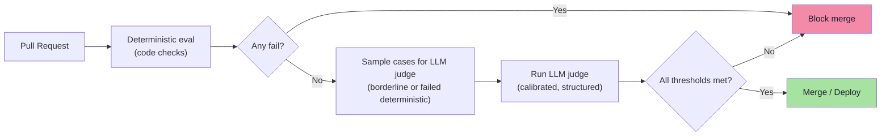

# Chapter 06: LLM-as-a-Judge — Semantic Evaluation with a Model

> **Chapter Goal:** Deterministic code checks can't answer *"is this answer helpful?"* or *"did the model hallucinate a fact?"* Those need an **LLM-as-a-Judge** — another model instance that scores outputs using a rubric. This chapter shows how to build, prompt, calibrate, and trust LLM judges, and when to use them instead of code.
>
> At the end you should be able to write an LLM judge prompt, run it against a test set, calibrate against humans, and integrate it into your CI eval pipeline.

---

## 6.1 What Is an LLM-as-a-Judge?

Instead of checking `contains("30 days")`, you ask another model:

```text
You are an expert evaluator. Given a user question, a retrieved context,
and a model answer, rate faithfulness 1–5 using this rubric:
...
```

The model returns a score — not a boolean property, but a **semantic judgement**.



| Deterministic eval | LLM-as-a-Judge |
|---|---|
| Fast (~microseconds) | Slower (~seconds per case) |
| Free | Costs money (per‑token) |
| Perfectly reproducible | Can disagree with itself |
| Objective (boolean) | Subjective (graded) |
| Facts, structure, tool calls | Tone, completeness, faithfulness, helpfulness |

> **FDE L17 principle:** *Use LLM judges only when code can't decide.* Start with deterministic checks; add LLM judges for the remaining 20% of quality properties.

---

## 6.2 When to Use an LLM Judge

| Property | Deterministic possible? | Use LLM judge? |
|---|---|---|
| "30 days" in answer | Yes — regex | No |
| JSON valid | Yes — schema | No |
| Tool called correctly | Yes — code | No |
| Tone professional | No | Yes |
| Factually correct vs context | Partially — cite check yes, semantics no | Yes (faithfulness) |
| Helpful to user | No | Yes |
| Safe / no PII | Partially — regex for PII | Yes for contextual safety |
| Citation relevant | Partially — code can match doc ids | Yes for precision |

**Rule of thumb:** If two competent humans could disagree on the answer, use an LLM judge. If there is one objectively right answer, use code.

---

## 6.3 Designing the Judge Prompt

A good judge prompt has **four parts**:

1. **Role** — who the judge is
2. **Input** — what the judge sees (question, context, answer, reference)
3. **Criteria / Rubric** — what to score and how
4. **Output format** — exactly what to return (number, JSON, etc.)

### Example: Faithfulness Judge

```text
You are an expert evaluation judge. Your task is to rate how faithful
a model's answer is to the provided context.

## Inputs
- User Question: {{question}}
- Retrieved Context: {{context}}
- Model Answer: {{answer}}

## Rubric — Faithfulness (1–5)
5 = Every claim in the answer is directly supported by the context
4 = Almost all claims supported; one minor inference not in context
3 = Several unsupported claims or one significant unsupported claim
2 = Most claims are not supported by the context
1 = Answer is entirely hallucinated / unsupported

## Instructions
- Score based ONLY on whether claims are supported by the context
- Do NOT penalize for style, tone, or completeness
- If a claim cannot be verified from context, treat it as unsupported
- Output format: a single integer between 1 and 5
- Output ONLY the integer, nothing else
```

### Example: Tone Judge

```text
You are an expert evaluation judge. Rate the tone of the model answer.

## Inputs
- User Question: {{question}}
- Brand Voice: {{brand_voice}}
- Model Answer: {{answer}}

## Rubric — Tone (1–5)
5 = Perfectly matches brand voice
4 = Minor slip (one sentence slightly off)
3 = Noticeable mismatch
2 = Major mismatch
1 = Inappropriate / unprofessional

## Instructions
- Focus only on tone, not factual correctness
- Output format: JSON with "score" (integer 1–5) and "reasoning" (one sentence)
```

---

## 6.4 Structuring the Output

Always force structured output from the judge. Never rely on free text.

```typescript
// JSON output schema for the judge
interface JudgeOutput {
  score: number;        // 1–5
  reasoning: string;    // one sentence
  confidence?: number;  // 0–1, optional
}
```

```text
## Output format (for tone judge)
{
  "score": 4,
  "reasoning": "Answer is professional but uses 'you guys' which is slightly informal."
}
```

> **Why structured output?** You can parse it programmatically, aggregate it, and build dashboards. Free text cannot be aggregated reliably.

---

## 6.5 Running the Judge — Pseudo‑Code

```typescript
interface JudgeCase {
  id: string;
  question: string;
  context: string;
  answer: string;
  reference?: string;  // optional, for factual correctness
}

interface JudgeResult {
  caseId: string;
  score: number;
  reasoning: string;
  cost: number;        // tokens used
  latencyMs: number;
}

async function runLLMJudge(
  judgeModel: LLM,
  promptTemplate: string,
  cases: JudgeCase[],
  rubric: string
): Promise<JudgeResult[]> {
  const results: JudgeResult[] = [];

  for (const c of cases) {
    const start = Date.now();
    const prompt = promptTemplate
      .replace("{{question}}", c.question)
      .replace("{{context}}", c.context)
      .replace("{{answer}}", c.answer)
      .replace("{{rubric}}", rubric)
      .replace("{{reference}}", c.reference ?? "");

    const raw = await judgeModel.generate(prompt, { temperature: 0 });
    const latencyMs = Date.now() - start;

    const parsed = JSON.parse(raw);  // assume structured JSON output

    results.push({
      caseId: c.id,
      score: parsed.score,
      reasoning: parsed.reasoning,
      cost: raw.usage.total_tokens * costPerToken,
      latencyMs
    });
  }

  return results;
}
```

> **Key settings:** `temperature: 0` for judges (deterministic scoring), structured output (JSON mode), batch processing if the provider supports it.

---

## 6.6 Calibrating an LLM Judge

Before trusting a judge in production, calibrate against human annotators.



### Calibration steps

1. **Pick a calibration set** — 50–100 cases spanning all difficulty levels, domains, and languages.
2. **Have multiple humans rate each case** — compute inter‑annotator agreement first (humans should agree with each other at Kappa ≥ 0.6).
3. **Run the LLM judge on the same set.**
4. **Compute agreement between LLM judge and human majority** — target Kappa ≥ 0.7.
5. **If below target**, refine the rubric: add examples, clarify ambiguous criteria, adjust scale anchors. Re‑run calibration.
6. **Only then deploy** the judge to the full dataset.

> **FDE L18 practice:** Teams spend a day on calibration. It is the difference between a judge that measures something real and one that measures its own quirks.

---

## 6.7 LLM Judge Agreement Metrics

| Metric | What it measures | Target |
|---|---|---|
| **Cohen's Kappa** | Agreement between two raters (chance‑adjusted) | ≥ 0.7 |
| **Krippendorff's alpha** | Agreement among multiple raters, handles missing data | ≥ 0.7 |
| **Pearson correlation** | Linear correlation between LLM and human scores | ≥ 0.8 |
| **Exact match rate** | % of cases where LLM score == human mode score | ≥ 70% |

```typescript
// Example: Cohen's kappa between LLM and human
function cohenKappa(
  llmScores: number[],
  humanScores: number[],
  numCategories: number
): number {
  const n = llmScores.length;
  let agree = 0;
  for (let i = 0; i < n; i++) {
    if (llmScores[i] === humanScores[i]) agree++;
  }
  const po = agree / n;

  // Expected agreement by chance
  const llmDist = new Array(numCategories).fill(0);
  const humanDist = new Array(numCategories).fill(0);
  for (let i = 0; i < n; i++) {
    llmDist[llmScores[i] - 1]++;
    humanDist[humanScores[i] - 1]++;
  }
  let pe = 0;
  for (let k = 0; k < numCategories; k++) {
    pe += (llmDist[k] / n) * (humanDist[k] / n);
  }

  return (po - pe) / (1 - pe);
}
```

---

## 6.8 Cost Control for LLM Judges

LLM judges cost money. Strategies to keep it manageable:

| Strategy | Savings | Trade‑off |
|---|---|---|
| **Sample judges** — judge only 10% of cases | 90% cost reduction | Less precise aggregate |
| **Batch processing** — provider bulk discounts | ~20–40% | Requires provider support |
| **Cache identical prompts** | Eliminates duplicate cost | Only works for repeated cases |
| **Smaller judge model** — use a cheaper/faster model for judging | 5–10x cheaper | Slightly lower accuracy |
| **Judge only on failures** — deterministic check first, judge only borderline cases | ~80% cost reduction | Requires deterministic triage |

> **FDE L17 tip:** *Don't judge every case with an LLM.* Use deterministic checks as a filter; only send borderline or failed cases to the LLM judge.

---

## 6.9 Failure Modes of LLM Judges

| Failure mode | Symptom | Mitigation |
|---|---|---|
| **Sycophancy** | Judge agrees with the model answer regardless of quality | Use blind evaluation (hide model name), add counter‑examples |
| **Verbosity bias** | Longer answers get higher scores | Normalize length, judge conciseness explicitly |
| **Position bias** | In pairwise, always picks A or B | Randomize order, run both directions |
| **Scale drift** | Judge interprets 1–5 differently over time | Fixed rubric with anchors, recalibrate periodically |
| **Context window truncation** | Long contexts get cut, judge misses key facts | Truncate context smartly, summarize before judging |
| **Self‑evaluation** | Judge is the same model that generated the answer | Use a different model / provider for judging |

> **Critical:** Never use the same model instance (same weights, same temperature) to generate an answer and judge it. Self‑evaluation inflates scores.

---

## 6.10 Integrating LLM Judge into CI



> **Pattern:** deterministic → LLM judge sample → aggregate → threshold gate → merge.

---

## 6.11 Pseudo‑Code: Full LLM Judge Eval Runner

```typescript
interface JudgeEvalSpec {
  judgeModel: LLM;
  promptTemplate: string;
  rubric: string;
  cases: JudgeCase[];
  threshold: { minMean: number; minPassRate: number };
}

async function runJudgeEval(spec: JudgeEvalSpec): Promise<{
  results: JudgeResult[];
  aggregates: { mean: number; passRate: number; cost: number };
  passed: boolean;
}> {
  const results = await runLLMJudge(
    spec.judgeModel,
    spec.promptTemplate,
    spec.cases,
    spec.rubric
  );

  const scores = results.map(r => r.score);
  const totalCost = results.reduce((sum, r) => sum + r.cost, 0);

  const mean = scores.reduce((a, b) => a + b, 0) / scores.length;
  const passRate = scores.filter(s => s >= 4).length / scores.length;  // threshold = 4+

  const passed = mean >= spec.threshold.minMean && passRate >= spec.threshold.minPassRate;

  return { results, aggregates: { mean, passRate, cost: totalCost }, passed };
}
```

---

## 6.12 Chapter Summary

| Concept | Takeaway |
|---|---|
| **LLM-as-a-Judge** | Another model scores outputs using a rubric; for semantic properties code can't check |
| **Four prompt parts** | Role, inputs, criteria/rubric, output format |
| **Structured output** | Always force JSON; never rely on free text from a judge |
| **temperature = 0** | Judges should be deterministic |
| **Calibration** | Required before deployment; target Kappa ≥ 0.7 vs humans |
| **Cost control** | Sample, batch, cache, smaller model, judge only failures |
| **Failure modes** | Sycophancy, verbosity bias, position bias, scale drift, truncation, self‑evaluation |
| **Never self‑evaluate** | Judge must be a different model / provider than the generator |

---

## Where This Goes Next

- **[Chapter 07](./07_Rubrics_Pointwise_Pairwise_Human.md)** — deeper on rubric design, pointwise vs pairwise, and human evaluation workflows.
- **[Chapter 08](./08_RAG_and_System_Level_Evaluation.md)** — applying judges and deterministic checks to full RAG pipelines.
- Cross-lecture: [Lecture 11](../../Lecture%2011/notes/README.md) (structured outputs for judge JSON), [Lecture 03](../../Lecture%2003/notes/README.md) (golden data for factual correctness judges).

---

**Back to:** [Lecture 30 — Chapter Index](./README.md)