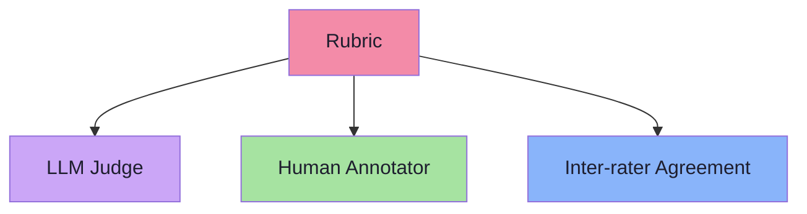
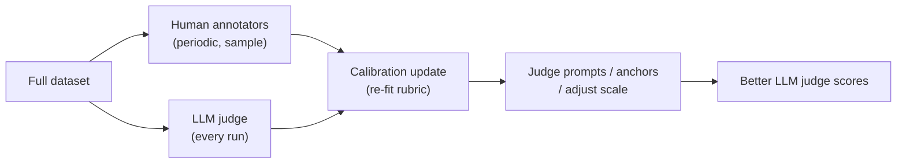

# Chapter 07: Rubrics, Pointwise vs Pairwise, Human Evaluation — Getting Quality Measurements Right

> **Chapter Goal:** LLM judges are useful but require calibration and cost money. Human evaluation is the gold standard. This chapter covers three topics: (1) how to design robust rubrics that LLM judges and humans can both use; (2) the difference between pointwise and pairwise evaluation; and (3) how to run human evaluation efficiently (crowdsourced, in‑house, calibrated). At the end you should know which evaluation style to use for each metric and how to build a cost‑effective human‑in‑the‑loop pipeline.

---

## 7.1 Why Rubrics Matter

Both LLM judges and humans need **clear, bounded criteria**. A vague rubric → inconsistent scores → unreliable data.



### Design Principles

| Principle | Why it matters |
|---|---|
| **One criterion per bullet** | Humans and LLMs attend to one thing at a time |
| **Score anchors (1 and 5 explicit)** | Prevents scale drift; every rater knows what "1" and "5" look like |
| **Concrete examples (≥ 2 per anchor)** | The most effective way to align raters |
| **Negative examples (what NOT to do)** | Reduces ambiguity from edge cases |
| **No cascading criteria** | "Does not hallucinate" and "is helpful" are separate; keep them separate rubrics |

### Example Rubric — Faithfulness 1‑5

```text
5: Every claim in the answer is directly supported by a sentence in the context
4: Almost all claims supported; at most one minor inference not explicitly stated
3: Several claims unsupported or one significant unsupported claim
2: Most claims are not supported by the context
1: Answer is entirely unsupported / hallucinated
```

> **Anchor examples:**
> - **5:** Context = "The return window is 30 days." Answer = "You have 30 days to return the product."
> - **4:** Context = "30‑day window." Answer = "You can return it within a month." (inference "month" ≈ "30 days")
> - **3:** Context = "30‑day window, original receipt required." Answer = "You can return within 30 days." (omits "receipt required")
> - **2:** Context = "30‑day window." Answer = "You can return it any time after 30 days."
> - **1:** Context = "30‑day window." Answer = "The policy is to keep the product forever."

---

## 7.2 Pointwise vs Pairwise Evaluation

| Type | What it is | When to use |
|---|---|---|
| **Pointwise** | Rate each answer independently on 1–5 (or pass/fail) | You have a rubric, you want per‑case scores, you need mean/median aggregates |
| **Pairwise** | Compare two answers A vs B and pick the better one | You don't have an absolute rubric, you want relative ranking, you want to minimize scale ambiguity |

### Pointwise Example

```
User question: "What is the return policy?"
Answer A: "You can return your product within 30 days of delivery."
Score: 5
```

### Pairwise Example

```
User question: "What is the return policy?"
Answer A: "You can return within 30 days."
Answer B: "Our return window is 30 days after delivery."
Judge: Which is better?
Result: A preferred (or tie)
```

| Metric | Pointwise | Pairwise |
|---|---|---|
| **Mean score** | ✅ (direct) | ❌ (requires conversion) |
| **Relative ranking** | ❌ (needs many cases) | ✅ (direct) |
| **Regression detection** | ✅ (compare to baseline) | ✅ (compare win rates) |
| **Human effort per case** | 1 rating | 1 comparison |
| **LLM judge cost** | 1 generation per case | 1 generation per comparison |
| **Best for** | Absolute quality, thresholds, dashboards | Ranking, A/B testing, choosing between two versions |

> **FDE L17 recommendation:** *Start with pointwise.* It gives you absolute scores and is easier to aggregate. Use pairwise only when you have no shared rubric or when you're directly comparing two versions (e.g., before/after a prompt change).

---

## 7.3 Designing a Pointwise Rubric

A rubric needs these fields:

| Field | Example |
|---|---|
| **Metric name** | Faithfulness |
| **Scale** | 1–5 |
| **Anchor 1** | "Answer is entirely hallucinated" |
| **Anchor 5** | "Every claim supported by context" |
| **Mid anchors** | "3: Several unsupported claims, one significant gap" |
| **Negative examples** | "What NOT to do" |
| **Exclusions** | "Do not penalize for style, tone, or length" |

> **Best practice:** 2–4 concrete examples per anchor. Include both good and bad examples.

---

## 7.4 Designing a Pairwise Prompt

A pairwise prompt is short because the comparison is the core task:

```text
You are an expert evaluator. Given a user question and two model answers,
choose the better one based on the criteria. Output only "A", "B", or "Tie".

## Inputs
- User question: {{question}}
- Answer A: {{answer_a}}
- Answer B: {{answer_b}}

## Criteria
- Faithfulness to the retrieved context
- Completeness of the answer
- Tone and clarity

## Instructions
- Base your decision on the above criteria only
- Do NOT pick the longer or shorter answer
- Output exactly: A, B, or Tie
```

> **Why "A, B, or Tie"?** It's the minimal output that captures the comparison. Anything more becomes subjective free‑text.

---

## 7.5 Human Evaluation — In‑House vs Crowdsourced

| Modality | Cost / case | Speed | Quality control | Best for |
|---|---|---|---|---|
| **In‑house (engineers / PMs)** | $$ / case (team salary) | Hours to days | Full control, deep domain knowledge | Internal QA, edge cases, policy‑sensitive topics |
| **Crowdsourced (Prolific / MTurk)** | $0.50–$2.00 / case | Days to weeks | Need QC (attention checks, qualification filters) | Large N, diverse perspectives, benchmark creation |
| **Expert (domain specialist)** | $$$ / case (hired consultant) | Days | High quality, policy/legal nuance | Legal, medical, safety‑critical systems |

### QC Checks for Crowdsourced

1. **Attention check** — "Select 'Strongly agree' for this question."
2. **Qualification filter** — require ≥ 95% HIT approval rate, ≥ 100 prior approved HITs
3. **Speed filter** — reject submissions completed in < minimum time per case
4. **Quality filter** — drop any annotator with Kappa < 0.5 against the majority

---

## 7.6 Calibrating Human Annotators

Same principle as LLM judge calibration: compute inter‑rater agreement before trusting the data.

```typescript
function krippendorffAlpha(ratings: number[][], numCategories: number): number {
  // Simplified: returns agreement 0–1, 1 = perfect agreement
  // Full implementation handles missing data, nominal/ordinal scales
  // Use established library (e.g., niles)
  return 0; // placeholder
}
```

> **Target:** Krippendorff's alpha ≥ 0.7 (substantial agreement) for the rubric to be considered reliable.

---

## 7.7 Human Evaluation Workflow

```mermaid
flowchart LR
    CASES["Test cases<br/>(100–500)] --> RECRUIT["Recruit annotators<br/>(in‑house or crowd)"]
    RECRUIT --> TRAIN["Brief + practice HITs<br/>(10 cases + feedback)"]
    TRAIN --> EVAL["Annotate all cases<br/>(pointwise or pairwise)"]
    EVAL --> QC["Quality checks<br/>(kappa, attention)"]
    QC --> PASS["Agreement ≥ 0.7?"]
    PASS -- Yes --> ANALYZE["Analyze scores /<br/>&rarr; thresholds"]
    PASS -- No --> RECRUIT2["Replace annotators<br/>or revise rubric"]
    RECRUIT2 --> TRAIN2

    style PASS fill:#a6e3a1,color:#1e1e2e
    style QC fill:#f38ba8,color:#1e1e2e
```

> **Iteration loop:** if agreement is low, either the rubric is bad or the annotators aren't a good fit. Fix one, re‑run.

---

## 7.8 Combining Human + LLM Judge Scores

You can use human scores as **ground truth** to continuously recalibrate the LLM judge:



> **Practical cadence:** Run human evaluation on a **sample of 50–100 cases** every month (or every release). Use those scores to check if the LLM judge's mean and distribution have drifted. If drift > 0.3 points, recalibrate the rubric.

---

## 7.9 Chapter Summary

| Topic | Key takeaway |
|---|---|
| **Rubric design** | One criterion, anchored 1 & 5, 2–4 examples per anchor, negative examples |
| **Pointwise vs Pairwise** | Pointwise = absolute scores (1–5), mean/median aggregates; Pairwise = relative ranking (A vs B), win‑rate aggregates |
| **When to use which** | Start with pointwise for thresholds, dashboards; use pairwise for A/B, choosing between two versions |
| **Human eval** | In‑house for depth, crowd for scale; QC (attention, qualification, kappa); iterative rubric refinement |
| **Calibration** | Required for both LLM judges and humans; target Kappa / alpha ≥ 0.7 |
| **Human + LLM combo** | Humans calibrate the judge periodically; judge runs every CI; humans sample for drift check |

---

## Where This Goes Next

- **[Chapter 08](./08_RAG_and_System_Level_Evaluation.md)** — applying all eval types (deterministic + LLM judge + human) to full RAG pipelines.
- **[Chapter 09](./09_Offline_and_Online_Evaluation.md)** — running evals in development (offline) vs production (online), monitoring in production.
- Cross-lecture: [Lecture 18](../../Lecture%2018/notes/README.md) (human‑in‑the‑loop flow for production), [Lecture 11](../../Lecture%2011/notes/README.md) (structured JSON outputs for rubric targets).

---

**Back to:** [Lecture 30 — Chapter Index](./README.md)