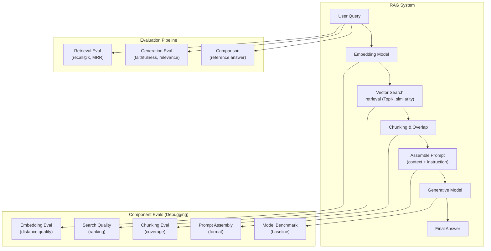
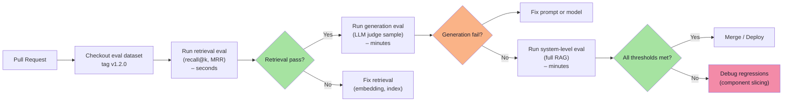

# Chapter 08: RAG and System-Level Evaluation — Applying Evals to Complex Applications

> **Chapter Goal:** So far we have discussed evals as isolated units (deterministic checks, LLM judges, human raters). A real application like RAG, agents, or a multi-tool system is a **pipeline**. Each step (retrieval, generation, tools, fallbacks) can fail in its own way, and failures in early steps propagate downstream.
>
> This chapter shows how to design and run **system‑level evals** that measure the whole RAG application (or any multi‑component system), including component‑level evals that isolate the source of failures. You will learn the FDE pipeline decomposition, how to write evals that reflect production behavior, and how to run them at scale.

---

## 8.1 The RAG Pipeline and Its Leak Points

> **FDE L17 visual reminder:** The board shows each component as a box with an arrow from one to the next. In a typical RAG system, quality can degrade at any stage.



> **Key insight:** System‑level evals catch the whole‑pipeline failures; component evals isolate where a regression started. Use both for efficient debugging.

---

## 8.2 System-Level Eval vs Component Eval

| Level | What it measures | Example failure detection |
|---|---|---|
| **System‑level** | Does the whole system work? | "Answer is irrelevant OR citation missing OR tool not called" |
| **Component‑level** | Which part broke? | "Retrieved docs are irrelevant" vs "Generated answer is hallucinated" |

> **FDE L17 practice:** In production, run system‑level evals nightly (or on release candidate). Run component evals on every PR because they are fast (retrieval, schema checks) and catch early regressions.

---

## 8.3 Component‑Level Evals for RAG

### 8.3.1 Retrieval Eval (Recall@k, MRR)

> **Recall@k** is the percentage of relevant documents that appear in the top‑k retrieved results.

```typescript
async function computeRecallAtK(
  query: string,
  expectedDocIds: string[],
  retrievedDocIds: string[],
  k: number
): Promise<number> {
  const retrieved = retrievedDocIds.slice(0, k);
  const relevantRetrieved = expectedDocIds.filter(id => retrieved.includes(id));
  return relevantRetrieved.length / expectedDocIds.length;
}
```

> **FDE L18 note:** They use a simple `recall@k` metric with a threshold of 0.9 (i.e., 90% of relevant docs must be in the top‑k). If recall drops below threshold, the CI fails.

### 8.3.2 Generation Eval (Faithfulness, Relevance)

> Same as chapter 05: use LLM judge (or deterministic string check for required facts) on the generation step only.

### 8.3.3 Component Eval: Embedding Model

> Check embedding distance quality: the context vector and query vector should have a cosine similarity > 0.7 (deterministic).

```typescript
function embeddingQuality(queryEmbedding: number[], contextEmbedding: number[]): number {
  return dotProduct(queryEmbedding, contextEmbedding) / (norm(queryEmbedding) * norm(contextEmbedding));
}
```

### 8.3.4 Component Eval: Prompt Assembly

> Verify that the assembled prompt follows the exact format expected by the model (e.g., system message tags, user message tags, context delimiter).

### 8.3.5 Component Eval: Model Benchmark

> Compare the generated answer against a baseline (e.g., same query run through the same model version) and score similarity of facts, completeness, tone.

---

## 8.4 System-Level Eval Pipeline (RAG Example)

### 8.4.1 The Test Case Structure

```typescript
interface RAGTestCase {
  id: string;
  question: string;
  metadata: {
    domain: "refund" | "billing" | "technical";
    difficulty: "easy" | "medium" | "hard";
    language: "en";
  };
  // Retrieval‑specific fields
  expectedDocIds: string[]; // documents that should be retrieved
  goldAnswer?: string;        // optional reference answer (for correctness)
  // Tool‑specific fields (if any)
  toolCalls?: {
    name: string;
    args: Record<string, unknown>;
    expectedResult?: unknown;
  }[];
}
```

### 8.4.2 System‑Level Eval Runner

```typescript
interface RAGSystemUnderTest {
  // Simulate what the production system does
  retrieve(query: string): Promise<{ docIds: string[]; chunks: string[] }>;
  generate(question: string, contextChunks: string[]): Promise<{ answer: string; toolCalls: any[] }>;
}

async function runRAGSystemEval(
  system: RAGSystemUnderTest,
  cases: RAGTestCase[],
  budgets: { latencyMs: number; tokens: number }
): Promise<{
  results: Array<{
    caseId: string;
    recallAtK: number;
    faithfulnessScore: number;
    relevanceScore: number;
    toolAccuracy: number;
    latencyMs: number;
    passed: boolean; // all per‑case thresholds met
  }>;
  aggregates: {
    meanRecall: number;
    meanFaithfulness: number;
    meanRelevance: number;
    meanToolAccuracy: number;
    latencyPct: number; // % of cases within budget
    regressions: number;
  };
}> {
  const results = [];

  for (const tc of cases) {
    const start = Date.now();

    // 1. Retrieval step (component eval)
    const retrievalResult = await system.retrieve(tc.question);
    const recall = await computeRecallAtK(tc.question, tc.expectedDocIds, retrievalResult.docIds, 5);

    // 2. Generation step (component eval)
    const genResult = await system.generate(tc.question, retrievalResult.chunks);

    // 3. System‑level checks
    const faithfulness = await llmFaithfulnessJudge(tc.question, retrievalResult.chunks, genResult.answer);
    const relevance = await llmRelevanceJudge(tc.question, genResult.answer);

    // 4. Tool accuracy (if tools involved)
    const toolAccuracy = await verifyTools(tc.toolCalls ?? [], genResult.toolCalls);

    const latencyMs = Date.now() - start;

    // 5. Per‑case pass (all thresholds met)
    const passed =
      recall >= 0.90 &&
      faithfulness >= 4.0 &&
      relevance >= 4.0 &&
      toolAccuracy >= 0.95 &&
      latencyMs <= budgets.latencyMs;

    results.push({
      caseId: tc.id,
      recallAtK: recall,
      faithfulnessScore: faithfulness,
      relevanceScore: relevance,
      toolAccuracy,
      latencyMs,
      passed
    });
  }

  const n = cases.length;
  const aggregates = {
    meanRecall: results.reduce((sum, r) => sum + r.recallAtK, 0) / n,
    meanFaithfulness: results.reduce((sum, r) => sum + r.faithfulnessScore, 0) / n,
    meanRelevance: results.reduce((sum, r) => sum + r.relevanceScore, 0) / n,
    meanToolAccuracy: results.reduce((sum, r) => sum + r.toolAccuracy, 0) / n,
    latencyPct: results.filter(r => r.latencyMs <= budgets.latencyMs).length / n,
    regressions: results.filter(r => r.recallAtK < 0.90 || r.faithfulnessScore < 4.0).length
  };

  return { results, aggregates };
}
```

> **FDE L18 implementation note:** They use `getRecallAtK` for retrieval, LLM judges for faithfulness and relevance, and `toolCallCheck` for tool accuracy.

---

## 8.5 Building Component Evals as CI Checks



> **Practical order:** deterministic retrieval (fast) → LLM judge generation (slower) → full system (costs money) → merge.

---

## 8.6 The Four‑Layer Evaluation Pipeline (FDE L18)

FDE L18 presents a framework that covers the whole lifecycle of evaluation: pre‑deployment, during changes, and in production.

```mermaid
flowchart TB
    subgraph PRE["Pre‑deployment"]
      direction LR
      GOLDEN["Golden Dataset<br/>(ground truth)"] --> DS["Build Evaluation Dataset<br/>(test cases)"]
      DS --> DEPS["Deterministic Evals<br/>(code checks)"]
      DEPS --> LLM["LLM‑Judge Evals<br/>(sample)"]
      LLM --> HUM["Human Eval<br/>(calibration)"]
    end

    subgraph CHANGE["During Changes"]
      direction LR
      CODE["Code / prompt change"] --> CI["CI Pipeline"]
      CI --> COMP_EVAL["Component Evals<br/>(retrieval, generation)"]
      COMP_EVAL --> SYS_EVAL["System Evals<br/>(full RAG)"]
      SYS_EVAL --> PASS{"All thresholds met?"}
      PASS -- No --> BLOCK["Block merge"]
    end

    subgraph PROD["Production"]
      direction LR
      LIVE["Live traffic<br/>+ synthetic probes"] --> METRICS["Continuous monitoring<br/>(metrics, latency)"]
      METRICS --> ALERT{"Drift / regression?"}
      ALERT --> ANALYZE["Analyze & alert"]
      ANALYZE --> FIX["Roll back / fix"]
    end

    style PRE fill:#89b4fa,color:#1e1e2e
    style CHANGE fill:#fab387,color:#1e1e2e
    style PROD fill:#a6e3a1,color:#1e1e2e
```



> **Key phases:**
> - **Pre‑deployment:** Establish golden data, deterministic evals, LLM judge calibration, human gold labels.
> - **During changes:** Every code / prompt change triggers CI, starting with fast component evals, then system evals.
> - **Production:** Continuous monitoring of metrics, drift detection, and rollback if regressions appear.

---

## 8.7 Metric Thresholds for RAG

| Metric | Threshold | CI action |
|---|---|---|
| **Recall@k** | ≥ 0.90 | Fail CI if < threshold |
| **Faithfulness** | ≥ 4.0 / 5 (LLM judge) | Sample, warn if average < threshold |
| **Relevance** | ≥ 4.0 / 5 (LLM judge) | Sample, warn if average < threshold |
| **Tool accuracy** | ≥ 0.95 | Deterministic check, fail CI |
| **Latency p95** | ≤ 800ms | Fail CI if > budget |
| **Token budget p95** | ≤ 1500 | Fail CI if > budget |
| **Regression count** | ≤ 0 (calibration set) | Fail CI |

---

## 8.8 Example Test Case with Real Data

> **Setting:** Refund policy RAG bot (similar to the one in the source but more realistic).

```typescript
// Golden retrieval: documents that should be retrieved for each question
const goldenRetrieval = {
  "case_001": ["policy_refund_v1.2.pdf", "faq_returns.pdf"],
  "case_002": ["policy_refund_v1.2.pdf", "terms_conditions.pdf"]
};

// Golden answer (reference answer) for correctness checks
const goldenAnswer = {
  "case_001": "You can return your product within 30 days of delivery.",
  "case_002": "Refunds are processed within 14 days after return."
};

// Test case definition for system‑level eval
const testCase: RAGTestCase = {
  id: "case_001",
  question: "How many days do I have to return a product?",
  metadata: { domain: "refund", difficulty: "easy", language: "en" },
  expectedDocIds: goldenRetrieval["case_001"],
  goldAnswer: goldenAnswer["case_001"]
};
```

> **Testing pipeline:** The CI will:
> 1. Run retrieval (using the same embedding model / index as production) → compute recall@k.
> 2. Generate answer (using the same model version) → score with LLM judge (faithfulness + relevance).
> 3. Compare against golden answer → factual correctness (deterministic string check for "30 days").
> 4. If any metric fails, the PR is blocked until fixed.

---

## 8.9 Chapter Summary

| Topic | What it gives you |
|---|---|
| **RAG pipeline** | Visual decomposition of retrieval → generation → answer, and where quality can break |
| **System‑level evals** | End‑to‑end measurement of the whole application (recall, faithfulness, relevance, tool accuracy) |
| **Component evals** | Fast, deterministic checks on each piece (retrieval recall, embedding quality, prompt format) |
| **Four‑layer pipeline** | Pre‑deployment (golden data + deterministic + LLM + human), during changes (CI), production (continuous monitoring) |
| **RAG‑specific thresholds** | Concrete numbers for recall, faithfulness, relevance, tool accuracy, latency |

---

## Where This Goes Next

- **[Chapter 09](./09_Offline_and_Online_Evaluation.md)** — running evals in CI (offline) vs production (online), monitoring drift, and rolling back.
- **Cross‑lecture:** [Lecture 18](../../Lecture%2018/notes/README.md) (human‑in‑the‑loop CI flow), [Lecture 12](../../Lecture%2012/notes/README.md) (retrieval levers that affect recall), [Lecture 11](../../Lecture%2011/notes/README.md) (structured outputs for tool call validation).

---

**Back to:** [Lecture 30 — Chapter Index](./README.md)