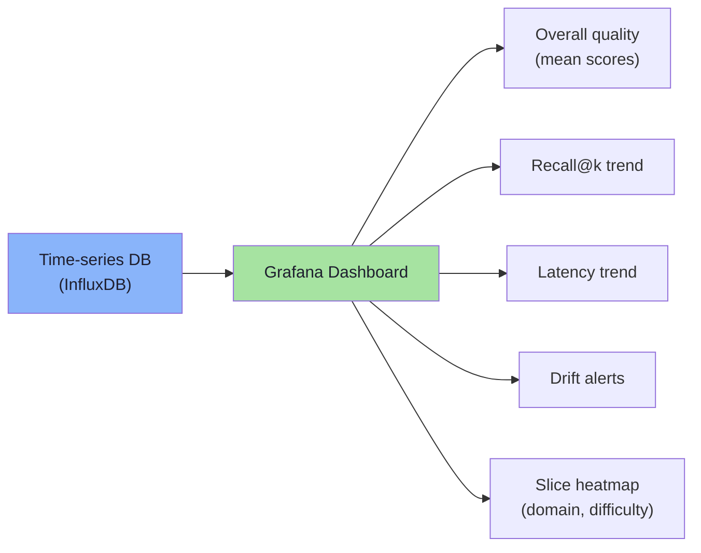

# Chapter 09: Offline and Online Evaluation — CI, Monitoring, and Release Gates

> **Chapter Goal:** So far we have focused on building the evaluation artifacts (test cases, deterministic checks, LLM judges, human calibrations). This chapter shows how to use those artifacts in two contexts:
> 1. **Offline** — the CI pipeline that runs before a PR is merged (sometimes called "pre‑flight" or "system tests")
> 2. **Online** — continuous evaluation in production after a change has shipped (sometimes called "A/B testing" or "observability")
>
> The difference is subtle but important: offline evals are *fast* and *deterministic*; online evals are *slower* and *real‑time* but can detect regressions that offline evals miss (e.g., retrieval index rebuilds, model version drift).

---

## 9.1 Offline Evaluation — The CI / PR Gate

### 9.1.1 The Offline Eval Workflow

> **FDE L18 architecture:** Offline evaluation is essentially a CI step that runs the system on a *fixed* dataset and checks thresholds.

```mermaid
graph TD
    CHANGE["Developer changes<br/>prompt / model / topK / etc."] --> CHECKOUT["Checkout eval dataset<br/>tag v1.2.0"]
    CHECKOUT --> BUILD["Run system on dataset<br/>(isolated, offline)"]
    BUILD --> DET_EVAL["Deterministic evals<br/>(seconds)"]
    DET_EVAL --> PASS{"All deterministic<br/>thresholds met?"}
    PASS -- Yes --> LLM_EVAL["Run LLM judge<br/>(sample)<br/>– minutes"]
    PASS -- No --> BLOCK["Block merge<br/>fix needed"]
    LLM_EVAL --> FAIL{"LLM thresholds?"]
    FAIL --> BLOCK
    LLM_EVAL --> SAMPLE["Sample 5% of<br/>cases for human review<br/>– optional"]
    SAMPLE --> QUALITY{"Human quality check?<br/>≥ 0.95 agreement?"}
    QUALITY -- Yes --> APPROVE["Approve merge"]
    QUALITY -- No --> REVISE["Revise rubric /<br/>rerun LLM judge"]

    style BLOCK fill:#f38ba8,color:#1e1e2e
    style APPROVE fill:#a6e3a1,color:#1e1e2e
    style REVISE fill:#fab387,color:#1e1e2e
```

> **Rule:** *Every change must re‑run the exact same evaluation pipeline that the last released version used.* This prevents “prompt updates” from shipping on trust.

### 9.1.2 What Runs Offline?

| Eval type | Frequency | Cost | Tooling |
|---|---|---|---|
| **Deterministic evals** | Every PR | Free | Bash script, GitHub Actions, GitLab CI, Jenkins |
| **LLM judge (sample)** | Every PR | $$$ (sampled) | Same CI, queued LLM API call |
| **Human review (optional)** | Every PR (sample) | $$$ | Crowdsourcing or internal QA |

> **FDE L17 CI pattern:** they have a `.github/workflows/eval.yml` that checks out the dataset from the release tag, runs a Docker container that runs the system under test, then runs the deterministic eval binary (written in Rust/TypeScript) and exits with a non‑zero code on failure.

### 9.1.3 Deterministic Eval in CI

```yaml
# Example GitHub Actions snippet
eval_job:
  runs-on: ubuntu-latest
  steps:
    - uses: actions/checkout@v4
    - name: Checkout eval dataset
      run: |
        git clone https://github.com/org/eval-dataset.git eval-data
        cd eval-data
        git checkout tags/v1.2.0
    - name: Run deterministic evals
      run: |
        cd eval-data
        npm ci
        npm run deterministic-eval
        # This exits 0 on success, 1 on any failure
        # The tool reads dataset/v1.2.0/cases.json,
        # runs the system under test, then checks thresholds
```

> **Key:** The CI must run *the same version* of the system that the merge would deploy (i.e., the code in the PR branch, not main). This is why they checkout the dataset from the release tag, not the current main.

### 9.1.4 LLM Judge in CI

```yaml
- name: Run LLM judge sample
  run: |
    cd eval-data
    npm run llm-judge \
      --dataset v1.2.0 \
      --sample 5% \
      --model anthropic/claude-3-5-sonnet \
      --prompt-template faithfulness.jinja
```

> **Sampling strategy:** Run LLM judge on 5% of cases (or only on failed deterministic cases). This reduces cost while preserving coverage of semantic regressions.

---

## 9.2 Online Evaluation — Post‑Release Monitoring

### 9.2.1 Why Online Evaluation?

Offline evals cannot detect *runtime* regressions, e.g.:

| Offline blind spot | Example |
|---|---|
| **Index rebuild** | After a nightly Elasticsearch reindex, recall drops from 0.96 to 0.85 – offline never catches it |
| **Model drift** | Provider updates the model behind the same name; answers change silently |
| **Traffic‑dependent bugs** | Tool API rate limit reached during peak usage; the system falls back to a broken path |
| **Context window fragmentation** | Real chat history exceeds truncation limits; the model misses key facts |
| **Feature flag flips** | New UI changes how the prompt is assembled; offline runs don’t simulate the new UI flow |

> **FDE L17 conclusion:** Offline evals are the *primary gate*; online evals are the *early warning system*.

### 9.2.2 The Online Evaluation Architecture

```mermaid
graph TD
    subgraph DEPLOY["Deployment (merge)"]
      direction LR
      CODE["New code / prompt"] --> DEPLOYED["Production system"]
    end

    subgraph MONITOR["Continuous Evaluation"]
      direction LR
      PROD["Live traffic"] --> EXTRACT["Extract queries & answers<br/>( anonymize PII )"]
      EXTRACT --> JUDGE["Run LLM judge<br/>(on sample)"]
      EXTRACT --> LATENCY["Measure latency<br/>(p95, p99)"]
      EXTRACT --> METRICS["System metrics<br/>(CPU, memory, token usage)"]
      JUDGE --> STORE["Store scores<br/>(time series)"]
      LATENCY --> STORE
      METRICS --> STORE
    end

    subgraph ALERTS["Alerting & Analysis"]
      direction LR
      STORE --> THRESH_CHECK["Threshold violation check<br/>(e.g., mean < 4.0)"]
      THRESH_CHECK --> DRIFT_CHECK["Drift detection<br/>(statistical)"]
      THRESH_CHECK --> ANOMALY_CHECK["Anomaly detection<br/>(isolate spikes)"]
      ANOMALY_CHECK --> ROUTE["Route to:""
      ROUTE --> TEAM["Engineering team"]
      ROUTE --> PRODUCT["Product team"]
      ROUTE --> SECURITY["Security team (if relevant)"]

      style THRESH_CHECK fill:#fab387,color:#1e1e2e
      style DRIFT_CHECK fill:#89b4fa,color:#1e1e2e
      style ANOMALY_CHECK fill:#f38ba8,color:#1e1e2e
      style ROUTE fill:#a6e3a1,color:#1e1e2e
    end
```

> **FDE L18 design:** The online eval runs **every N queries** (e.g., 1 in 20 requests) or **on a schedule** (e.g., hourly) to get a steady stream of scores while keeping cost manageable.

### 9.2.3 Sampling Strategies for Online Evaluation

| Strategy | How it works | Pros | Cons |
|---|---|---|---|
| **Deterministic sampling** (e.g., every 20th request) | Use a hash of the request ID to pick queries | Predictable cost, reproducible analysis | Could miss spikes in activity periods |
| **Random sampling** (N queries per hour) | Pull N random requests from the logs | Simple, uniform over time | May cluster in high‑traffic periods |
| **Stratified sampling** (by domain, difficulty, language) | Oversample edge cases to ensure coverage | Balanced view of quality across slices | Requires pre‑defined slices and metadata |
| **Trigger‑based** (on threshold drift) | Only sample when offline eval threshold was violated | Cost efficient | Might detect regression too late |

> **FDE L17 note:** Most teams start with deterministic sampling (e.g., `hash(query) % 20 === 0`). It’s easy to reason about, and the logs can always be re‑hashed for analysis.

### 9.2.4 Data Flow in Online Evaluation

1. **Instrumentation** – Every request logs:
   - Query hash (for deterministic sampling)
   - Timestamp
   - System version
   - Retrieved doc IDs (for recall evals)
   - Tool calls (if any)
   - Generated answer
   - Latency, token usage

2. **Sampling** – Based on strategy, select a subset for evaluation.

3. **Evaluation** – For each sampled query, run the **same LLM judge** that was calibrated with humans. Use the same prompt templates and rubrics as offline (so scores are comparable).

4. **Storage** – Store each evaluation result in a time‑series DB (e.g., InfluxDB, ClickHouse). Index by date, model version, slice.

5. **Analysis** – Run scheduled jobs every hour:
   - Compute rolling averages (last 1h, 24h, 7d)
   - Compare to baseline (previous release)
   - Detect drift (t‑test, KS test, or simple threshold check)
   - Generate alerts (Slack, PagerDuty)

### 9.2.5 Example Alert Logic

```yaml
# Pseudo‑config for alert rules
alerts:
  - name: "Faithfulness drift"
    condition: "mean_score < 4.0 for 4h"
    severity: "high"
    channels: ["#ml-alerts", "@ml-engineers"]

  - name: "Recall drop"
    condition: "recall@k < 0.90 for 2h"
    severity: "critical"
    channels: ["#ml-alerts", "@infra-team"]

  - name: "Latency spike"
    condition: "p95_latency > 1200ms for 30m"
    severity: "medium"
    channels: ["#ml-alerts"]
```

---

## 9.3 Thresholds in Online Evaluation

Online thresholds are usually *looser* than CI thresholds because they must tolerate higher variance and limited sample size. Typical patterns:

| Metric | Offline threshold | Online threshold | Rationale |
|---|---|---|---|
| **Faithfulness** | ≥ 4.0 (mean) | Mean > 3.5 (95% CI lower bound) | Sample size limited, so we add statistical confidence interval |
| **Recall@k** | ≥ 0.90 (deterministic) | Recall > 0.85 for 4h | System restarts, indexing may be in progress |
| **Latency p95** | ≤ 800ms (CI) | ≤ 1200ms (online) | Some variance expected, cost constraints |
| **Regression count** | ≤ 0 (CI) | ≤ 1 regression per 10k queries | Rare events tolerated in production |

> **FDE L18 insight:** The online threshold must be *practical* (i.e., we can tolerate a small number of regressions in production because catching them immediately is expensive). The real value of online evals is *trend detection* – a slow drift over days/weeks.

---

## 9.4 Drift Detection

Online evaluation is only useful if we can detect *changes* in quality over time. This is called **drift detection**.

### 9.4.1 Simple Threshold Check

```typescript
function checkDrift(
  currentScores: number[],
  baselineMean: number,
  baselineStd: number,
  currentMean: number
): { driftDetected: boolean; zScore: number } {
  const n = currentScores.length;
  const se = baselineStd / Math.sqrt(n);
  const z = (currentMean - baselineMean) / se;
  return { driftDetected: Math.abs(z) > 1.96, zScore: z }; // 95% confidence
}
```

### 9.4.2 Statistical Tests

| Test | When to use | What it catches |
|---|---|---|
| **Two‑sample t‑test** | Large enough samples (n > 30) | Shift in mean quality |
| **Kolmogorov–Smirnov** | Any sample size, distribution differences | Non‑parametric drift |
| **Mann‑Whitney U** | Non‑normal data, outliers | Shift in median / location |

> **FDE L17 recommendation:** Start with a simple threshold check + rolling average. If the drift detector goes off, run a more sophisticated statistical test to confirm.

---

## 9.5 Alerting, Incident Response, and Rollback

When online eval detects a regression:

1. **Alert generation** – Slack message, PagerDuty incident, or email to ML team.
2. **Isolation** – Identify the affected slice (domain, difficulty, language) and the failing metric.
3. **Quick diagnosis** – Did the change happen at deployment (model version, prompt)? Check recent releases.
4. **Rollback** – If regression is severe (e.g., recall drops below 0.80), automatically trigger a rollback script (e.g., revert to previous model version or previous prompt).
5. **Post‑mortem** – Document the regression, fix root cause, and add a test case to prevent recurrence.

> **FDE L18 practice:** The rollback script is stored in a separate repo (e.g., `infra-ops`) and can be run with a single command: `curl -X POST https://api.infra-ops.run/rollback?reason=eval_drift&version=v1.2.0`.

---

## 9.6 Practical Example — End‑to‑End Online Eval Flow

### Step 1: Instrument the System

```typescript
// In production, every request logs:
interface EvaluationLog {
  requestId: string;                // hash(request.query + timestamp)
  timestamp: number;                // epoch ms
  systemVersion: string;            // deployed tag (e.g., v1.2.0)
  query: string;
  retrievedDocIds: string[];
  answer: string;
  toolCalls: { name: string; args: any }[];
  latencyMs: number;
  tokensUsed: number;
}

async function logForEvaluation(log: EvaluationLog) {
  await db.write('eval_logs', log);
  // sample deterministically: if hash(log.requestId) % 20 === 0, run judge
  if (hash(log.requestId) % 20 === 0) {
    const score = await llmJudge('faithfulness', log);
    await db.write('eval_scores', { requestId: log.requestId, score, timestamp: log.timestamp });
  }
}
```

### Step 2: Scheduled Analysis Job

```yaml
# Cron job runs every hour
schedule: "0 * * * *"
steps:
  - name: Compute rolling averages
    run: |
      python analyze.py --window 24h --metrics faithfulness,recall,latency
  - name: Detect drift
    run: |
      python drift.py --baseline v1.2.0 --current v1.3.0 --threshold 0.5
  - name: Alert on violations
    run: |
      python alert.py --rule faithfulness_drift --severity high
```

### Step 3: Dashboard



---

## 9.7 Chapter Summary

| Concept | What you get |
|---|---|
| **Offline eval** | CI gate that runs on every PR; deterministic checks (fast) + LLM judge sample (slow) |
| **Online eval** | Production monitoring; deterministic sampling of live queries; statistical drift detection |
| **Sampling strategies** | Deterministic hash, random, stratified, trigger‑based – pick based on cost vs coverage |
| **Data flow** | Instrument → Sample → LLM judge → Store → Analyze (rolling avg, drift, alerts) |
| **Thresholds** | Tighter offline thresholds (prevent bad code) + looser online thresholds (detect slow drift) |
| **Alert & rollback** | PagerDuty + scriptable rollback; isolate slice + quick diagnosis |

---

## Where This Goes Next

- **[Lecture 31](../../Lecture%2031/notes/README.md)** (if exists) — **Operationalizing Evals** – how to set up the entire eval infrastructure in your repo (CI, monitoring, alerts).
- **Cross‑lecture:** [Lecture 18](../../Lecture%2018/notes/README.md) (human‑in‑the‑loop CI), [Lecture 17](../../Lecture%2017/notes/README.md) (dataset versioning), [Lecture 13](../../Lecture%2013/notes/README.md) (structured outputs for deterministic evals).

---

**Back to:** [Lecture 30 — Chapter Index](./README.md)