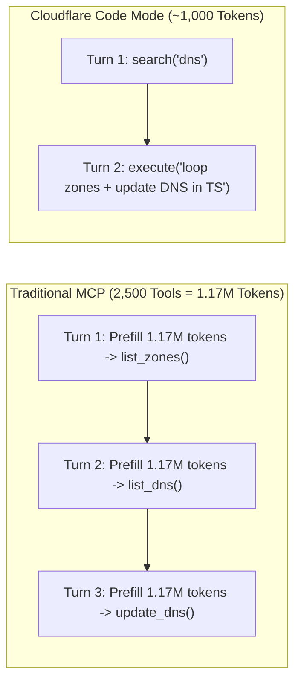
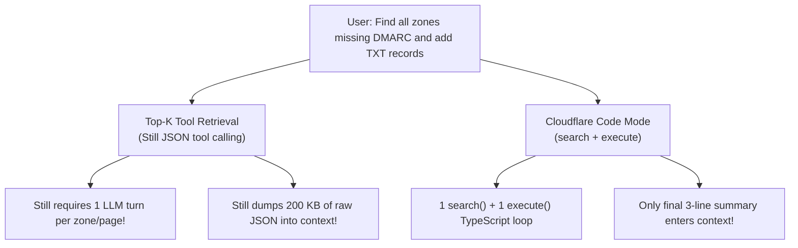

# Chapter 01 — The Tool Schema Scaling Wall

> **Lecture 31 · Chapter 01 of 08** · Level: 🟠 Advanced · Phase 7 — Connectors, Code Mode & Proactive Workflows
> **Source:** `Cloudflare Code Mode Blog & Docs` · **Roadmap Reference:** [`roadmap-v1.md`](../../roadmap-v1.md#lecture-31--cloudflare-code-mode--isolated-code-execution-mcp-cloudflarecodemode)
> **References:** [Cloudflare Blog: Code Mode](https://blog.cloudflare.com/code-mode/) · [Build a Code Mode MCP Server](https://developers.cloudflare.com/agents/model-context-protocol/guides/build-codemode-mcp-server/)
> **Roadmap topics:** Why 500+ JSON tool schemas break reasoning · the 1.17M-token Cloudflare API example · attention dilution · sequential roundtrip latency.

---

## 01.0 What this chapter is for

In [Lecture 27](../../Lecture%2027%20-%20MCP%20Core/) and [Lecture 30](../../Lecture%2030%20-%20Enterprise%20APIs%20OpenAPI-to-MCP%20and%20Computer-Use/), we saw how MCP connects agents to external tools. That works beautifully when an MCP server exposes **5 to 15 tools**.

Now ask what happens when you connect an agent to a **real enterprise platform** — Cloudflare's API (`2,500+` endpoints), GitHub's REST API (`1,000+` endpoints), or Salesforce (`500+` objects). You hit **The Tool Schema Scaling Wall**.

By the end of this chapter you should be able to:

1. Quantify why exposing 500–2,500+ JSON tool schemas **overflows context windows** and destroys unit economics.
2. Explain **attention dilution** and **tool-selection confusion** when similar endpoints compete in the system prompt.
3. Quantify **sequential roundtrip latency** when pagination and multi-step joins require $N$ separate LLM turns.
4. Contrast **JSON tool-calling roundtrips** with **Code Mode's ~1,000-token collapse**.

---

## 01.1 The math of the Tool Schema Scaling Wall

Every MCP tool definition (`name`, `description`, `inputSchema` JSON) averages **~450 tokens** (and complex enterprise endpoints with nested enums can exceed 800 tokens). Look at what happens as your API surface grows:

| Enterprise API Size | Traditional MCP Tool Count | Schema Tokens Loaded *Every Turn* | Fits in 128k–200k Context? |
| :--- | :---: | :---: | :---: |
| **Small Demo** | `10` tools | `~4,500` tokens | ✅ Yes |
| **Medium SaaS** | `150` tools | `~67,500` tokens | ⚠️ Half the window gone before the user speaks |
| **GitHub REST API** | `1,000+` endpoints | `~450,000` tokens | ❌ Overflows standard 200k windows |
| **Cloudflare API** | `2,500+` endpoints | **`~1,170,000` tokens** | ❌ **Impossible** (overflows even 1M+ windows) |

Even if you pay for a 1M+ token model, you are **prefilling 1.17M schema tokens** just to ask *"List my DNS records for example.com"*!

> [!IMPORTANT]
> **The 1.17M-token lesson:** In traditional MCP (`1 endpoint = 1 JSON tool`), your token bill and latency scale **linearly $O(N)$** with the size of the API surface, even when a user only needs 2 endpoints out of 2,500.

---

## 01.2 Three ways massive JSON schemas break agents

1. **Context Overflow & Cost Explosion:** Every turn re-sends the tool definitions in the prompt. Even with prompt prefix caching, prefilling hundreds of thousands of schema tokens inflates Time-to-First-Token (TTFT) and eats the memory budget needed for actual conversation history and retrieved documents.
2. **Attention Dilution & Tool-Selection Confusion:** When `dns_records_list`, `dns_records_export`, `dns_records_scan`, `dns_records_batch`, and 40 other `dns_*` tools sit side by side in the system prompt, models frequently pick the wrong sibling or hallucinate parameters from a neighboring schema.
3. **Sequential Roundtrip Latency:** Traditional MCP forces `Call 1 (list zones)` $\rightarrow$ `Wait for LLM` $\rightarrow$ `Call 2 (list DNS)` $\rightarrow$ `Wait for LLM` $\rightarrow$ `Call 3 (update record)`. A 10-page pagination loop requires **10 full LLM inference turns**!

### Why naive "RAG over tools" is only half a fix

Some teams try to solve the scaling wall by embedding tool descriptions in a vector database and injecting the top-5 matching tools per user query. That helps with token count, **but it still fails on multi-step workflows**:

| Dimension | Top-K Tool RAG | Cloudflare Code Mode |
| :--- | :--- | :--- |
| **Schema Tokens** | ~2,500–5,000 tokens | **~1,000 tokens** (constant `O(1)`) |
| **50-Zone Pagination Loop** | **51 sequential LLM turns** | **1 `execute()` turn** |
| **Intermediate Data** | Floods LLM context window | Stays inside V8 isolate memory |

> [!TIP]
> **Think of Code Mode as two orthogonal wins:** `search()` collapses the *schema* into ~1,000 tokens, and `execute()` collapses *control flow* (loops, filters, joins) into a single turn.

---

## 01.3 Common mistakes

| # | Common Mistake | Why It Hurts | What To Do Instead |
| :--- | :--- | :--- | :--- |
| **1** | **Exposing 100+ OpenAPI endpoints as 1:1 MCP tools** | Consumes 50K–1M+ tokens per turn and causes tool-selection confusion | Switch to `codeMcpServer()` (15–150 tools) or `openApiMcpServer()` (200+ endpoints) |
| **2** | **Assuming prompt caching eliminates schema bloat** | You still suffer attention dilution, TTFT latency, and context window exhaustion | Shrink the exposed tool surface to `~1,000` tokens with Code Mode |
| **3** | **Using JSON tool calling for `for`-loop pagination** | 10 pages = 10 LLM roundtrips and 10× latency | Run loops and pagination inside `execute()` in a single turn |
| **4** | **Dumping raw 200 KB API responses into chat history** | Crowds out system instructions and triggers early compaction | Filter and aggregate inside the sandbox; return only the summary |

---

## 01.4 Key takeaways

1. **Traditional 1-endpoint = 1-MCP-tool breaks past ~50 tools** (Cloudflare's 2,500+ endpoints = `1.17M` tokens).
2. **Code Mode collapses 2,500+ endpoints into `~1,000` tokens** — a **99.9% schema token reduction**.
3. **Moving loops and pagination into code** eliminates multi-turn sequential LLM roundtrips and keeps intermediate payloads out of context.

---

**Next:** [Chapter 02 — Code-First Agents vs. JSON Tool Calling](./02_Code_First_Agents_vs_JSON_Tool_Calling.md)
