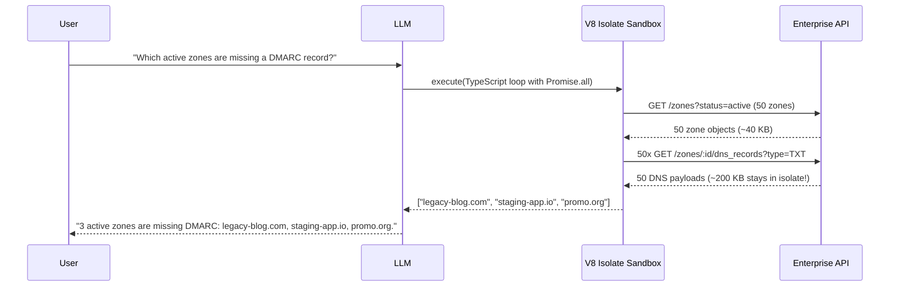
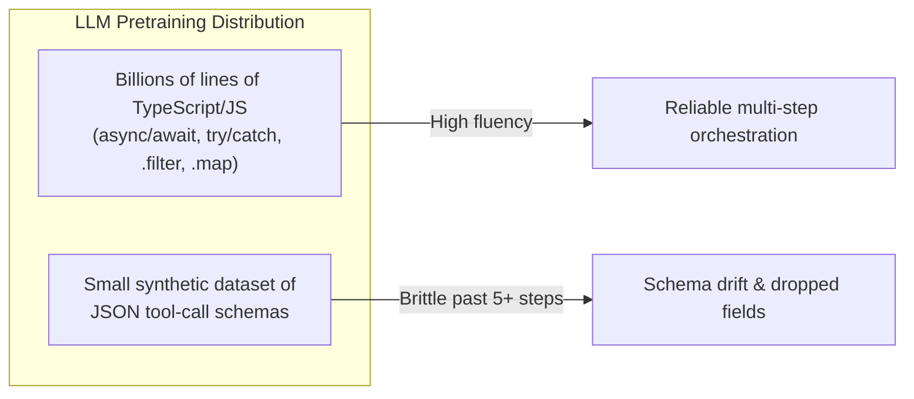

# Chapter 02 — Code-First Agents vs. JSON Tool Calling

> **Lecture 31 · Chapter 02 of 08** · Level: 🟠 Advanced · Phase 7 — Connectors, Code Mode & Proactive Workflows
> **Source:** `Cloudflare Code Mode Blog` · **Roadmap Reference:** [`roadmap-v1.md`](../../roadmap-v1.md#lecture-31--cloudflare-code-mode--isolated-code-execution-mcp-cloudflarecodemode)
> **Roadmap topics:** Why LLMs write TypeScript better than chaining raw JSON tool calls · training-data advantage · control flow (`for`, `filter`, `Promise.all`) · intermediate data hiding.

---

## 02.0 What this chapter is for

Cloudflare's central insight in *"Code Mode"* is deceptively simple:

> **LLMs have seen billions of lines of real-world TypeScript/JavaScript during pretraining — they have seen only a tiny fraction of synthetic JSON tool-calling syntax.**

Asking an LLM to orchestrate a 10-step workflow using sequential JSON tool calls is like forcing a senior engineer to program by filling out 10 separate tax forms. Letting the LLM write **a single typed TypeScript snippet** unlocks its strongest capability: native control flow, parallel `Promise.all`, error handling, and in-memory filtering.

By the end of this chapter you should be able to:

1. Explain the **three architectural advantages** of Code-First agents over JSON tool calling.
2. Show how **control flow** (`for` loops, `if/else`, `Promise.all`, `Array.filter`) replaces multi-turn LLM roundtrips.
3. Explain **intermediate data hiding**: keeping 500 KB of raw API pagination out of the LLM context window.
4. Identify the few cases where **simple JSON tool calling** is still preferable to Code Mode.

---

## 02.1 JSON Tool Calling vs. Code-First Execution

Suppose a user asks: *"Find all active DNS zones on our account and return only the ones missing a DMARC TXT record."*

| Dimension | JSON Tool Calling | Code-First (`execute()`) |
| :--- | :--- | :--- |
| **LLM Roundtrips** | `1` call to list 50 zones + `50` calls to list DNS records = **51 LLM turns** | **`1` LLM turn** writes a `Promise.all` loop |
| **Context Window Bloat** | All 50 DNS JSON payloads (~200 KB) flood the LLM conversation history | Sandbox filters in memory; returns **only the 3 missing domain names** |
| **Concurrency** | Sequential or awkward parallel tool-call batches | Native **`Promise.all()`** with bounded concurrency |
| **Model Reliability** | Models lose track of state across 51 turns | Standard `async/await` + TypeScript types |



### Concrete Code-First Snippet

```typescript
// What the LLM writes in ONE Code Mode turn:
const zones = await codemode.listZones({ status: "active" });

const checks = await Promise.all(
  zones.result.map(async (zone) => {
    const records = await codemode.listDnsRecords({ zoneId: zone.id, type: "TXT" });
    const hasDmarc = records.result.some((r) => r.content.includes("v=DMARC1"));
    return hasDmarc ? null : zone.name;
  })
);

return checks.filter(Boolean); // Only 3 strings ever enter the LLM's context!
```

> [!IMPORTANT]
> **Intermediate Data Hiding is a superpower.** In JSON tool calling, every intermediate API response must pass *through* the LLM's context window to reach the next step. In Code Mode, the 240 KB of intermediate JSON stays in V8 RAM, and only the 3-item final answer crosses back to the LLM.

---

## 02.2 The Training-Data & TypeScript Advantage

Why do models make fewer mistakes when writing TypeScript against `declare const codemode` than when emitting JSON tool calls?



1. **Native Error Handling:** In Code Mode, the model can write `try { ... } catch (err) { ... }` to handle a `404` on one zone without aborting the entire 50-zone sweep.
2. **Data Joins & Aggregation:** Computing sums, grouping by `status`, or joining `orders` with `customers` in TypeScript is exact and deterministic — whereas asking an LLM to sum 40 numbers across 4 JSON tool responses invites arithmetic hallucination.

### Where Code-First is overkill (and where it shines)

| Workload | Best Approach | Why |
| :--- | :--- | :--- |
| **Simple 1-step lookup** (`get_weather("NYC")`) | Standard JSON Tool Calling | Zero sandbox overhead; 1 tool call is already 1 turn |
| **3–15 simple tools, no loops** | Standard JSON Tool Calling | Simpler to debug and audit |
| **Multi-step workflows, pagination, filtering, joins** | **Code-First (`execute()`)** | Collapses $N$ turns into 1 and hides intermediate data |
| **50–2,500+ endpoint enterprise APIs** | **Code-First (`codeMcpServer` / `openApiMcpServer`)** | Solves both the Schema Scaling Wall and roundtrip latency |

> [!TIP]
> **Never use raw `eval()` for Code-First agents.** Giving an LLM a code-writing tool without a hardware/V8 sandbox is an immediate Remote Code Execution (RCE) vulnerability. Chapter 05 covers how Cloudflare Dynamic Workers isolate untrusted LLM code in ~2–5 ms.

---

## 02.3 Common mistakes

| # | Common Mistake | Why It Hurts | What To Do Instead |
| :--- | :--- | :--- | :--- |
| **1** | **Printing entire API responses with `console.log()` in `execute()`** | Re-introduces context bloat by dumping 200 KB of logs back to the LLM | Return only the filtered/aggregated result object from `execute()` |
| **2** | **Running `eval()` or `vm.runInNewContext()` in Node.js** | Node's `vm` module is **not** a security boundary; LLM code can escape and read `process.env` | Always execute LLM code inside an isolated V8 Dynamic Worker or microVM |
| **3** | **Using Code Mode for a 2-tool chatbot** | Unnecessary complexity when 2 JSON tools work in 1 turn | Reserve Code Mode for 15+ tools or multi-step/paginated workflows |
| **4** | **Unbounded `Promise.all()` over 1,000 items** | Triggers `429 Too Many Requests` against upstream APIs | Use batched concurrency (e.g. chunks of 5–10) or host-proxy rate limits |

---

## 02.4 Key takeaways

1. **LLMs are native TypeScript programmers:** writing code against typed APIs is far more reliable than chaining 20 JSON tool calls.
2. **Loops, filtering, error handling, and joins stay inside the sandbox** — only the final compact answer enters the LLM's context window.
3. **One `execute()` call replaces $N$ sequential roundtrips**, slashing both token cost and wall-clock latency.

---

**Next:** [Chapter 03 — Single Code Tool Pattern (`codeMcpServer`)](./03_Single_Code_Tool_Pattern_codeMcpServer.md)
