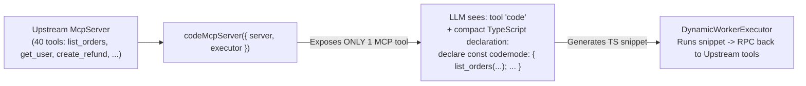
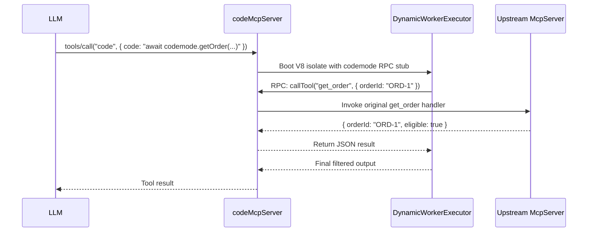

# Chapter 03 — Single Code Tool Pattern (`codeMcpServer`)

> **Lecture 31 · Chapter 03 of 08** · Level: 🟠 Advanced · Phase 7 — Connectors, Code Mode & Proactive Workflows
> **Source:** `Cloudflare Code Mode Docs` · **Roadmap Reference:** [`roadmap-v1.md`](../../roadmap-v1.md#lecture-31--cloudflare-code-mode--isolated-code-execution-mcp-cloudflarecodemode)
> **Roadmap topics:** `@cloudflare/codemode/mcp` · `codeMcpServer()` · collapsing an existing MCP server into a single `code` tool · the typed `codemode` TypeScript namespace.

---

## 03.0 What this chapter is for

What if you already have an existing MCP server with 40–100 tools (from [Lecture 27](../../Lecture%2027%20-%20MCP%20Core/) or [Lecture 30](../../Lecture%2030%20-%20Enterprise%20APIs%20OpenAPI-to-MCP%20and%20Computer-Use/)), and you want to upgrade it to Code Mode **without rewriting a single upstream tool**?

`@cloudflare/codemode/mcp` provides **`codeMcpServer()`**: a drop-in wrapper that takes any existing `McpServer` and exposes **one single `code` tool** backed by a typed `codemode.*` TypeScript API inside the sandbox.

By the end of this chapter you should be able to:

1. Explain how `codeMcpServer()` transforms $N$ upstream MCP tools into TypeScript methods on `codemode`.
2. Wire `codeMcpServer({ server, executor })` using `@cloudflare/codemode/mcp`.
3. Quantify the **5×–10× token compression** of TypeScript declarations vs. JSON Schema.
4. Identify when `codeMcpServer()` is the right pattern vs. `openApiMcpServer()` (Chapter 04).

---

## 03.1 How `codeMcpServer()` works

Under the hood, `codeMcpServer()` inspects every tool registered on your upstream `McpServer`, converts its JSON Schema `inputSchema` into a compact TypeScript `declare const codemode: { ... }` signature, and exposes **only one MCP tool named `code`** to the LLM:



### How RPC callbacks bridge the sandbox and upstream tools

When the LLM's TypeScript snippet calls `await codemode.getOrder({ orderId: "ORD-1" })` inside the V8 isolate, it does **not** talk to the database directly:



---

## 03.2 Concrete Implementation with `@cloudflare/codemode`

```typescript
import { DynamicWorkerExecutor } from "@cloudflare/codemode";
import { codeMcpServer } from "@cloudflare/codemode/mcp";
import { McpServer } from "@modelcontextprotocol/sdk/server/mcp.js";

// 1. Your existing upstream MCP server (e.g. 40 enterprise tools)
const upstreamMcpServer = new McpServer({ name: "enterprise-ops", version: "1.0.0" });
// ... register tools as usual (list_orders, get_order, create_refund, etc.)

// 2. Create the isolated V8 executor
const executor = new DynamicWorkerExecutor({
  loader: env.LOADER,
});

// 3. Wrap into a single `code` tool with zero upstream rewrites
const wrappedServer = await codeMcpServer({
  server: upstreamMcpServer,
  executor,
  description: "Execute TypeScript against the codemode.* enterprise toolkit.",
});
```

### Why TypeScript signatures compress 5×–10× better than JSON Schema

Compare the same tool in raw JSON Schema vs. `codemode` TypeScript declaration:

```json
// Raw JSON Schema (~110 tokens for ONE tool)
{
  "name": "create_refund",
  "description": "Issue a customer refund",
  "inputSchema": {
    "type": "object",
    "required": ["orderId", "amountUsd", "idempotencyKey"],
    "properties": {
      "orderId": { "type": "string" },
      "amountUsd": { "type": "number" },
      "idempotencyKey": { "type": "string" }
    }
  }
}
```

```typescript
// Compiled TypeScript declaration (~22 tokens — 5x smaller!)
create_refund(args: { orderId: string; amountUsd: number; idempotencyKey: string }): Promise<unknown>;
```

---

## 03.3 Choosing the Right Pattern

| Upstream Tool Count | Recommended Pattern | Schema Token Footprint | Why |
| :---: | :--- | :---: | :--- |
| `1 – 15` tools | **Standard MCP** | `~500 – 6,500` tokens | Small enough that raw JSON schemas don't bloat context |
| `15 – 150` tools | **`codeMcpServer()`** | `~800 – 5,000` tokens | TypeScript declarations fit cleanly in 1 `code` tool + unlocks loops |
| `200 – 2,500+` endpoints | **`openApiMcpServer()`** | **`~1,000` tokens (constant)** | Even TS declarations for 2,500 endpoints would overflow; use `search` + `execute` |

> [!WARNING]
> **Where `codeMcpServer()` hits its own ceiling:** If you feed a 2,500-endpoint server into `codeMcpServer()`, the generated `declare const codemode` string itself will exceed 100,000 tokens! Past ~150 tools, switch to **`openApiMcpServer()`** (Chapter 04).

---

## 03.4 Common mistakes

| # | Common Mistake | Why It Hurts | What To Do Instead |
| :--- | :--- | :--- | :--- |
| **1** | **Passing a 1,000-tool server into `codeMcpServer()`** | The single `code` tool description becomes 100K+ tokens long | Use `openApiMcpServer()` (`search` + `execute`) for 200+ endpoints |
| **2** | **Rewriting upstream MCP tools just to adopt Code Mode** | Wastes engineering weeks and duplicates validation/auth logic | Wrap the existing `McpServer` directly with `codeMcpServer()` |
| **3** | **Forgetting `env.LOADER` binding in `wrangler.jsonc`** | `DynamicWorkerExecutor` fails at runtime because it cannot spawn isolates | Add `"worker_loaders": [{ "binding": "LOADER" }]` (Chapter 07) |
| **4** | **Removing idempotency/governance from upstream tools** | Sandbox code can still call `codemode.create_refund()` in a loop | Keep all idempotency, rate-limit, and HITL checks inside the upstream handlers |

---

## 03.5 Key takeaways

1. **`codeMcpServer()` wraps any existing `McpServer`** into a single `code` tool with zero upstream rewrites.
2. **Every upstream tool becomes a typed `codemode.<toolName>()` method** inside the sandbox, compressing schemas by 5×–10×.
3. **All upstream governance (idempotency, HITL, OAuth) stays intact** because the isolate calls upstream tools over RPC.
4. **Best for 15–150 tools**; for **200–2,500+ endpoints**, use `openApiMcpServer()` (Chapter 04).

---

**Next:** [Chapter 04 — Search & Execute Pattern (`openApiMcpServer`)](./04_Search_and_Execute_Pattern_openApiMcpServer.md)
