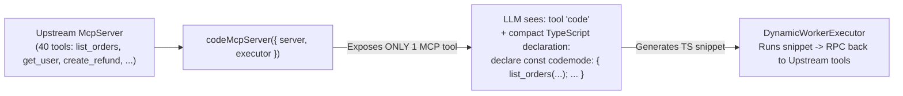

# Chapter 03 — Single Code Tool Pattern (`codeMcpServer`)

> **Lecture 31 · Chapter 03 of 08** · Level: 🟠 Advanced · Phase 7 — Connectors, Code Mode & Proactive Workflows
> **Source:** `Cloudflare Code Mode Docs` · **Roadmap Reference:** [`roadmap-v1.md`](../../roadmap-v1.md#lecture-31--cloudflare-code-mode--isolated-code-execution-mcp-cloudflarecodemode)
> **Roadmap topics:** `@cloudflare/codemode/mcp` · `codeMcpServer()` · collapsing an existing MCP server into a single `code` tool · the typed `codemode` TypeScript namespace.

---

## 03.0 What this chapter is for

What if you already have an existing MCP server with 40–100 tools (from [Lecture 27](../../Lecture%2027%20-%20MCP%20Core/) or [Lecture 30](../../Lecture%2030%20-%20Enterprise%20APIs%20OpenAPI-to-MCP%20and%20Computer-Use/)), and you want to upgrade it to Code Mode **without rewriting a single upstream tool**?

`@cloudflare/codemode/mcp` provides **`codeMcpServer()`**: a drop-in wrapper that takes any existing `McpServer` and exposes **one single `code` tool** backed by a typed `codemode.*` TypeScript API inside the sandbox.

By the end of this chapter you should be able to:

1. Explain how `codeMcpServer()` transforms $N$ upstream MCP tools into TypeScript methods on `codemode`.
2. Wire `codeMcpServer({ server, executor })` using `@cloudflare/codemode/mcp`.
3. Identify when `codeMcpServer()` is the right pattern vs. `openApiMcpServer()` (Chapter 04).

---

## 03.1 How `codeMcpServer()` works



### Usage with `@cloudflare/codemode`

```typescript
import { DynamicWorkerExecutor } from "@cloudflare/codemode";
import { codeMcpServer } from "@cloudflare/codemode/mcp";

const executor = new DynamicWorkerExecutor({
  loader: env.LOADER,
});

// Wraps an existing McpServer into a single `code` tool with typed `codemode.*` methods
const wrappedServer = await codeMcpServer({
  server: upstreamMcpServer,
  executor,
  description: "Execute TypeScript against the codemode.* enterprise toolkit.",
});
```

Because TypeScript type signatures (`codemode.getOrder(args: { orderId: string }): Promise<Order>`) are **far more compact** than verbose JSON Schema objects, 50 tools shrink by **5×–10×** in tokens while enabling multi-step chaining in a single call.

### Choosing the Right Pattern

| Upstream Tool Count | Recommended Pattern | Why |
| :---: | :--- | :--- |
| `1 – 15` tools | Standard MCP | Small enough that raw JSON schemas don't bloat context |
| `15 – 150` tools | **`codeMcpServer()`** | TypeScript declarations fit cleanly in 1 `code` tool |
| `200 – 2,500+` endpoints | **`openApiMcpServer()`** | Constant `~1,000` tokens via `search()` + `execute()` |

---

## 03.2 Key takeaways

1. **`codeMcpServer()` wraps any existing `McpServer`** into a single `code` tool with zero upstream rewrites.
2. **Every upstream tool becomes a typed `codemode.<toolName>()` method** inside the sandbox.
3. **Best for 15–150 tools** where the TypeScript declaration fits comfortably in one `code` tool description; for **200–2,500+ endpoints**, use `openApiMcpServer()` (Chapter 04).

---

**Next:** [Chapter 04 — Search & Execute Pattern (`openApiMcpServer`)](./04_Search_and_Execute_Pattern_openApiMcpServer.md)

