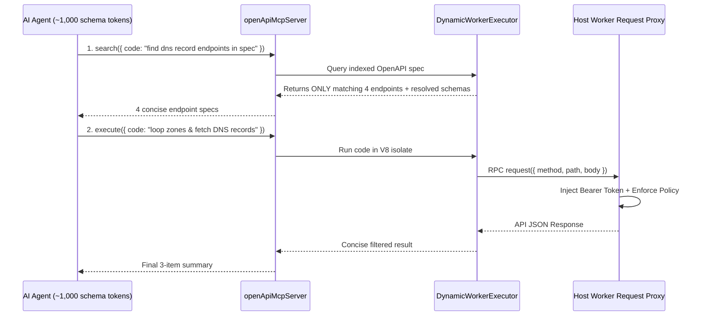
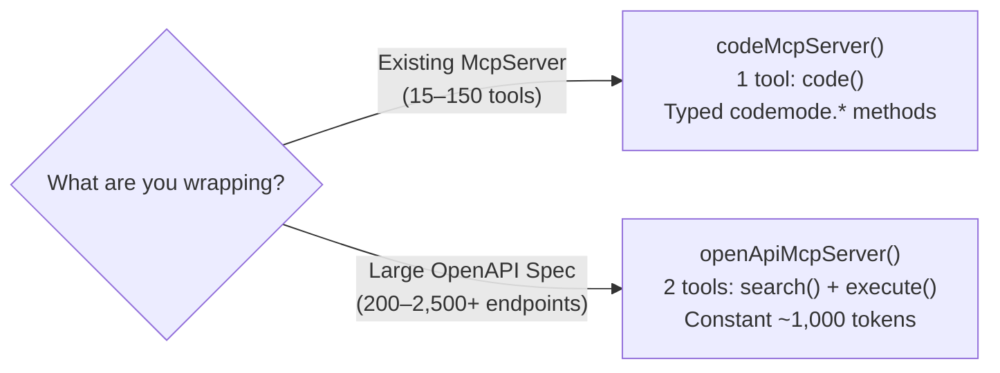

# Chapter 04 — Search & Execute Pattern (`openApiMcpServer`)

> **Lecture 31 · Chapter 04 of 08** · Level: 🟠 Advanced · Phase 7 — Connectors, Code Mode & Proactive Workflows
> **Source:** `Cloudflare Code Mode Blog & Docs` · **Roadmap Reference:** [`roadmap-v1.md`](../../roadmap-v1.md#lecture-31--cloudflare-code-mode--isolated-code-execution-mcp-cloudflarecodemode)
> **Roadmap topics:** `openApiMcpServer()` · two-tool architecture (`search` + `execute`) · publishing 2,500+ endpoints in `~1,000` tokens · `$ref` resolution · host-side `request` proxy.

---

## 04.0 What this chapter is for

When an enterprise API has **200 to 2,500+ endpoints** (like Cloudflare's full OpenAPI spec or GitHub's REST API), even TypeScript declarations for all 2,500 endpoints would exceed 100,000 tokens.

**`openApiMcpServer()`** solves this with a **two-tool progressive discovery pattern**:
1. **`search(code)`** — lets the agent query the OpenAPI spec (paths, summaries, tags, schemas, resolved `$ref`s) *on demand* inside a lightweight JS filter.
2. **`execute(code)`** — lets the agent run a JavaScript/TypeScript snippet that calls `request()` inside the sandbox, proxied safely by the host Worker.

Regardless of whether the OpenAPI spec has **20 endpoints or 2,500 endpoints**, the LLM only ever sees **two tools (`search` and `execute`) totaling ~1,000 tokens**!

By the end of this chapter you should be able to:

1. Explain how `openApiMcpServer()` achieves **constant $O(1)$ schema token size (~1,000 tokens)** regardless of API size.
2. Trace the two-turn **`search()` $\rightarrow$ `execute()`** workflow.
3. Configure the **host-side `request` proxy** so API credentials never enter the sandbox.
4. Explain why **in-memory `$ref` resolution** during `search()` prevents parameter hallucinations.

---

## 04.1 Constant $O(1)$ Token Scaling: `search()` + `execute()`



### Why `search()` runs code against the OpenAPI spec too

Instead of relying on fuzzy vector search (which often misses exact path parameters or `$ref` sub-objects), Cloudflare's `search()` lets the agent write a small JS filter against the `spec` object (with `$ref`s resolved):

- The agent can filter `spec.paths` by tag (`"DNS"`), path prefix (`"/zones"`), or HTTP method (`"GET"`).
- Only the **3–5 matching endpoints** and their resolved request/response schemas are returned to the LLM's context.

---

## 04.2 Concrete Implementation with `@cloudflare/codemode/mcp`

```typescript
import { DynamicWorkerExecutor } from "@cloudflare/codemode";
import { openApiMcpServer } from "@cloudflare/codemode/mcp";

const apiServer = await openApiMcpServer({
  spec: enterpriseOpenApiSpec, // 200 to 2,500+ endpoints
  executor: new DynamicWorkerExecutor({ loader: env.LOADER }),
  request: async ({ url, method, headers, body }) => {
    // Host-side proxy injects auth headers safely outside the sandbox!
    return fetch(url, {
      method,
      headers: {
        ...headers,
        Authorization: `Bearer ${env.API_TOKEN}`,
      },
      body,
    });
  },
});
```

### What `execute()` Looks Like in Practice

After `search()` returns the matching paths and parameter shapes, the agent writes one clean `execute()` snippet:

```javascript
async () => {
  const zones = await request({ method: "GET", path: "/zones?status=active" });
  const results = [];

  for (const z of zones.result) {
    const dns = await request({ method: "GET", path: `/zones/${z.id}/dns_records?type=TXT` });
    results.push({ zone: z.name, txtCount: dns.result.length });
  }

  return results;
}
```

> [!IMPORTANT]
> **Notice where `env.API_TOKEN` lives:** It lives **strictly inside the Host Worker's `request` callback**. Even if the LLM generates malicious code inside `execute()`, it can only invoke `request(...)` — it can never read `env.API_TOKEN` or call `fetch()` directly.

---

## 04.3 Comparing `codeMcpServer` vs. `openApiMcpServer`



| Feature | `codeMcpServer()` | `openApiMcpServer()` |
| :--- | :--- | :--- |
| **Exposed MCP Tools** | `1` (`code`) | `2` (`search`, `execute`) |
| **Schema Scaling** | $O(N)$ TypeScript signatures | **$O(1)$ constant (~1,000 tokens)** |
| **Discovery Step** | None needed (all `codemode.*` types in prompt) | 1 `search()` turn to inspect matching endpoints |
| **Auth Boundary** | Upstream `McpServer` tool handlers | Host-side `request()` proxy callback |

> [!TIP]
> **Pin `baseUrl` and `allowedMethods` inside your `request()` proxy.** Never blindly pass `url` from `execute()` straight to `fetch(url)` without checking that it starts with your API's base URL (e.g., `https://api.cloudflare.com/client/v4`) — otherwise sandboxed code could probe internal cloud metadata URLs!

---

## 04.4 Common mistakes

| # | Common Mistake | Why It Hurts | What To Do Instead |
| :--- | :--- | :--- | :--- |
| **1** | **Forwarding arbitrary `url` in `request()` without base-URL pinning** | Sandboxed code can trigger SSRF against `169.254.169.254` or internal VPC hosts | Validate `url.startsWith(ALLOWED_BASE_URL)` inside the Host `request` callback |
| **2** | **Allowing `DELETE` in the `request()` proxy** | Agent can wipe resources in a loop inside `execute()` | Enforce an explicit `ALLOWED_METHODS` set (or require HITL for destructive paths) |
| **3** | **Passing a raw OpenAPI spec with broken/circular `$ref`s** | `search()` returns incomplete parameter schemas, causing `400 Bad Request` in `execute()` | Validate and normalize the OpenAPI 3.x spec in CI before bundling |
| **4** | **Using `openApiMcpServer` for a tiny 5-endpoint API** | Adds an extra `search()` roundtrip when 5 tools fit in 2,000 tokens | Use standard MCP or `codeMcpServer()` for small APIs |

---

## 04.5 Key takeaways

1. **`openApiMcpServer()` exposes only `search()` and `execute()`** — keeping schema tokens constant at `~1,000` tokens even for 2,500+ endpoints.
2. **The agent discovers endpoints lazily via `search()`** (with `$ref`s resolved) and chains multi-step calls inside `execute()`.
3. **The `request` callback runs on the host Worker**, keeping API tokens completely outside the sandbox and enforcing URL/method allow-lists.

---

**Next:** [Chapter 05 — Dynamic Workers & Sandbox Isolation](./05_Dynamic_Workers_and_Sandbox_Isolation.md)
