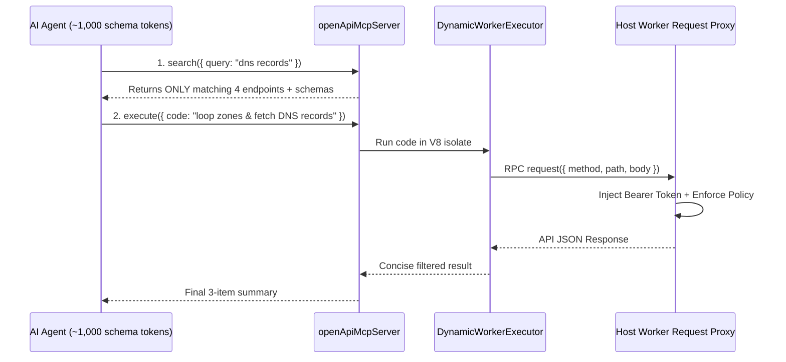

# Chapter 04 — Search & Execute Pattern (`openApiMcpServer`)

> **Lecture 31 · Chapter 04 of 08** · Level: 🟠 Advanced · Phase 7 — Connectors, Code Mode & Proactive Workflows
> **Source:** `Cloudflare Code Mode Blog & Docs` · **Roadmap Reference:** [`roadmap-v1.md`](../../roadmap-v1.md#lecture-31--cloudflare-code-mode--isolated-code-execution-mcp-cloudflarecodemode)
> **Roadmap topics:** `openApiMcpServer()` · two-tool architecture (`search` + `execute`) · publishing 2,500+ endpoints in `~1,000` tokens · `$ref` resolution · host-side `request` proxy.

---

## 04.0 What this chapter is for

When an enterprise API has **200 to 2,500+ endpoints** (like Cloudflare's full OpenAPI spec), even TypeScript declarations for all 2,500 endpoints would exceed 100,000 tokens.

**`openApiMcpServer()`** solves this with a **two-tool progressive discovery pattern**:
1. **`search(query)`** — lets the agent query the OpenAPI spec (paths, summaries, tags, schemas) *on demand*.
2. **`execute(code)`** — lets the agent run a JavaScript/TypeScript snippet that calls `spec` / `request()` inside the sandbox, proxied safely by the host Worker.

Regardless of whether the OpenAPI spec has **20 endpoints or 2,500 endpoints**, the LLM only ever sees **two tools (`search` and `execute`) totaling ~1,000 tokens**!

By the end of this chapter you should be able to:

1. Explain how `openApiMcpServer()` achieves **constant $O(1)$ schema token size (~1,000 tokens)** regardless of API size.
2. Trace the two-turn **`search()` $\rightarrow$ `execute()`** workflow.
3. Configure the **host-side `request` proxy** so credentials never enter the sandbox.

---

## 04.1 Constant $O(1)$ Token Scaling: `search()` + `execute()`



### Usage with `@cloudflare/codemode/mcp`

```typescript
import { DynamicWorkerExecutor } from "@cloudflare/codemode";
import { openApiMcpServer } from "@cloudflare/codemode/mcp";

const apiServer = await openApiMcpServer({
  spec: enterpriseOpenApiSpec, // 200 to 2,500+ endpoints
  executor: new DynamicWorkerExecutor({ loader: env.LOADER }),
  request: async ({ url, method, headers, body }) => {
    // Host-side proxy injects auth headers safely outside the sandbox!
    return fetch(url, {
      method,
      headers: { ...headers, Authorization: `Bearer ${env.API_TOKEN}` },
      body,
    });
  },
});
```

### What `execute()` Looks Like in Practice
After `search({ query: "dns" })` returns the matching paths, the agent writes one clean `execute()` snippet:
```javascript
async () => {
  const zones = await request({ method: "GET", path: "/zones?status=active" });
  return zones.result.map((z) => ({ id: z.id, name: z.name }));
}
```

---

## 04.2 Key takeaways

1. **`openApiMcpServer()` exposes only `search()` and `execute()`** — keeping schema tokens constant at `~1,000` tokens even for 2,500+ endpoints.
2. **The agent discovers endpoints lazily via `search()`** and chains multi-step calls inside `execute()`.
3. **The `request` callback runs on the host Worker**, keeping API tokens completely outside the sandbox.

---

**Next:** [Chapter 05 — Dynamic Workers & Sandbox Isolation](./05_Dynamic_Workers_and_Sandbox_Isolation.md)

