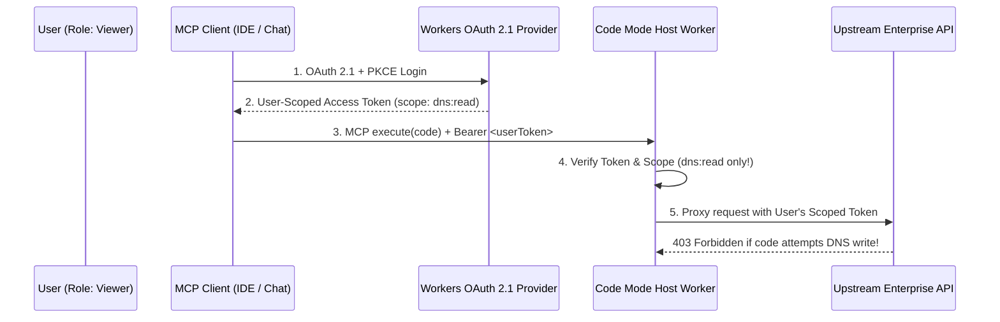

# Chapter 06 — OAuth 2.1 & Scoped Delegated Execution

> **Lecture 31 · Chapter 06 of 08** · Level: 🟠 Advanced · Phase 7 — Connectors, Code Mode & Proactive Workflows
> **Source:** `Cloudflare Code Mode Docs` · **Roadmap Reference:** [`roadmap-v1.md`](../../roadmap-v1.md#lecture-31--cloudflare-code-mode--isolated-code-execution-mcp-cloudflarecodemode)
> **Roadmap topics:** MCP Authorization (OAuth 2.1 + PKCE) · Workers OAuth Provider · per-user permission downscoping · preventing Confused Deputy attacks.

---

## 06.0 What this chapter is for

Giving a Code Mode MCP server a single global `ADMIN_API_TOKEN` creates a **Confused Deputy** vulnerability: User A (a read-only intern) asks the agent to run `execute()` and delete User B's production DNS zone — and the Host Worker blindly uses the global admin token!

By the end of this chapter you should be able to:

1. Explain how **OAuth 2.1 + PKCE** authenticates the human user to the MCP server.
2. Implement **per-user token delegation & downscoping** inside the Host Worker `request` proxy.
3. Prevent **cross-tenant and privilege-escalation** attacks inside Code Mode `execute()` blocks.

---

## 06.1 Delegated OAuth 2.1 Execution Flow

### Enforcing scope inside the Host `request` proxy

Even before calling the upstream API, the Host Worker `request` handler can check the user's OAuth scopes:
- If `userScopes` only includes `read`, reject any `POST`/`PATCH`/`DELETE` inside the `request()` callback with `403 Insufficient Scope`.
- This ensures **User A's sandboxed code can only act with User A's exact permissions**.

---

## 06.2 Key takeaways

1. **Never share a single admin token across all MCP callers:** use OAuth 2.1 delegated tokens.
2. **Enforce user scopes in the Host Worker `request` proxy** — the sandbox never touches the OAuth token, and cannot escalate beyond the caller's scopes.

---

**Next:** [Chapter 07 — Serving with Cloudflare Workers & Agents SDK](./07_Serving_with_Cloudflare_Workers_and_Agents_SDK.md)

