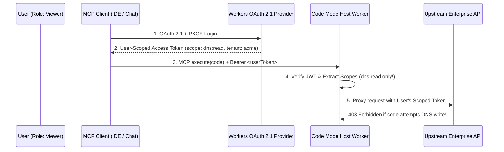
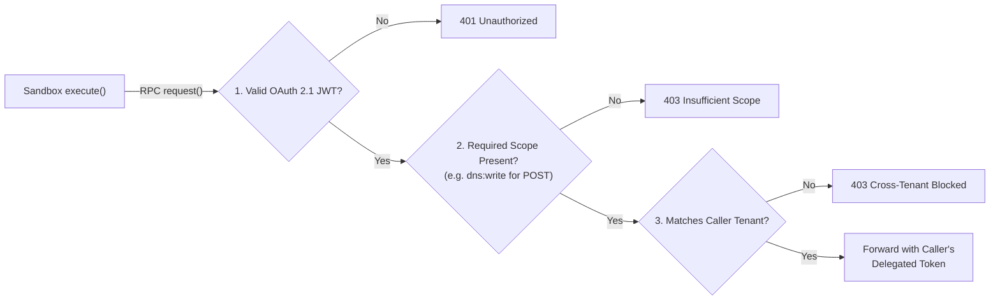

# Chapter 06 — OAuth 2.1 & Scoped Delegated Execution

> **Lecture 31 · Chapter 06 of 08** · Level: 🟠 Advanced · Phase 7 — Connectors, Code Mode & Proactive Workflows
> **Source:** `Cloudflare Code Mode Docs` · **Roadmap Reference:** [`roadmap-v1.md`](../../roadmap-v1.md#lecture-31--cloudflare-code-mode--isolated-code-execution-mcp-cloudflarecodemode)
> **Roadmap topics:** MCP Authorization (OAuth 2.1 + PKCE) · Workers OAuth Provider · per-user permission downscoping · preventing Confused Deputy attacks.

---

## 06.0 What this chapter is for

Giving a Code Mode MCP server a single global `ADMIN_API_TOKEN` creates a classic **Confused Deputy** vulnerability: User A (a read-only intern) asks the agent to run `execute()` and delete User B's production DNS zone — and the Host Worker blindly uses the global admin token!

In multi-tenant enterprise MCP deployments, **every `execute()` call must run with the exact OAuth permissions of the authenticated human caller**, never a shared god-mode service key.

By the end of this chapter you should be able to:

1. Explain how **OAuth 2.1 + PKCE** authenticates the human user to a remote MCP server.
2. Diagnose and prevent **Confused Deputy** attacks in Code Mode Host Workers.
3. Implement **per-user token delegation & scope downscoping** inside the Host Worker `request` proxy.
4. Enforce **tenant isolation** so User A's `execute()` code can never query User B's account IDs.

---

## 06.1 Delegated OAuth 2.1 Execution Flow



### The Confused Deputy Trap

| Architecture | What Happens When Intern Asks Agent to Delete Prod DNS | Risk |
| :--- | :--- | :--- |
| **Shared Global `env.ADMIN_TOKEN`** | Host Worker attaches `ADMIN_TOKEN` $\rightarrow$ DNS zone is deleted! | 🔴 **Critical Confused Deputy** |
| **OAuth 2.1 Delegated User Token** | Host Worker checks `userScopes` (`dns:read` only) $\rightarrow$ **403 Insufficient Scope** | ✅ **Zero privilege escalation** |

---

## 06.2 Enforcing Scope & Tenant Isolation in the Host `request` Proxy

Even before forwarding the request to the upstream API, the Host Worker `request` handler verifies both **OAuth scopes** and **tenant boundaries** outside the V8 isolate:

```typescript
interface AuthenticatedContext {
  userId: string;
  tenantId: string;
  scopes: Set<string>;
  upstreamAccessToken: string;
}

function createScopedRequestProxy(auth: AuthenticatedContext) {
  return async ({ url, method, headers, body }: ProxyRequest) => {
    const upperMethod = method.toUpperCase();

    // 1. Enforce method-level OAuth scope
    if (upperMethod !== "GET" && !auth.scopes.has("dns:write")) {
      return new Response("403 Insufficient Scope: dns:write required", { status: 403 });
    }

    // 2. Enforce tenant boundary on path/query
    if (url.includes("/accounts/") && !url.includes(`/accounts/${auth.tenantId}`)) {
      return new Response("403 Forbidden: Cross-tenant access denied", { status: 403 });
    }

    // 3. Forward using the caller's delegated token — NEVER a global admin key
    return fetch(url, {
      method: upperMethod,
      headers: {
        ...headers,
        Authorization: `Bearer ${auth.upstreamAccessToken}`,
      },
      body,
    });
  };
}
```



> [!IMPORTANT]
> **The sandbox never sees `auth.upstreamAccessToken`.** Just like `env.API_TOKEN` in Chapter 05, the user's OAuth token stays inside the Host Worker closure. Sandboxed code cannot extract the raw JWT and replay it elsewhere.

> [!TIP]
> **Downscope at login time too:** When configuring your OAuth 2.1 client (`Workers OAuth Provider`), request only the minimum scopes the agent needs (e.g., `dns:read`, `workers:read`) rather than `account:admin`.

---

## 06.3 Common mistakes

| # | Common Mistake | Why It Hurts | What To Do Instead |
| :--- | :--- | :--- | :--- |
| **1** | **Using one global `API_TOKEN` for all authenticated MCP users** | Read-only users can mutate or read other tenants' data (Confused Deputy) | Authenticate callers with OAuth 2.1 + PKCE and proxy with user-scoped tokens |
| **2** | **Passing the user's raw JWT into the sandbox environment** | Prompt-injected code can `return process.env.USER_TOKEN` back to the chat | Keep the token in the Host Worker `request` closure; never pass it to the isolate |
| **3** | **Checking scopes only in the UI, not in the Host `request()` proxy** | Agent code in `execute()` can still call write endpoints directly | Enforce scope and tenant checks on every `request()` invocation |
| **4** | **Skipping PKCE on public IDE/desktop MCP clients** | Authorization code interception attacks during OAuth redirect | Require OAuth 2.1 + PKCE (`S256`) per the MCP Authorization spec |

---

## 06.4 Key takeaways

1. **Never share a single admin token across all MCP callers:** use OAuth 2.1 + PKCE delegated tokens.
2. **Enforce user scopes and tenant boundaries in the Host Worker `request` proxy** — the sandbox never touches the OAuth token and cannot escalate beyond the caller's scopes.
3. **Defense against Confused Deputy:** authentication + scope enforcement must happen deterministically outside the LLM and outside the sandbox.

---

**Next:** [Chapter 07 — Serving with Cloudflare Workers & Agents SDK](./07_Serving_with_Cloudflare_Workers_and_Agents_SDK.md)
