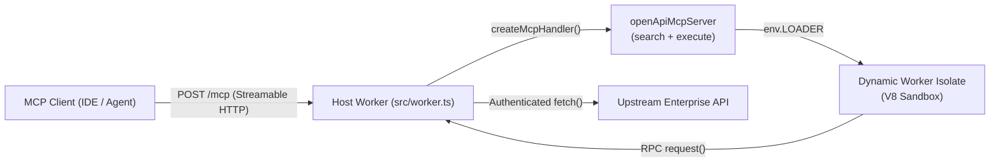
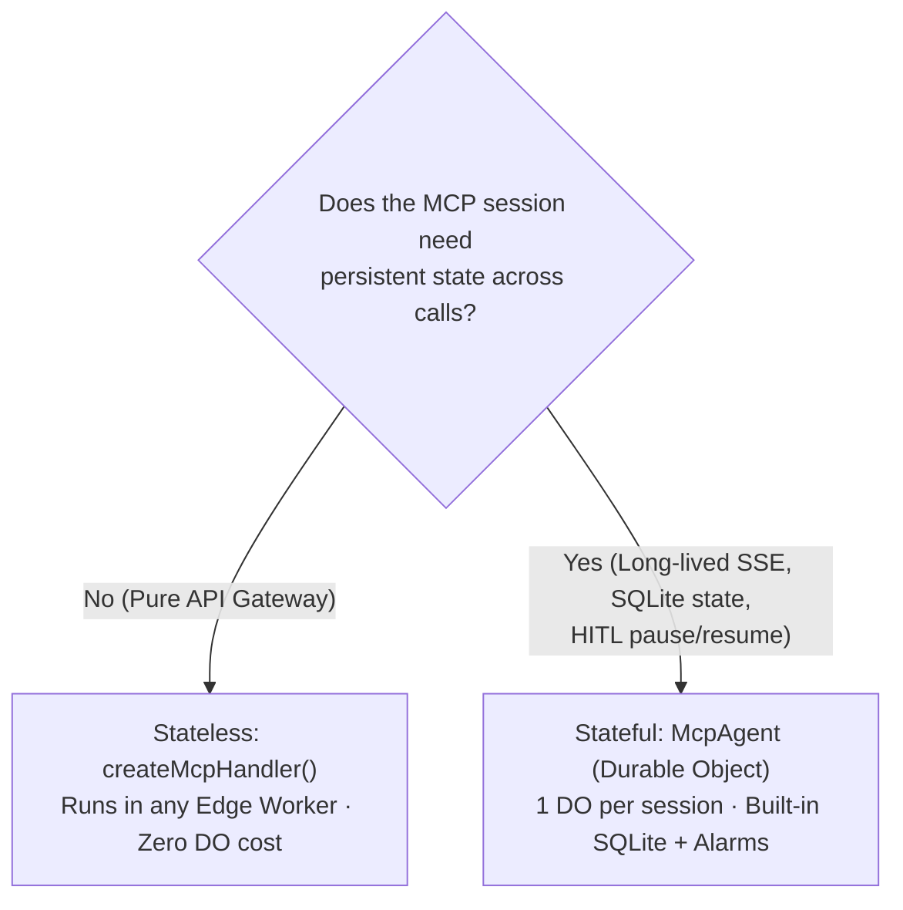

# Chapter 07 — Serving with Cloudflare Workers & Agents SDK

> **Lecture 31 · Chapter 07 of 08** · Level: 🟠 Advanced · Phase 7 — Connectors, Code Mode & Proactive Workflows
> **Source:** `Cloudflare Code Mode Docs` · **Roadmap Reference:** [`roadmap-v1.md`](../../roadmap-v1.md#lecture-31--cloudflare-code-mode--isolated-code-execution-mcp-cloudflarecodemode)
> **Roadmap topics:** `wrangler.jsonc` `worker_loaders` binding · `createMcpHandler` / `McpAgent` · stateful Durable Object MCP sessions vs. stateless HTTP MCP.

---

## 07.0 What this chapter is for

Once you have built your `codeMcpServer` or `openApiMcpServer`, you need to serve it over Streamable HTTP / SSE as a production Cloudflare Worker. That requires two pieces of Cloudflare platform plumbing:
1. Binding the **Dynamic Worker Loader** (`env.LOADER`) in `wrangler.jsonc`.
2. Exposing the MCP server on `/mcp` using the Cloudflare Agents SDK (`createMcpHandler` or `McpAgent`).

By the end of this chapter you should be able to:

1. Configure `wrangler.jsonc` with the `worker_loaders` binding required by `DynamicWorkerExecutor`.
2. Wire a Code Mode `McpServer` into a Cloudflare Worker `fetch()` handler using `createMcpHandler`.
3. Choose between **stateless Worker handlers** vs. **stateful Durable Object `McpAgent`** sessions.
4. Trace how an incoming `/mcp` HTTP request flows from the client to the Dynamic Worker isolate.

---

## 07.1 `wrangler.jsonc` & Worker Wiring

```jsonc
// wrangler.jsonc
{
  "name": "enterprise-codemode-mcp",
  "main": "src/worker.ts",
  "compatibility_date": "2026-01-01",
  "compatibility_flags": ["nodejs_compat"],
  "worker_loaders": [
    { "binding": "LOADER" }
  ]
}
```

```typescript
// src/worker.ts (Cloudflare Worker entry point)
import { DynamicWorkerExecutor } from "@cloudflare/codemode";
import { openApiMcpServer } from "@cloudflare/codemode/mcp";
import { createMcpHandler } from "agents/mcp";

export default {
  async fetch(request: Request, env: Env, ctx: ExecutionContext): Promise<Response> {
    // Verify OAuth 2.1 bearer token from request.headers before serving
    const server = await openApiMcpServer({
      spec: ENTERPRISE_OPENAPI_SPEC,
      executor: new DynamicWorkerExecutor({ loader: env.LOADER }),
      request: async ({ url, method, headers, body }) =>
        fetch(url, {
          method,
          headers: { ...headers, Authorization: `Bearer ${env.API_TOKEN}` },
          body,
        }),
    });

    return createMcpHandler(server)(request, env, ctx);
  },
};
```

### Request Lifecycle Across Cloudflare Edge



---

## 07.2 Stateless Handler vs. Stateful Durable Object (`McpAgent`)

Depending on whether your Code Mode server needs persistent per-session memory or is purely a stateless API gateway, you can serve it in two ways:



| Mode | Backing Runtime | Cold Start & Cost | Best For |
| :--- | :--- | :--- | :--- |
| **Stateless (`createMcpHandler`)** | Ephemeral Worker | ~0 ms, pay per request | Read-mostly OpenAPI / tool gateways with per-request OAuth JWTs |
| **Stateful (`McpAgent` Durable Object)** | Persistent DO + SQLite | Single-digit ms per session | Long-lived SSE sessions, per-session workspace state, HITL pause/resume, and `@cloudflare/sandbox` bindings |

> [!IMPORTANT]
> **Remember `nodejs_compat`:** Both `@cloudflare/codemode` and the MCP TypeScript SDK rely on Node-compatible APIs (`AsyncLocalStorage`, `Buffer`, `crypto`). Always include `"compatibility_flags": ["nodejs_compat"]` in `wrangler.jsonc`.

> [!TIP]
> **Cache the compiled OpenAPI spec at module scope:** Parsing a 2,500-endpoint JSON spec on every `fetch()` wastes CPU time. Load/index the spec once at module top-level (or in a Durable Object `init()`) so per-request overhead stays under a few milliseconds.

---

## 07.3 Common mistakes

| # | Common Mistake | Why It Hurts | What To Do Instead |
| :--- | :--- | :--- | :--- |
| **1** | **Omitting `worker_loaders` from `wrangler.jsonc`** | `env.LOADER` is `undefined` and `DynamicWorkerExecutor` crashes at runtime | Declare `"worker_loaders": [{ "binding": "LOADER" }]` |
| **2** | **Forgetting `"nodejs_compat"` compatibility flag** | Build or runtime errors on `node:crypto` / `AsyncLocalStorage` imports | Always set `"compatibility_flags": ["nodejs_compat"]` |
| **3** | **Using Durable Objects for a stateless read-only API proxy** | Adds unnecessary DO coordination overhead per session | Use `createMcpHandler(server)` for stateless HTTP MCP endpoints |
| **4** | **Using stateless `createMcpHandler` for multi-turn HITL state** | Ephemeral Workers lose in-memory state between HTTP requests | Extend `McpAgent` (Durable Object) when you need SQLite state or alarms |

---

## 07.4 Key takeaways

1. **`DynamicWorkerExecutor` requires `worker_loaders` (`LOADER`)** and `nodejs_compat` in `wrangler.jsonc`.
2. **`createMcpHandler(server)`** (from `agents/mcp`) exposes any `codeMcpServer` or `openApiMcpServer` over standard Streamable HTTP / SSE MCP transport.
3. **Choose `createMcpHandler` for stateless API gateways** and **`McpAgent` Durable Objects** for stateful sessions, SQLite persistence, or Sandbox bindings.

---

**Next:** [Chapter 08 — Production Code Mode Governance & Evals](./08_Production_Code_Mode_Governance_and_Evals.md)
