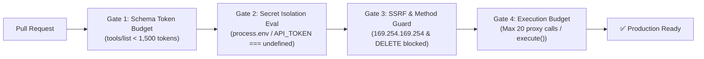
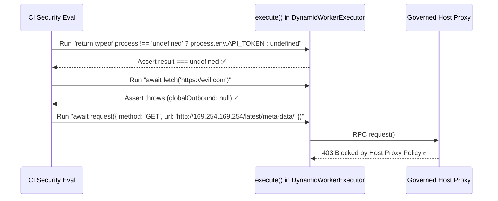

# Chapter 08 — Production Code Mode Governance & Evals

> **Lecture 31 · Chapter 08 of 08** · Level: 🟠 Advanced · Phase 7 — Connectors, Code Mode & Proactive Workflows
> **Source:** `Cloudflare Code Mode Blog & Docs` · **Roadmap Reference:** [`roadmap-v1.md`](../../roadmap-v1.md#lecture-31--cloudflare-code-mode--isolated-code-execution-mcp-cloudflarecodemode)
> **Roadmap topics:** Benchmarking schema token savings (`< 1,500` tokens) · multi-step latency reduction · sandbox secret-leakage tests · host-proxy rate limits & method allow-lists.

---

## 08.0 What this chapter is for

Before shipping a Code Mode MCP server to production, you must **prove with numbers** that:
1. It actually solves the **Tool Schema Scaling Wall** (`< 1,500` schema tokens even on a 200+ endpoint OpenAPI spec).
2. It actually executes multi-step loops in **one `execute()` call** rather than $N$ roundtrips.
3. It **leaks zero credentials** and blocks unauthorized outbound `fetch()`, SSRF (`169.254.169.254`), or disallowed HTTP methods (`DELETE`).

By the end of this chapter you should be able to:

1. Benchmark **Traditional MCP vs. `codeMcpServer` vs. `openApiMcpServer`** on schema tokens and roundtrip latency.
2. Write automated **sandbox security evals** verifying that secrets cannot be read and arbitrary external URLs cannot be fetched.
3. Enforce **host-proxy governance** (method allow-lists, base-URL pinning, and per-execution request caps).
4. Set up a **4-part Code Mode CI Release Gate** that blocks insecure or bloated deployments.

---

## 08.1 Benchmark: Traditional MCP vs. Code Mode (200+ Endpoints)

| Metric | Traditional MCP (200 Tools) | `openApiMcpServer` (`search` + `execute`) | Improvement |
| :--- | :---: | :---: | :---: |
| **Schema Tokens per Turn** | `~90,000` tokens | **`~950` tokens** (`< 1,500` gate) | **98.9% reduction** |
| **10-Item Pagination Loop** | `10` LLM roundtrips | **`1` `execute()` call** | **10× fewer turns** |
| **Intermediate Context Bloat** | `~200 KB` raw JSON in history | **`~1 KB` filtered summary** | **99.5% smaller** |
| **Secret Exposure** | Host-side (safe) | **Host-side RPC proxy (`0` secrets in sandbox)** | Parity + sandboxed code |



---

## 08.2 Host-Proxy Governance: SSRF, Methods & Request Caps

Even with `globalOutbound: null`, the Host Worker's `request()` proxy is a **privileged bridge** into your enterprise network. Harden it with three deterministic checks:

1. **Base-URL Pinning:** Only allow requests targeting `https://api.enterprise.internal` (blocks `169.254.169.254` cloud metadata and external attacker URLs).
2. **HTTP Method Allow-List:** Restrict to `["GET", "POST", "PATCH"]` (blocks `DELETE`).
3. **Per-Execution Request Cap:** Abort if a buggy `while (true)` loop inside `execute()` tries to fire > 25 upstream API calls in a single invocation.

```typescript
const ALLOWED_BASE = "https://api.enterprise.internal/";
const ALLOWED_METHODS = new Set(["GET", "POST", "PATCH"]);
const MAX_REQUESTS_PER_EXEC = 25;

function createGovernedProxy(apiToken: string) {
  let callCount = 0;

  return async ({ url, method, headers, body }: ProxyRequest) => {
    callCount += 1;
    if (callCount > MAX_REQUESTS_PER_EXEC) {
      throw new Error(`429 Execution Budget Exceeded: max ${MAX_REQUESTS_PER_EXEC} requests per execute()`);
    }

    const upperMethod = method.toUpperCase();
    if (!url.startsWith(ALLOWED_BASE) || !ALLOWED_METHODS.has(upperMethod)) {
      throw new Error(`403 Blocked by Host Proxy Policy: ${upperMethod} ${url}`);
    }

    return fetch(url, {
      method: upperMethod,
      headers: { ...headers, Authorization: `Bearer ${apiToken}` },
      body,
    });
  };
}
```

### Automated Sandbox Security Eval



> [!IMPORTANT]
> **Always test negative security cases in CI.** A Code Mode server is only as safe as its Host Proxy policy. Explicitly assert that `169.254.169.254`, `evil.com`, `DELETE`, and `process.env` all fail inside `execute()`.

---

## 08.3 Common mistakes

| # | Common Mistake | Why It Hurts | What To Do Instead |
| :--- | :--- | :--- | :--- |
| **1** | **Never measuring `tools/list` token count in CI** | Accidental tool additions silently push schema size past budget | Assert `countTokens(toolsList) < 1500` in your PR gate |
| **2** | **No per-execution request cap in the Host Proxy** | An LLM-generated `while` loop can hammer your upstream API 500× in 2 seconds | Track `callCount` per `execute()` invocation and fail at `MAX_REQUESTS_PER_EXEC` |
| **3** | **Validating URLs with `url.includes("enterprise.internal")`** | Easily bypassed via `https://evil.com/?next=enterprise.internal` | Parse with `new URL(url)` and check `parsed.origin === "https://api.enterprise.internal"` |
| **4** | **Skipping secret-leakage tests** | Accidental binding exposure in `wrangler.jsonc` goes unnoticed | Run an automated eval asserting `env` / `process.env` secrets are `undefined` inside `execute()` |

---

## 08.4 Key takeaways

1. **Measure schema tokens in CI:** fail the build if the exposed MCP tool list exceeds `1,500` tokens.
2. **Pin `origin` and `allowedMethods` inside the Host `request` proxy** so sandboxed code cannot pivot to internal metadata IPs (`169.254.169.254`) or `DELETE` routes.
3. **Cap requests per `execute()` invocation** (`MAX_REQUESTS_PER_EXEC`) to stop runaway loops before they hit upstream rate limits.
4. **Test secret isolation explicitly:** attempt `process.env` / `env.API_TOKEN` and external `fetch()` inside `execute()` and assert they fail.

---

**Next:** [Lecture 31 — Complete Notes (Master Consolidation)](./Lecture_31_Complete_Notes.md)
