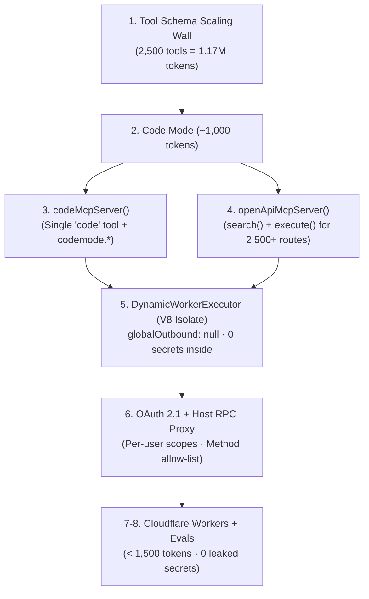

# Lecture 31 — Complete Notes
## Cloudflare Code Mode & Isolated Code-Execution MCP (`@cloudflare/codemode`)

> **Phase:** 7 · Connectors, Code Mode & Proactive Workflows · **Level:** 🟠 Advanced
> **Scope:** A single-pass consolidation of the eight chapter notes in this folder.
> **References:** [Cloudflare Blog: Code Mode](https://blog.cloudflare.com/code-mode/) · [Build a Code Mode MCP Server](https://developers.cloudflare.com/agents/model-context-protocol/guides/build-codemode-mcp-server/)
>
> | Chapter | File |
> | :--- | :--- |
> | 01 · The Tool Schema Scaling Wall | [01_The_Tool_Schema_Scaling_Wall.md](./01_The_Tool_Schema_Scaling_Wall.md) |
> | 02 · Code-First Agents vs. JSON Tool Calling | [02_Code_First_Agents_vs_JSON_Tool_Calling.md](./02_Code_First_Agents_vs_JSON_Tool_Calling.md) |
> | 03 · Single Code Tool Pattern (`codeMcpServer`) | [03_Single_Code_Tool_Pattern_codeMcpServer.md](./03_Single_Code_Tool_Pattern_codeMcpServer.md) |
> | 04 · Search & Execute Pattern (`openApiMcpServer`) | [04_Search_and_Execute_Pattern_openApiMcpServer.md](./04_Search_and_Execute_Pattern_openApiMcpServer.md) |
> | 05 · Dynamic Workers & Sandbox Isolation | [05_Dynamic_Workers_and_Sandbox_Isolation.md](./05_Dynamic_Workers_and_Sandbox_Isolation.md) |
> | 06 · OAuth 2.1 & Scoped Delegated Execution | [06_OAuth_2_1_and_Scoped_Delegated_Execution.md](./06_OAuth_2_1_and_Scoped_Delegated_Execution.md) |
> | 07 · Serving with Cloudflare Workers & Agents SDK | [07_Serving_with_Cloudflare_Workers_and_Agents_SDK.md](./07_Serving_with_Cloudflare_Workers_and_Agents_SDK.md) |
> | 08 · Production Code Mode Governance & Evals | [08_Production_Code_Mode_Governance_and_Evals.md](./08_Production_Code_Mode_Governance_and_Evals.md) |

---

## 1. Executive summary

**The lecture in five sentences.**

1. Exposing 500–2,500+ REST endpoints as individual MCP tools hits the **Tool Schema Scaling Wall** (`1.17M` tokens for Cloudflare's API), causing context overflow, tool confusion, and slow sequential roundtrips.
2. **Code Mode** flips the paradigm: LLMs write compact **TypeScript/JavaScript** snippets against typed APIs — keeping loops, pagination, and intermediate payloads inside the sandbox.
3. **`codeMcpServer()`** wraps existing MCP servers into a single `code` tool with a typed `codemode.*` namespace, while **`openApiMcpServer()`** publishes 2,500+ OpenAPI endpoints in **`~1,000` tokens** via `search()` + `execute()`.
4. **Dynamic Workers (`DynamicWorkerExecutor`)** run generated code inside **V8 isolates** (~2–5 ms boot) with **`globalOutbound: null`** and a **Host Worker RPC `request` proxy** so secrets never enter the sandbox.
5. **OAuth 2.1 delegation**, `createMcpHandler` on Cloudflare Workers, and token/security evals ensure `< 1,500` schema tokens and zero secret leakage in production.

---

## 2. The arc of the lecture in one diagram

---

## 3. Cheat sheet

| Concept | One-line definition | Chapter |
| :--- | :--- | :--- |
| **Schema Scaling Wall** | 2,500+ JSON tool schemas consuming `1.17M` tokens per turn | [01](./01_The_Tool_Schema_Scaling_Wall.md) |
| **Code-First Execution** | LLM writes TS loops/filters instead of $N$ sequential JSON calls | [02](./02_Code_First_Agents_vs_JSON_Tool_Calling.md) |
| **`codeMcpServer()`** | Wraps an existing `McpServer` into 1 `code` tool + `codemode.*` | [03](./03_Single_Code_Tool_Pattern_codeMcpServer.md) |
| **`openApiMcpServer()`** | Exposes 2,500+ OpenAPI routes in `~1,000` tokens via `search()` + `execute()` | [04](./04_Search_and_Execute_Pattern_openApiMcpServer.md) |
| **Dynamic Workers** | V8 isolates (`~2–5ms` boot) with `globalOutbound: null` for JS/TS Code Mode | [05](./05_Dynamic_Workers_and_Sandbox_Isolation.md) |
| **Cloudflare Sandbox SDK (GA)** | Durable Objects + full Linux containers (`@cloudflare/sandbox`) for bash/Python/git & OpenAI Agents | [05](./05_Dynamic_Workers_and_Sandbox_Isolation.md) |
| **OAuth 2.1 Delegation** | Per-user scoped tokens enforced by the Host Worker `request` proxy | [06](./06_OAuth_2_1_and_Scoped_Delegated_Execution.md) |
| **`createMcpHandler`** | Serves Code Mode MCP servers on Cloudflare Workers (`worker_loaders`) | [07](./07_Serving_with_Cloudflare_Workers_and_Agents_SDK.md) |

---

## 4. Self-check questions (Release Gate Prep)

1. Why does `openApiMcpServer()` stay at `~1,000` schema tokens even when the OpenAPI spec grows from 20 to 2,500 endpoints?
2. When should you choose `codeMcpServer()` vs. `openApiMcpServer()`?
3. How do Dynamic Workers prevent an LLM-generated `execute()` script from exfiltrating `env.API_TOKEN`?
4. Why is `globalOutbound: null` critical inside `DynamicWorkerExecutor`?

