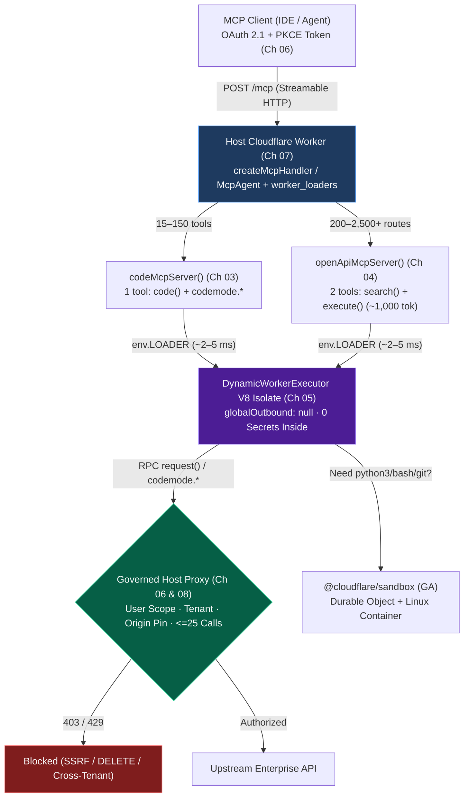

# Lecture 31 — Complete Notes
## Cloudflare Code Mode & Isolated Code-Execution MCP (`@cloudflare/codemode`)

> **Phase:** 7 · Connectors, Code Mode & Proactive Workflows · **Level:** 🟠 Advanced
> **Scope:** Single-pass revision guide consolidating all eight chapter notes in this folder.
> **References:** [Cloudflare Blog: Code Mode](https://blog.cloudflare.com/code-mode/) · [Build a Code Mode MCP Server](https://developers.cloudflare.com/agents/model-context-protocol/guides/build-codemode-mcp-server/)

---

## 1. Executive Summary

**Thesis:** Traditional 1-endpoint-per-tool MCP hits a fatal **Tool Schema Scaling Wall** at 200–2,500+ enterprise endpoints (`1.17M` tokens); **Cloudflare Code Mode** collapses the tool surface to `~1,000` tokens by letting LLMs write TypeScript inside **V8 Dynamic Workers** (`globalOutbound: null`) while keeping credentials, OAuth 2.1 scopes, and governance strictly in the **Host Worker RPC proxy**.

**The lecture in five sentences:**

1. Exposing 500–2,500+ REST endpoints as individual JSON MCP tools hits the **Tool Schema Scaling Wall** (`~1.17M` tokens for Cloudflare's API), causing context overflow, attention dilution, and $N$-turn sequential roundtrip latency.
2. **Code Mode** leverages the fact that LLMs are pretrained on billions of lines of TypeScript/JS—letting a single `execute()` turn run `Promise.all` loops, filters, and joins while keeping 200 KB+ intermediate payloads out of the LLM context.
3. **`codeMcpServer()`** wraps existing 15–150 tool MCP servers into a single `code` tool with a typed `codemode.*` namespace (5×–10× smaller than JSON Schema), whereas **`openApiMcpServer()`** publishes 2,500+ OpenAPI endpoints in a constant **`~1,000` tokens** via `search()` + `execute()`.
4. **`DynamicWorkerExecutor`** runs untrusted LLM code inside **V8 isolates** (~2–5 ms cold start, ~3–10 MB RAM) with **`globalOutbound: null`** and a **Host Worker `request()` proxy**, while **`@cloudflare/sandbox` (GA)** handles full Linux (`python3`, `bash`, `git`) workloads.
5. **OAuth 2.1 + PKCE delegation**, `createMcpHandler` / `McpAgent` on Cloudflare Workers (`worker_loaders` + `nodejs_compat`), and a **4-part CI Security & Token Gate** (`< 1,500` tokens, zero secret leaks, SSRF/method guards) make Code Mode production-ready.

| Chapter | Core Topic | Link |
| :--- | :--- | :--- |
| **01** | The Tool Schema Scaling Wall | [01_The_Tool_Schema_Scaling_Wall.md](./01_The_Tool_Schema_Scaling_Wall.md) |
| **02** | Code-First Agents vs. JSON Tool Calling | [02_Code_First_Agents_vs_JSON_Tool_Calling.md](./02_Code_First_Agents_vs_JSON_Tool_Calling.md) |
| **03** | Single Code Tool Pattern (`codeMcpServer`) | [03_Single_Code_Tool_Pattern_codeMcpServer.md](./03_Single_Code_Tool_Pattern_codeMcpServer.md) |
| **04** | Search & Execute Pattern (`openApiMcpServer`) | [04_Search_and_Execute_Pattern_openApiMcpServer.md](./04_Search_and_Execute_Pattern_openApiMcpServer.md) |
| **05** | Dynamic Workers & Sandbox Isolation | [05_Dynamic_Workers_and_Sandbox_Isolation.md](./05_Dynamic_Workers_and_Sandbox_Isolation.md) |
| **06** | OAuth 2.1 & Scoped Delegated Execution | [06_OAuth_2_1_and_Scoped_Delegated_Execution.md](./06_OAuth_2_1_and_Scoped_Delegated_Execution.md) |
| **07** | Serving with Cloudflare Workers & Agents SDK | [07_Serving_with_Cloudflare_Workers_and_Agents_SDK.md](./07_Serving_with_Cloudflare_Workers_and_Agents_SDK.md) |
| **08** | Production Code Mode Governance & Evals | [08_Production_Code_Mode_Governance_and_Evals.md](./08_Production_Code_Mode_Governance_and_Evals.md) |

---

## 2. Master Architecture Diagram

---

## 3. Chapter-by-Chapter Short Revision Notes

### 3.1 Chapter 01 — The Tool Schema Scaling Wall

Every MCP JSON tool definition averages **~450 tokens**, so traditional 1-endpoint-per-tool MCP scales linearly $O(N)$: 150 tools consume `~67,500` tokens, GitHub's 1,000+ endpoints consume `~450,000`, and Cloudflare's 2,500+ endpoints hit **`~1,170,000` tokens** every turn. Beyond context overflow, massive schemas cause **attention dilution** across sibling tools (`dns_*`) and **sequential roundtrip latency** ($N$ LLM turns for $N$ pagination pages).

- **Why Top-K Tool RAG Falls Short:** Embedding tool descriptions shrinks schema tokens, but still forces 51 sequential LLM turns for a 50-zone pagination sweep and dumps 200 KB of raw JSON into chat history.
- **Code Mode's Two Wins:** `search()` collapses the *schema* to constant $O(1)$ `~1,000` tokens, and `execute()` collapses *control flow* into a single turn.

> 📖 **Need depth?** Read [Chapter 01 — The Tool Schema Scaling Wall](./01_The_Tool_Schema_Scaling_Wall.md)

### 3.2 Chapter 02 — Code-First Agents vs. JSON Tool Calling

LLMs are pretrained on billions of lines of real-world TypeScript/JavaScript (`async/await`, `Promise.all`, `try/catch`, `.filter`), making code generation far more reliable than chaining 20 synthetic JSON tool calls. In one `execute()` turn, the agent fetches 50 zones, checks DNS records concurrently, and returns only the 3 missing domain names.

- **Intermediate Data Hiding:** 240 KB of raw API pagination stays inside V8 isolate RAM; only the compact 3-item summary crosses back into the LLM context window.
- **When NOT to Use Code Mode:** Simple 1-step lookups (`get_weather`) or 3–15 simple tools without loops are cleaner with standard JSON tool calling. Never run LLM code via `eval()` or Node's `vm` module—use V8 isolates.

> 📖 **Need depth?** Read [Chapter 02 — Code-First Agents vs. JSON Tool Calling](./02_Code_First_Agents_vs_JSON_Tool_Calling.md)

### 3.3 Chapter 03 — Single Code Tool Pattern (`codeMcpServer`)

`@cloudflare/codemode/mcp` provides `codeMcpServer({ server, executor })`, a drop-in wrapper that converts any existing 15–150 tool `McpServer` into **one `code` tool** backed by a typed `declare const codemode` namespace—requiring **zero rewrites** of upstream tool handlers.

- **5×–10× Compression:** A 110-token JSON Schema collapses to a ~22-token TypeScript method signature (`create_refund(args: { ... }): Promise<unknown>`).
- **Governance Preserved:** Inside the isolate, `codemode.create_refund()` makes an RPC callback to the original upstream handler, keeping idempotency, rate limits, and HITL gates intact. Past ~150 tools, switch to `openApiMcpServer()`.

> 📖 **Need depth?** Read [Chapter 03 — Single Code Tool Pattern (`codeMcpServer`)](./03_Single_Code_Tool_Pattern_codeMcpServer.md)

### 3.4 Chapter 04 — Search & Execute Pattern (`openApiMcpServer`)

For 200 to 2,500+ endpoint APIs, even TypeScript declarations exceed 100K tokens. `openApiMcpServer({ spec, executor, request })` exposes only **two tools (`search` and `execute`) totaling `~1,000` tokens**—achieving constant $O(1)$ schema size regardless of spec size.

- **Two-Turn Flow:** (1) `search(code)` runs a lightweight JS filter over the OpenAPI spec (with `$ref`s resolved) to return only the 3–5 relevant endpoints; (2) `execute(code)` runs a TS/JS workflow calling the host-side `request()` proxy.
- **Credential Boundary:** `env.API_TOKEN` lives strictly inside the Host Worker's `request()` callback; pin `baseUrl` and `allowedMethods` there to block SSRF.

> 📖 **Need depth?** Read [Chapter 04 — Search & Execute Pattern (`openApiMcpServer`)](./04_Search_and_Execute_Pattern_openApiMcpServer.md)

### 3.5 Chapter 05 — Dynamic Workers & Sandbox Isolation

Running untrusted LLM code requires strong isolation without 1–2 s Docker cold starts. **Dynamic Workers (`env.LOADER`)** spawn fresh **V8 isolates in ~2–5 ms** (~3–10 MB RAM) with **`globalOutbound: null`** (blocking raw `fetch()`/sockets) and zero access to host secrets or `process.env`.

| Runtime | Cold Start | Languages | Best For |
| :--- | :---: | :--- | :--- |
| **Dynamic Workers (`env.LOADER`)** | **~2–5 ms** | JS / TS only | Code Mode (`codeMcpServer` / `openApiMcpServer`) |
| **Cloudflare Sandbox SDK (GA)** (`@cloudflare/sandbox`) | ~1–2 s | Full Linux (`python3`, `bash`, `git`) | SWE coding agents, persistent files, preview URLs |

> 📖 **Need depth?** Read [Chapter 05 — Dynamic Workers & Sandbox Isolation](./05_Dynamic_Workers_and_Sandbox_Isolation.md)

### 3.6 Chapter 06 — OAuth 2.1 & Scoped Delegated Execution

Using one global `ADMIN_API_TOKEN` in a multi-tenant Code Mode server creates a **Confused Deputy** vulnerability where a read-only user can mutate production resources. Every `execute()` call must authenticate the human caller via **OAuth 2.1 + PKCE** and forward only their scoped token.

- **Host Proxy Checks:** Outside the isolate, `createScopedRequestProxy(auth)` verifies (1) valid OAuth 2.1 JWT, (2) required method scope (e.g., `dns:write` for `POST`), and (3) tenant boundary (`/accounts/${auth.tenantId}`), returning `403` on violations while keeping the raw JWT out of sandbox RAM.

> 📖 **Need depth?** Read [Chapter 06 — OAuth 2.1 & Scoped Delegated Execution](./06_OAuth_2_1_and_Scoped_Delegated_Execution.md)

### 3.7 Chapter 07 — Serving with Cloudflare Workers & Agents SDK

Deploying Code Mode on Cloudflare Workers requires `"worker_loaders": [{ "binding": "LOADER" }]` and `"compatibility_flags": ["nodejs_compat"]` in `wrangler.jsonc`, plus caching the parsed OpenAPI spec at module scope.

- **Stateless vs. Stateful:** Use **`createMcpHandler(server)`** (from `agents/mcp`) for stateless HTTP API gateways with per-request OAuth JWTs; extend **`McpAgent` (Durable Object)** when you need persistent SQLite state, long-lived SSE, HITL pause/resume, or `@cloudflare/sandbox` bindings.

> 📖 **Need depth?** Read [Chapter 07 — Serving with Cloudflare Workers & Agents SDK](./07_Serving_with_Cloudflare_Workers_and_Agents_SDK.md)

### 3.8 Chapter 08 — Production Code Mode Governance & Evals

Before shipping, prove with CI evals that 200+ endpoint specs stay under `< 1,500` schema tokens (`~950` tokens vs. `~90,000` in traditional MCP—a **98.9% reduction**), multi-step loops finish in 1 `execute()` call, and zero secrets or SSRF paths are reachable.

- **4-Part CI Release Gate:** (1) `countTokens(toolsList) < 1500`; (2) `process.env` / `API_TOKEN` returns `undefined` inside `execute()` and `fetch("https://evil.com")` throws; (3) Host proxy blocks `http://169.254.169.254` and `DELETE` via `new URL(url).origin` pinning; (4) `MAX_REQUESTS_PER_EXEC = 25` aborts runaway loops.

> 📖 **Need depth?** Read [Chapter 08 — Production Code Mode Governance & Evals](./08_Production_Code_Mode_Governance_and_Evals.md)

---

## 4. Cheat Sheet & Common Traps

| Pattern / Control | Key Rule / Number | Common Trap to Avoid |
| :--- | :--- | :--- |
| **Pattern Selection** | `1–15` tools: Standard MCP · `15–150`: `codeMcpServer()` · `200+`: `openApiMcpServer()` | Passing 1,000+ tools into `codeMcpServer()` (100K+ TS declaration!) |
| **Runtime Selection** | JS/TS API glue: Dynamic Workers (~2–5 ms) · `python3`/`git`: `@cloudflare/sandbox` | Trying to run `python3`/`git` inside a V8 isolate, or using Node `vm`/`eval()` |
| **Network Isolation** | `globalOutbound: null` + Host `request()` with `new URL(url).origin` check | Using `url.includes("enterprise.internal")` (bypassed via query string!) |
| **OAuth 2.1 Delegation** | Verify JWT, scopes, and `tenantId` in Host `request()` closure | Sharing one `ADMIN_API_TOKEN` (Confused Deputy) or passing JWT to sandbox |
| **Wrangler Config** | `"worker_loaders": [{ "binding": "LOADER" }]` + `"nodejs_compat"` | Missing `nodejs_compat` or re-parsing 2,500-route OpenAPI JSON per request |
| **Context Hygiene** | Return only filtered/aggregated summary from `execute()` | Using `console.log()` on 200 KB responses (re-bloats context!) |

---

## 5. Self-Check Questions (Release Gate Prep)

1. **Constant Scaling:** Why does `openApiMcpServer()` stay at `~1,000` schema tokens even when an OpenAPI spec grows from 20 to 2,500 endpoints, while `codeMcpServer()` grows $O(N)$?
   - *Key check:* `openApiMcpServer()` only ever exposes `search` and `execute` ($O(1)$), resolving endpoints lazily inside `search()`; `codeMcpServer()` embeds `declare const codemode` for every tool, which overflows past ~150 tools.
2. **Choosing the Pattern:** When should you choose Standard MCP vs. `codeMcpServer()` vs. `openApiMcpServer()`?
   - *Key check:* `1–15` simple tools $\rightarrow$ Standard MCP; `15–150` existing MCP tools $\rightarrow$ `codeMcpServer()`; `200–2,500+` OpenAPI endpoints $\rightarrow$ `openApiMcpServer()`.
3. **Secret & Network Isolation:** Trace how `DynamicWorkerExecutor` with `globalOutbound: null` and a Host Worker `request()` proxy stops prompt-injected code from reading `env.API_TOKEN` or fetching `http://169.254.169.254/latest/meta-data/`.
   - *Key check:* Host secrets never enter the V8 isolate (`process.env` is `undefined`); `globalOutbound: null` blocks direct `fetch()`; the Host `request()` proxy pins `new URL(url).origin` and rejects `169.254.169.254` with `403`.
4. **Runtime Choice:** Why would you choose **Cloudflare Sandbox SDK (`@cloudflare/sandbox`)** over **Dynamic Workers (`env.LOADER`)**, and what is the cold-start trade-off?
   - *Key check:* Choose `@cloudflare/sandbox` when the agent needs a full Linux OS (`python3`, `bash`, `git`, persistent disk, `exposePort` preview URLs); trade-off is `~1–2 s` container boot vs. `~2–5 ms` V8 isolate boot.
5. **Confused Deputy:** How does OAuth 2.1 + PKCE delegation inside the Host `request()` proxy prevent a read-only user from mutating another tenant's resources?
   - *Key check:* The Host proxy verifies the caller's OAuth 2.1 JWT, checks required scopes (`dns:write`) and `tenantId` path boundaries, and attaches the caller's scoped token rather than a shared `ADMIN_TOKEN`.
6. **Production Release Gate:** Name the four automated checks in the Lecture 31 CI Release Gate.
   - *Key check:* (1) `tools/list < 1,500` tokens; (2) `process.env` / `API_TOKEN` is `undefined` and external `fetch()` throws; (3) `169.254.169.254` & `DELETE` return `403`; (4) `MAX_REQUESTS_PER_EXEC` caps runaway loops.

---

## 6. Quick Reference: Traditional MCP vs. Code Mode (200+ Endpoints)

| Metric | Traditional MCP (200 Tools) | `openApiMcpServer` (`search` + `execute`) | Gain |
| :--- | :---: | :---: | :--- |
| **Schema Tokens / Turn** | `~90,000` tokens | **`~950` tokens** (`< 1,500` gate) | **98.9% reduction** |
| **10-Page Pagination** | `10` sequential LLM turns | **`1` `execute()` turn** | **10× fewer turns** |
| **Intermediate Payload** | `~200 KB` raw JSON in context | **`~1 KB` filtered summary** | **99.5% smaller** |
| **Cold Start / Isolation** | N/A | **~2–5 ms** V8 isolate (`globalOutbound: null`) | Zero secret leakage |
