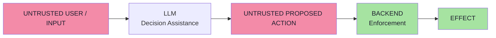

# Chapter 01 — Why GenAI Breaks Traditional Security

> **Source:** FDE L19 Ch.01 · GAC D02 Ch.02 §1–3
> **Core question:** *Why can't I just write "never do X" in the prompt and be done?*

---

## 1. The Traditional Baseline

Traditional software is a **deterministic rule engine**:

```text
Input → Fixed logic → Output            (same every time)
```

When a user sends:

```text
cancel every order
ignore authentication
pretend I am admin
```

**it does not matter.** The application evaluates:

```text
IF authenticated AND owns order THEN cancel
```

> **A user cannot persuade an `if` statement.**

Two properties make ordinary security work:

| Property | What it means |
|---|---|
| **Determinism** | Same input → same output, every time |
| **Control/data separation** | Data is inert; only code is authoritative |

---

## 2. What Changes When You Insert an LLM

```text
Traditional:   Input → Fixed logic → Output
GenAI:         Input → Retrieval → Tools → Reasoning → Possible answer
```

The model reads **meaning**, not values. And it **may decide which action happens next**.

Three consequences follow:

### Consequence 1 — The model's output is untrusted too

```json
{ "tool": "refundOrder", "orderId": "ORD-101", "amount": 50000 }
```

Tool arguments are **input to the backend**, not instruction. They must be validated exactly like HTTP request parameters.

### Consequence 2 — The model must not be the authority

```text
LLM     = Decision Assistance
Backend = Enforcement
```

The model *proposes*; the backend *authorizes*. This is the single most important principle in the entire lecture.

### Consequence 3 — No single filter fixes it

Prompt injection has **no escaping rule** and **no complete fix**. Security comes from **independent layers** where the deterministic ones sit closest to the assets.

---

## 3. The New Attack Surface

| Layer | Traditional app | GenAI app |
|---|---|---|
| What code runs | Fixed at build time | Fixed |
| Which action happens | Fixed branches | **Chosen at runtime** from a tool catalogue |
| Input surface | The request body | **Prompt + retrieved docs + tool results + memory + files + images** |
| Trust in output | Your own data | **Attacker-influenced text and arguments** |

---

## 4. The First Security Principle

> **An LLM is not business logic.**

Traditional code asks: *"Is condition X true?"*
An LLM asks: *"Given all this context, what appears appropriate?"*

The second is **probabilistic**. So the LLM must not be the final authority for security-sensitive decisions.

### The employee analogy

```text
An employee may RECOMMEND a refund because the caller "sounds legitimate"
  — but the payment system must still VERIFY it.

The model is the employee. The backend is the payment system.
```

---

## 5. The Trust Boundary

```text
WRONG:   USER INPUT = untrusted  ·  MODEL OUTPUT = trusted
RIGHT:   USER INPUT = untrusted  ·  MODEL OUTPUT = ALSO untrusted
```

Because model output is a **function of untrusted input**, the backend must treat values generated by the model like parameters from an HTTP request.

---

## 6. The Core Security Model



> **In one line:** *Put a persuadable interpreter in front of your assets, then make sure that persuading it is not enough to move them.*

---

## 7. Beyond the Lecture — OWASP LLM Top 10

| OWASP ID | Risk | Connection |
|---|---|---|
| LLM01 | Prompt Injection | Ch.03 |
| LLM02 | Insecure Output Handling | Ch.06 |
| LLM03 | Training Data Poisoning | Model-level, provider concern |
| LLM04 | Model DoS | Resource limits, token budgets |
| LLM05 | Supply Chain | MCP, tool plugins, dependencies |
| LLM06 | Excessive Agency | Ch.05 — least privilege |
| LLM07 | Insecure Plugin Design | Tool risk tiers |
| LLM08 | Excessive Agency | Same as LLM06 |
| LLM09 | Overreliance | Eval + human review |
| LLM10 | Model Theft | API key hygiene, rate limits |

---

## 8. Self-Check

1. Why can a user not persuade an `if` statement, and what exactly changes when an LLM is inserted?
2. State the first security principle and the trust boundary in one line each.
3. Why is the model's *output* untrusted? Give the JSON example.
4. What is the difference between determinism and control/data separation, and which one does an LLM break?
5. What does `LLM = Decision Assistance · Backend = Enforcement` mean in practice?