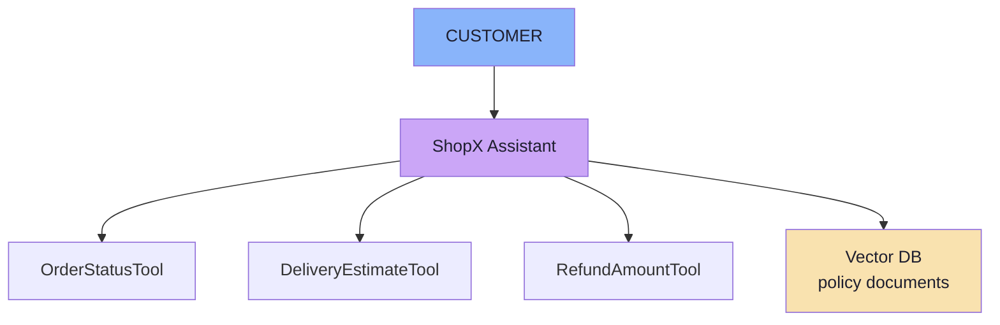
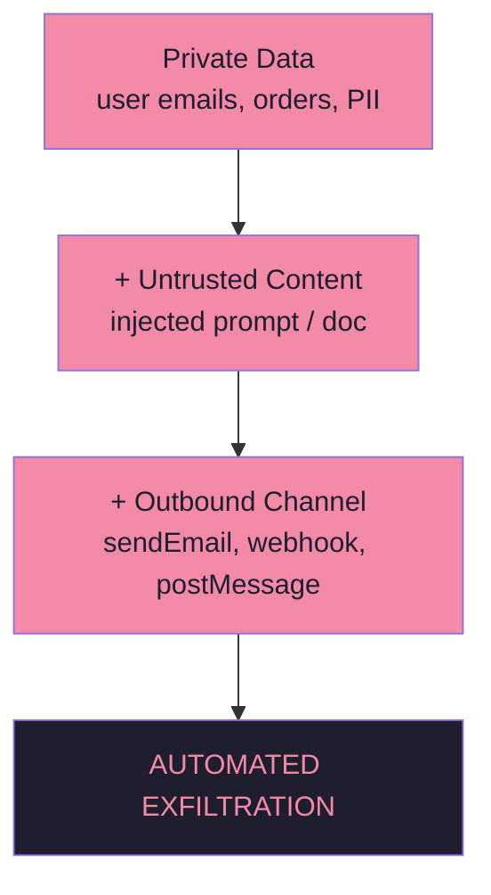

# Chapter 02 — Threat Modelling: Assets, Blast Radius & Trust Boundaries

> **Source:** FDE L19 Ch.02 · GAC D02 Ch.02 §4
> **Core question:** *What exactly does an attacker want, and what can reach it?*

---

## 1. The Order of Work

```text
1 · ASSETS        →  2 · REACHABILITY  →  3 · BLAST RADIUS  →  4 · CONTROLS
```

You cannot protect what you have not enumerated. You cannot enumerate reachability without knowing what is reachable. You cannot size the blast radius without knowing what can be reached. And you cannot choose controls without knowing the blast radius.

---

## 2. The Five Asset Classes

| # | Asset | Example | Key rule |
|---|---|---|---|
| **A** | **Confidential information** | Internal escalation policy, API endpoints, account flags in the system prompt | **Do not place secrets inside a system prompt.** A hidden prompt is not a strong security boundary |
| **B** | **Other users' data** | `getOrderStatus("ORD-879")` for someone else's order | **Never rely on the model to infer ownership** — the backend decides |
| **C** | **Powerful tools** | `cancelOrder`, `refundOrder`, `sendEmail`, `deleteAccount` | The LLM becomes an **indirect pathway into backend systems** |
| **D** | **Application behaviour** | "Act as an unrestricted financial expert" | Persona, scope, refusals and workflow order are assets |
| **E** | **Downstream systems** | Email sent, DB modified, meeting created, money moved | Real consequences; `sendEmail` is an **outbound channel** |

---

## 3. The Risk Equation

```text
Risk ≈ Model Manipulability × Tool Capability × Permission Level
```

```text
A manipulated chatbot may generate a bad answer.
A manipulated agent with payment permissions may execute a financial transaction.

Same model.  Very different blast radius.
```

> **It is a product, not a sum.** Any factor at zero → risk at zero. Any factor very high → risk very high.

---

## 4. Every Input Can Be Untrusted

```text
User prompt · RAG documents · Memory · Tool results
MCP resources · Web pages · PDFs · Emails · Images · OCR output
```

> **Refinement:** in multi-tenant systems, every retrieval query must carry a **tenant/ACL filter derived from the session** — the model never supplies the filter.

---

## 5. The ShopX Running Example

The lecture's board (from Lecture 18, reused here) shows the application architecture under attack:



This is the system the security lecture attacks. Every tool is a potential pathway.

---

## 6. Asset → Primary Control

| Asset | Primary control | Secondary |
|---|---|---|
| System prompt content | No secrets in the prompt; canary tokens | Versioned prompt, leakage detection |
| Other users' data | Ownership check in code, from the session | Tenant/ACL filter on retrieval |
| Powerful tools | Least privilege + capability routing | Risk tiers, narrow tools |
| Application behaviour | Instruction guardrails | Code enforcement of security-relevant rules |
| Downstream systems | Confirmation + limits + audit | Egress allowlist, idempotency |
| Money | Backend-derived amounts, thresholds | Dual control, step-up auth |
| Outbound channels | Recipient allowlist, DLP | Split reader/actor agents |

---

## 7. Beyond the Lecture — Blast Radius Thinking

| Question | Answer |
|---|---|
| What is the worst single action? | e.g. `refundOrder(ORD-X, 50000)` |
| How many users could be affected? | Multi-tenancy amplifies blast radius |
| Is there an outbound channel? | `sendEmail`, `postMessage`, webhook |
| Can the action be reversed? | Refund = reversible; deleteAccount = not |
| What is the detection time? | Minutes vs. days changes severity |

> **Rule of thumb:** classify tools by blast radius, not just by "read vs write."

---

## 8. Beyond the Lecture — The Lethal Trifecta

```text
Private data  +  Untrusted content  +  Outbound channel  ⇒  automated exfiltration
```



> **Remove any one leg** and the attack fails. This is the highest-leverage design insight in the lecture.

---

## 9. Beyond the Lecture — Attack Surface Enumeration

| Source | Example | Trust Level |
|---|---|---|
| User chat | Direct prompt injection | Untrusted |
| RAG / vector store | Poisoned document in corpus | Untrusted |
| Web fetch | Malicious page summarisation | Untrusted |
| Email / calendar | Instruction in email body | Untrusted |
| MCP resources | Compromised resource payload | Untrusted |
| MCP tool descriptions | Poisoned tool description | Untrusted |
| Tool results | Second-order injection | Untrusted |
| Memory / summaries | Stored injection persisting | Untrusted |
| Multi-agent messages | Cross-agent injection | Untrusted |
| Images / PDFs / OCR | Text hidden in pixels | Untrusted |

---

## 10. Self-Check

1. Name the five asset classes and one control for each.
2. Write the risk equation and explain why it is a product, not a sum.
3. Why must identity come from the session rather than a tool argument?
4. What is the "lethal trifecta," and which leg is easiest to remove?
5. In a multi-tenant RAG system, who supplies the tenant/ACL filter?