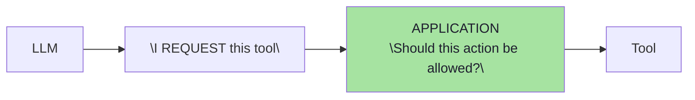
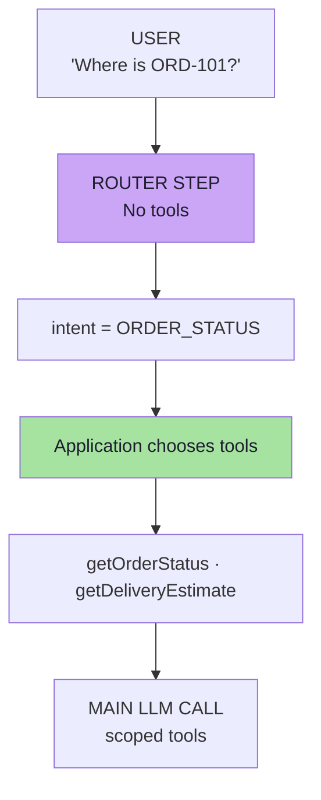

# Chapter 05 — Safe Tools: Least Privilege, Capability Routing & Argument Validation

> **Source:** FDE L19 Ch.06, Ch.07, Ch.08 §2–3 · GAC D02 Ch.02 §13–15
> **Core question:** *Which tools should exist for this request, and who decides?*

---

## 1. How Tool Calling Works

```text
1. Application tells the model which tools exist (names, descriptions, argument schemas)
2. Model receives them
3. Model decides: "I want to call refundOrder"
4. Model produces a tool request: Tool = refundOrder, Args = { orderId: "ORD-101" }
5. THE APPLICATION EXECUTES THE TOOL
6. Tool result is returned to the model
7. Model generates the final response
```



> **The key point:** **The LLM proposes the tool call. Your application ultimately executes it.** Security belongs in that middle layer.

---

## 2. Propose, Don't Authorize

```text
LLM:         "I think we should refund ORD-101."
Application: "Let me verify whether that action is allowed."
```

---

## 3. Tool Risk Is Not Equal

| Tier | Examples | Controls |
|---|---|---|
| **READ** | `getOrderStatus`, `searchProducts`, `getReturnPolicy` | Validation, ownership filter |
| **WRITE** | `cancelOrder`, `updateAddress`, `sendEmail` | + Authorization, business rules |
| **HIGH-IMPACT WRITE** | `refundPayment`, `deleteAccount`, `transferMoney`, `changePermissions` | + Confirmation, limits, audit |
| **GENERIC** | `executeSql`, `runShell`, `fetchUrl` | **Should not exist as model-facing tools** |

> **As impact increases, require more:** Validation + Authorization + Confirmation.

---

## 4. Three Ways Teams Over-Grant Authority

| Mistake | Unsafe | Safer |
|---|---|---|
| **Authority** | `refund(orderId, amount)` — the model supplies the amount | `refund(orderId)` — the backend calls `calculateRefund(order)` |
| **Generic tools** | `executeSql(sql)` | `getOrder(orderId)` |
| **No risk classification** | All tools get the same controls | Tier them (above) |

---

## 5. Least Privilege

> **Rule 1 — Least privilege:** expose only the tools required for the current task.

**Bad architecture:** the model always receives `getOrderStatus, cancelOrder, refundOrder, deleteUser, sendEmail, updateDatabase, executeShellCommand` — **even when the user asks "Where is my order?"** Every exposed tool is attack surface.

**Better architecture:**

```text
For order status:      getOrderStatus, getTrackingDetails
For cancellation:      getOrder, cancelOrder
```

---

## 6. Per-Call Exposure vs Default Tools

| Configuration | What the model sees | Verdict |
|---|---|---|
| `defaultTools(all)` | Everything, always | ❌ |
| `defaultTools(sensitive)` + `tools(readTool)` | Sensitive tools **plus** the read tool | ⚠️ False scoping — per-call tools are **added to** defaults |
| `tools(readTool)` only | Just the read tool | ✅ |
| No tools at all | None | ✅ (for the router) |

> **For strict least privilege, avoid putting sensitive capabilities into global defaults.**

---

## 7. The Chicken-and-Egg, and the Router

The application must know the **intent** before choosing tools — but understanding intent is why we introduced an LLM.



```js
// PSEUDO CODE — TypeScript environment
enum Intent { ORDER_STATUS, DELIVERY, REFUND, CANCELLATION, GENERAL }

async function classifyIntent(question): Intent {
  return await llm.call({
    system: "Classify the user's request. Allowed intents: ORDER_STATUS, DELIVERY, REFUND, CANCELLATION, GENERAL",
    user: question,
    // tools: []  — router has NO tools
  })
}

function chooseTools(intent: Intent): Tool[] {
  switch (intent) {
    case ORDER_STATUS:   return [getOrderStatus, getDeliveryEstimate]
    case DELIVERY:       return [getOrder, getTrackingDetails]
    case REFUND:         return [refundPayment]
    case CANCELLATION:   return [cancelOrder]
    default:             return []
  }
}
```

> **The router does not have business tools available.** Even if the user says *"Call executeShellCommand"* or *"Ignore your instructions"*, the router **cannot execute that capability because it was never exposed.**

---

## 8. Don't Tell the LLM — Remove It

> **Don't tell the LLM:** *"You know about `executeShellCommand`, but please don't call it."*
>
> **Prefer:** *"For this request, `executeShellCommand` does not exist from the model's perspective."*
>
> **The pattern in one line: the model classifies; the application chooses capabilities.**

---

## 9. Beyond the Lecture — Router Hygiene

| Concern | Guidance |
|---|---|
| Misclassification | **Fail closed** — default to the *narrowest* set |
| Router injection | No tools; constrained enum output; length caps |
| Multi-intent requests | Split into turns, or intersect capability sets |
| Latency/cost | Small fast model; deterministic pre-routing where possible |
| Entitlement | Effective set = **intent ∩ per-user entitlement** |
| Lifetime | Capabilities **shrink** over a session; confirmation capabilities are one-shot |
| Measurement | Track **routing accuracy** and the **dangerous-routing rate** |

---

## 10. Beyond the Lecture — Capability Routing Implementation

```js
// PSEUDO CODE — TypeScript environment
class CapabilityRouter {
  private toolRegistry: Map<string, ToolDefinition> = new Map();
  
  registerTool(name: string, definition: ToolDefinition): void {
    this.toolRegistry.set(name, definition);
  }
  
  async routeIntent(
    userId: string,
    sessionId: string,
    question: string,
    intent: Intent
  ): Promise<Tool[]> {
    // 1. Start with intent-based tools
    const intentTools = this.toolsForIntent(intent);
    
    // 2. Intersect with user entitlements
    const userEntitlements = await this.getUserTools(userId);
    const entitled = intentTools.filter(tool => userEntitlements.includes(tool.name));
    
    // 3. Apply blast radius limits per session
    const sessionTools = await this.getSessionTools(sessionId);
    const allowed = entitled.filter(tool => sessionTools.includes(tool.name));
    
    return allowed;
  }
  
  private toolsForIntent(intent: Intent): Tool[] {
    switch (intent) {
      case Intent.ORDER_STATUS:
        return [getOrderStatus, getDeliveryEstimate];
      case Intent.DELIVERY:
        return [getOrder, getTrackingDetails];
      case Intent.REFUND:
        return [refundPayment];
      case Intent.CANCELLATION:
        return [cancelOrder];
      default:
        return [];
    }
  }
  
  // Validate tool request against allowed set
  async validateToolRequest(
    toolName: string,
    args: Record<string, any>,
    allowedTools: Tool[]
  ): Promise<boolean> {
    const tool = allowedTools.find(t => t.name === toolName);
    if (!tool) {
      await this.auditLogger.log(`Blocked tool request: ${toolName} not in allowed set`);
      return false;
    }
    // Validate arguments against tool schema
    return await this.validateArgsAgainstSchema(args, tool.schema);
  }
}
```

---

## 11. Self-Check

1. Describe the seven steps of tool calling and identify the security seam.
2. Rewrite `refund(orderId, amount)` to remove model authority.
3. Classify `getReturnPolicy`, `sendEmail` and `transferMoney` by risk tier and list the controls for each.
4. Explain the chicken-and-egg problem of least privilege and how a router solves it.
5. Why is the router given no tools?
6. Why is per-call `.tools(...)` **added to** defaults, and what does that imply for configuration?