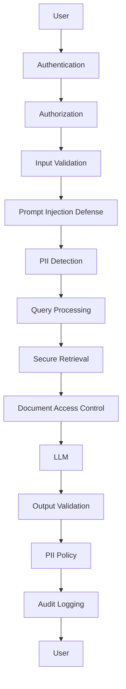

# Chapter 08 — PII Masking, Output Validation & Production Hardening

> **Source:** FDE L19 Ch.01 §5, Ch.09 §17–20 · GAC D02 Ch.02 §6–7 · GAC D05 Ch.05
> **Core question:** *Protect data in transit and at rest.*

---

## 1. PII Masking

PII means **Personally Identifiable Information** — data that can identify or help identify a person.

### Examples

```text
Email
Phone Number
Address
Government ID
Bank Account
Credit Card
Passport Number
Personal Name
```

### Why Mask Before the AI Pipeline?

Imagine:

```text
User
  ↓
API Gateway
  ↓
Load Balancer
  ↓
Application
  ↓
LLM
```

If the raw request contains:

```text
My phone number is 9876543210
```

that information may appear in:

```text
CDN logs
Load balancer logs
Application logs
APM traces
Error reports
Analytics
LLM observability tools
```

**Therefore:** never let raw PII cross system boundaries.

> **Rule of thumb:** If data could become a security incident, mask it early.

---

## 2. PII Masking Implementation

### Step 1 — Input Guardrails

```js
// PSEUDO CODE — TypeScript environment
function maskPII(text: string): MaskedResult {
  const piiMap: Record<string, string> = {}
  let sanitized = text

  // Email pattern
  sanitized = sanitized.replace(
    /\b[A-Za-z0-9._%+-]+@[A-Za-z0-9.-]+\.[A-Za-z]{2,}\b/g,
    (match) => {
      const token = `[EMAIL_${++emailCounter}]`
      piiMap[token] = match
      return token
    }
  )

  // Name pattern
  sanitized = sanitized.replace(
    /\b(John Doe|Jane Smith|Alice Johnson)\b/gi,
    (match) => {
      const token = `[NAME_${++nameCounter}]`
      piiMap[token] = match
      return token
    }
  )

  return { sanitized, piiMap }
}
```

### Step 2 — Store Mapping Securely

The mapping store should be:

* **Short-lived** where possible
* **Access controlled**
* **Encrypted**
* **Isolated from the LLM**
* **Unavailable to the model itself**

### Step 3 — Output Guardrails

```js
// PSEUDO CODE
function outputGuardrails(answer: string, piiMap: Record<string, string>): GuardrailResult {
  // First, restore PII that the user is authorized to see
  const unmasked = unmaskPII(answer, piiMap)

  // Then, validate the unmasked output
  if (containsForbiddenTerms(unmasked)) {
    return { allowed: false, answer: "Security violation" }
  }

  // Additional checks...
  if (isPII(unmasked) && !isUserAuthorized()) {
    return { allowed: false, answer: "PII leakage detected" }
  }

  return { allowed: true, answer: unmasked }
}
```

---

## 3. Output Guardrails

Input is not the only problem. The model might produce:

```text
❌ PII
❌ Hallucination
❌ Toxic content
❌ Internal system information
❌ Unauthorized data
❌ Prompt/system information
```

So:

```text
LLM
  ↓
Output Guardrails
  ↓
Final User Response
```

### Output PII Detection

Suppose the model generates:

```text
John's phone number is 9876543210.
```

The output guardrail can detect:

```text
PHONE_NUMBER
```

Then:

```text
John's phone number is [REDACTED].
```

Or, if tokenization was used:

```text
USER_8923
```

Can be safely mapped back to the user's own permitted identity.

---

## 4. CRAG / Groundedness Check

Connects with **CRAG** from previous sections. The output guardrail can ask:

> "Are the claims in this answer supported by the retrieved evidence?"

```text
Retrieved Context:
  "Premium users receive 30 days of support."

LLM:
  "Premium users receive 90 days of support."

Groundedness check:

❌ Unsupported claim
```

---

## 5. Production Security Architecture



### Important Production Rules

> **Don't think:** "Can I make my LLM safe with one guardrail?"

> **Think:**

```text
                  DEFENSE IN DEPTH

User
  ↓
Input Validation
  ↓
PII Protection
  ↓
Authentication
  ↓
Authorization
  ↓
Query Routing
  ↓
Retrieval Security
  ↓
Prompt Injection Defense
  ↓
LLM
  ↓
CRAG / Groundedness
  ↓
Output Safety
  ↓
PII Detection
  ↓
Final Response
```

Every layer assumes that another layer **can fail**.

---

## 6. Beyond the Lecture — Production Hardening Checklist

| Category | Hardening Measures |
|---|---|
| **Logging** | Never log raw PII; mask before logging; structured logging with PII filters |
| **Metrics** | Track PII detection rate; false positive/negative rates; guardrail latency |
| **Alerting** | Alert on PII leakage in production responses; alert on guardrail failures |
| **Recovery** | Automated redaction pipeline; rollback capability if guardrail misfires |
| **CI/CD** | Guardrail tests in pipeline; adversarial test cases; regression testing |
| **Observability** | End-to-end tracing of data flow; guardrail decision boundaries; exception monitoring |
| **Secrets Management** | Automated secret rotation; no secrets in prompts; encrypted storage |

---

## 7. Self-Check

1. Why should PII be masked before external services?
2. Explain the difference between masking and tokenization.
3. Why is output validation necessary?
4. How does CRAG help prevent hallucinations?
5. List three production hardeners you would implement.
6. Explain the "most important concept: trusted vs untrusted data."