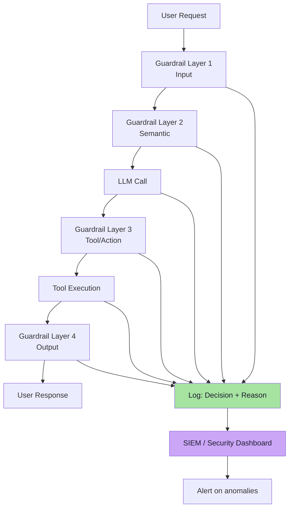
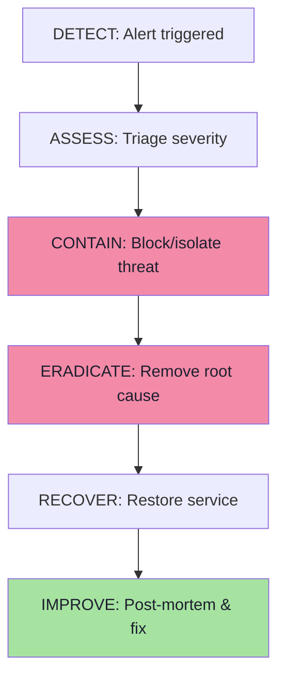

# Chapter 10 — Production Security Operations & Incident Response

> **Source:** FDE L19 Ch.09 · GAC D02 Ch.02 §19–20 · GAC D05 Ch.07
> **Core question:** *How do you operate and respond when security fails in production?*

---

## 1. Security Operations Mindset

Security is not a one-time setup. It requires continuous monitoring, detection, and response. Production AI agents face evolving threats, and you must be prepared.

```text
Prevent → Detect → Respond → Recover → Improve
```

---

## 2. Monitoring & Detection

### What to Monitor

| Area | What to Track | Why |
|---|---|---|
| **Guardrail decisions** | Allowed vs denied, reasons, layers triggered | Detect evasion attempts |
| **Tool executions** | Tool name, args, user, session, result | Detect unauthorized actions |
| **Confirmations** | Created, consumed, expired, revoked | Detect replay attacks |
| **PII detections** | Count, type, source, outcome | Detect data leakage |
| **Authentication** | Login attempts, failures, session anomalies | Detect credential abuse |
| **Authorization** | Access denied, privilege escalation attempts | Detect broken access control |
| **Rate limits** | Requests per user/IP/tool | Detect abuse and DoS |
| **Errors** | Guardrail failures, tool errors, timeouts | Detect system issues |

### Logging Strategy



### Structured Log Example

```json
{
  "timestamp": "2026-11-01T12:00:00Z",
  "requestId": "req-abc123",
  "userId": "USER-17",
  "sessionId": "sess-xyz789",
  "layer": "tool_action",
  "tool": "refundOrder",
  "args": { "orderId": "ORD-101", "amount": 50000 },
  "decision": "DENY",
  "reason": "amount_exceeds_order_value",
  "rule": "monetary_policy"
}
```

---

## 3. Alerting & Incident Triage

### Alert Severity Levels

| Severity | Example | Response Time | Notification |
|---|---|---|---|
| **P1 — Critical** | PII leakage, unauthorized fund transfer, full system compromise | < 15 minutes | On-call + incident commander |
| **P2 — High** | Guardrail bypass attempt, auth failure spike, tool argument tampering | < 1 hour | Security team + engineering lead |
| **P3 — Medium** | Rate limit approaching, false positive spike, minor PII detection | < 4 hours | Engineering team |
| **P4 — Low** | Individual denied request, configuration drift, log gap | < 24 hours | Weekly review |

### Alert Rules

```js
// PSEUDO CODE — TypeScript environment
class AlertRules {
  
  // PII leakage detected in production response
  async onPIILeakage(event: PIIEvent): Promise<void> {
    if (event.severity === 'HIGH' || event.type === 'CREDIT_CARD') {
      await this.notifyOnCall({
        severity: 'P1',
        title: 'PII leakage detected',
        description: `${event.type} leaked in response to ${event.userId}`,
        evidence: event.responseId
      })
    }
  }
  
  // Unauthorized tool execution attempt
  async onUnauthorizedTool(event: ToolEvent): Promise<void> {
    await this.notifySecurityTeam({
      severity: 'P2',
      title: 'Unauthorized tool attempt',
      description: `User ${event.userId} attempted ${event.tool} with args ${JSON.stringify(event.args)}`,
      evidence: event.requestId
    })
  }
  
  // Guardrail failure spike
  async onGuardrailFailure(event: GuardrailEvent): Promise<void> {
    const failureRate = await this.calculateFailureRate(event.timeWindow)
    if (failureRate > 0.05) {
      await this.notifyEngineering({
        severity: 'P2',
        title: 'Guardrail failure spike',
        description: `Failure rate is ${failureRate}% over last ${event.timeWindow}`,
        evidence: event.layer
      })
    }
  }
}
```

---

## 4. Incident Response Playbook

### Incident Response Lifecycle



### Phase 1 — Detect

- Automated alerts fire
- Security team acknowledges within SLA
- Initial triage: Is this real? What's the blast radius?

### Phase 2 — Assess

| Question | Answer Source |
|---|---|
| What happened? | Logs, guardrail decisions, tool execution records |
| Who is affected? | User IDs, sessions, affected orders/data |
| What's the blast radius? | Tool permissions, data access, downstream systems |
| Is it ongoing? | Active sessions, pending confirmations |
| What's the severity? | P1-P4 scale |

### Phase 3 — Contain

```text
1. Revoke affected sessions immediately
2. Block the attacking IP/user at the gateway
3. Disable the vulnerable tool if needed
4. Revoke pending confirmations for affected users
5. Enable emergency kill switch if widespread
```

### Phase 4 — Eradicate

```text
1. Patch the vulnerable code path
2. Add missing guardrails where absent
3. Rotate compromised credentials/API keys
4. Remove injected content from RAG stores/MCP resources
5. Re-validate all tool schemas and risk tiers
```

### Phase 5 — Recover

```text
1. Restore service gradually (canary deployment)
2. Verify guardrails are functioning
3. Confirm no residual injected content remains
4. Monitor closely for 24-48 hours
```

### Phase 6 — Improve (Post-Mortem)

| Question | Purpose |
|---|---|
| What was the root cause? | Fix the actual problem, not symptoms |
| Which controls failed? | Add missing layers |
| Why wasn't it detected sooner? | Improve monitoring/alerting |
| How long did response take? | Optimize incident response time |
| What would prevent recurrence? | Long-term remediation plan |

---

## 5. Kill Switch Design

### Kill Switch Capabilities

```text
1. Block all LLM calls (emergency stop)
2. Block specific tools (e.g., refundOrder, deleteAccount)
3. Block specific users/sessions
4. Block specific channels (e.g., MCP, web fetch)
5. Enable fail-closed mode for all guardrails
```

### Kill Switch Implementation

```js
// PSEUDO CODE — TypeScript environment
class KillSwitch {
  private switches: Map<string, boolean> = new Map()
  
  async activate(switchId: string, reason: string): Promise<void> {
    this.switches.set(switchId, true)
    await this.auditLogger.log(`Kill switch activated: ${switchId} — ${reason}`)
    await this.notifySecurityTeam({
      severity: 'P1',
      title: 'Kill switch activated',
      description: `${switchId}: ${reason}`
    })
  }
  
  async deactivate(switchId: string, reason: string): Promise<void> {
    this.switches.set(switchId, false)
    await this.auditLogger.log(`Kill switch deactivated: ${switchId} — ${reason}`)
  }
  
  isActive(switchId: string): boolean {
    return this.switches.get(switchId) ?? false
  }
  
  // Middleware integration
  async middleware(req: Request, next: NextFunction): Promise<Response> {
    if (this.isActive('ALL_LLM_CALLS')) {
      throw new Error('Service temporarily disabled')
    }
    if (this.isActive('TOOL_REFUND_ORDER')) {
      if (req.tool === 'refundOrder') {
        throw new Error('Refund tool disabled')
      }
    }
    return next()
  }
}
```

---

## 6. Audit & Compliance

### Audit Log Requirements

Every security-relevant action must be logged:

```
Actor (who) · Action (what) · Target (which resource) · Result (allow/deny) · Reason (why) · Timestamp · Request ID · Session ID
```

### Retention Policy

| Log Type | Retention | Purpose |
|---|---|---|
| Guardrail decisions | 90 days | Incident investigation |
| Tool executions | 1 year | Compliance, financial audit |
| Confirmations | 1 year | Dispute resolution |
| PII detections | 2 years | Data protection compliance |
| Authentication events | 1 year | Security monitoring |
| Kill switch activations | 3 years | Operational audit |

### Compliance Considerations

- **GDPR**: Right to be forgotten, data minimization, breach notification (72 hours)
- **PCI DSS**: No credit card numbers in logs, encryption in transit
- **SOC 2**: Access controls, change management, monitoring
- **HIPAA**: PHI protection, audit trails, breach notification

---

## 7. Production Security Checklist

### Pre-Deployment

```text
☐ All secrets stored in secure vault (not in prompts or code)
☐ All tools have risk tiers assigned
☐ Router has no tools (least privilege)
☐ Confirmation records implemented for high-impact actions
☐ Atomic conditional updates for all write operations
☐ Input guardrails on all entry points
☐ Output guardrails on all responses
☐ PII masking before LLM pipeline
☐ Logging configured for all security events
☐ Alert rules configured with severity levels
☐ Kill switch tested and operational
☐ Incident response playbook documented
☐ Red teaming completed and vulnerabilities fixed
☐ CI/CD includes adversarial test cases
```

### Ongoing Operations

```text
☐ Daily: Review guardrail denial logs
☐ Weekly: Review false positive/negative rates
☐ Monthly: Rotate API keys and credentials
☐ Quarterly: Red team exercise
☐ Annually: Full security audit and compliance review
```

---

## 8. Self-Check

1. What are the six phases of the incident response lifecycle?
2. What information must every audit log entry contain?
3. What are the five kill switch capabilities?
4. What is the difference between P1 and P2 severity alerts?
5. What three things must be in the pre-deployment security checklist?
6. How long should tool execution logs be retained?
7. What should happen when a P1 alert fires?
8. Why is post-mortem analysis important after an incident?

---

## 9. Beyond the Lecture — Incident Response Templates

### Incident Report Template

```text
INCIDENT REPORT
===============
ID:           INC-2026-11-01-001
Severity:     P1 — Critical
Detected:     2026-11-01T12:00:00Z
Resolved:     2026-11-01T14:30:00Z
Affected Users: USER-17, USER-42 (2 users)
Blast Radius:   $50,000 unauthorized refund attempt
Root Cause:   Missing amount validation on refundOrder tool
Fix:          Added range validation + derive amount from order value
Prevention:   CI adversarial test S04 added
Lessons:      Always validate tool args against trusted data
```

### Runbook: PII Leakage

```text
1. Detect: PII leakage alert fires
2. Contain: Block the response, revoke session
3. Assess: What PII was leaked? To whom? How many users?
4. Notify: Data protection officer if GDPR applies
5. Remediate: Fix the masking logic, redeploy
6. Monitor: Watch for similar patterns for 48 hours
```

### Runbook: Prompt Injection Detected

```text
1. Detect: Guardrail blocks injection attempt
2. Contain: Block the attacking user/IP
3. Assess: Was any tool executed? Was any data exfiltrated?
4. Remediate: Add the injection pattern to the detection rules
5. Monitor: Watch for similar evasion techniques
6. Improve: Add to adversarial test suite
```

---

## 10. Self-Check (Extended)

9. What should an incident report include?
10. What are the key steps in the PII leakage runbook?
11. How does the kill switch integrate with middleware?
12. What compliance frameworks might apply to your AI agent?