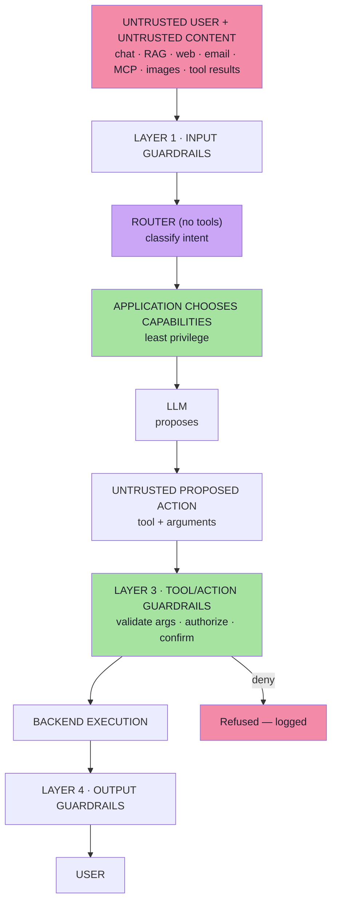
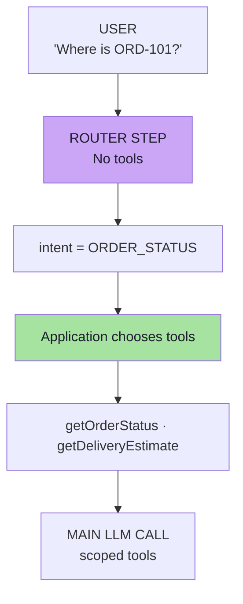
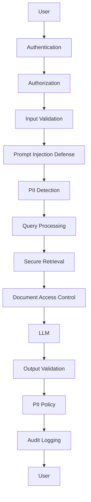
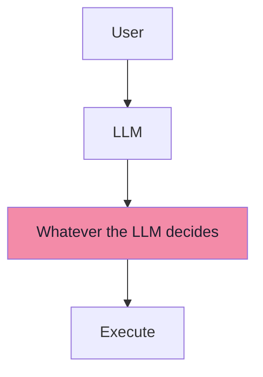
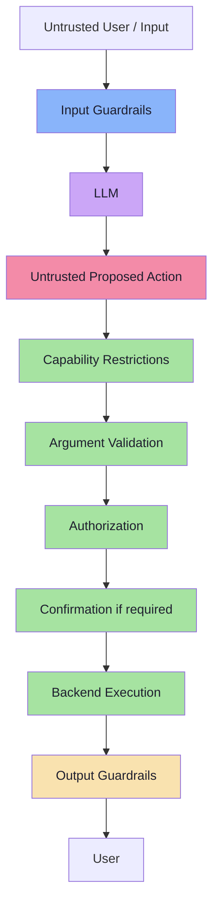

# Lecture 31 — Security & Guardrails: Complete Consolidated Notes

## The Whole Lecture on One Reference

> **This document is a synthesis, not a concatenation.** It keeps the load-bearing ideas, the decision tables and the architecture, and links to the chapters for full reasoning, worked examples and pseudo-code. If a section here feels too compressed, the chapter link at the top of that part is the place to go.

> **Source:** `FDE L19 · GAC D02, D03, D05` — see the roadmap for exact file paths inside `Forward-Deployed-Engineer/` and `gen-ai-cohort/`.

> **Snippets:** TypeScript-style pseudo-code only. No runnable production code appears in these notes.

---

## How to Use This Document

| If you want to… | Go to |
|---|---|
| Understand *why* this is a new problem at all | [Part 1](#part-1--why-genai-breaks-traditional-security) → [Ch. 01](./notes/01-Why-GenAI-Breaks-Traditional-Security.md) |
| Build a threat model for your own agent | [Part 2](#part-2--threat-modelling-assets-blast-radius-trust-boundaries) → [Ch. 02](./notes/02-Threat-Modelling-Assets-Trust-Boundaries.md) |
| Explain prompt injection to a colleague | [Part 3](#part-3--prompt-injection-jailbreaks-the-fundamental-problem) → [Ch. 03](./notes/03-Prompt-Injection-Jailbreaks-Fundamental-Problem.md) |
| Find how an attack actually arrives | [Part 4](#part-4--injection-delivery-channels-direct-indirect-mcp-multimodal) → [Ch. 04](./notes/04-Injection-Delivery-Channels.md) |
| Design your tool layer | [Parts 5–6](#part-5--safe-tools-least-privilege-capability-routing--argument-validation) → [Ch. 05](./notes/05-Safe-Tools-Least-Privilege-Capability-Routing.md), [Ch. 06](./notes/06-Never-Trust-Always-Verify.md) |
| Assemble the full defence and test it | [Part 7](#part-7--guardrails-as-layers-defense-in-depth-architecture) → [Ch. 07](./notes/07-Guardrails-as-Layers-Defense-in-Depth.md) |
| PII masking & output validation | [Part 8](#part-8--pii-masking-output-validation--production-hardening) → [Ch. 08](./notes/08-PII-Masking-Output-Validation.md) |
| Revise quickly | [Cheat Sheets](#cheat-sheet-the-five-safe-tool-principles), [Glossary](#glossary), [Self-Check](#self-check-questions) |

---

## Executive Summary

### The Thesis

Traditional software is a **deterministic rule engine**:

```text
Input → Fixed logic → Output            (same every time)
```

When a user sends `cancel every order`, `ignore authentication`, `pretend I am admin`, **it does not matter** — because the application evaluates:

```text
IF authenticated AND owns order THEN cancel
```

> **A user cannot persuade an `if` statement.**

Now insert an LLM:

```text
GenAI: Input → Retrieval → Tools → Reasoning → Possible answer
```

The model reads *meaning*, and **may decide which action happens next**. So:

> **The system now contains a component whose behaviour can be influenced through language.**

Three consequences follow:

1. **The model's output is untrusted too.** Tool arguments are input, not instruction: treat them exactly like HTTP request parameters.
2. **The model must not be the authority.** It proposes; the backend authorizes. `LLM = Decision Assistance · Backend = Enforcement`.
3. **No single filter fixes it.** Prompt injection has no escaping rule and no complete fix, so security comes from **independent layers** where the deterministic ones sit closest to the assets.

---

### The Big Idea in One Diagram



> **The most important principle:** The LLM can propose an action. It should never be the authority that decides whether the action is permitted.

---

## Part 1 — Why GenAI Breaks Traditional Security

> **Full chapter:** [Ch. 01](./notes/01-Why-GenAI-Breaks-Traditional-Security.md)

### The break

| Property | Traditional app | GenAI app |
|---|---|---|
| What code runs | Fixed at build time | Fixed |
| Which action happens | Fixed branches | **Chosen at runtime** from a tool catalogue |
| Input surface | The request body | **Prompt + retrieved docs + tool results + memory + files + images** |
| Trust in output | Your own data | **Attacker-influenced text and arguments** |

### First security principle

> **An LLM is not business logic.**

Traditional code asks: *"Is condition X true?"*
An LLM asks: *"Given all this context, what appears appropriate?"*

The second is **probabilistic**, so the LLM must not be the final authority for security-sensitive decisions.

### The trust boundary

```text
WRONG:   USER INPUT = untrusted  ·  MODEL OUTPUT = trusted
RIGHT:   USER INPUT = untrusted  ·  MODEL OUTPUT = ALSO untrusted
```

### Core model

```text
LLM     = Decision Assistance
Backend = Enforcement
```

---

## Part 2 — Threat Modelling: Assets, Blast Radius & Trust Boundaries

> **Full chapter:** [Ch. 02](./notes/02-Threat-Modelling-Assets-Trust-Boundaries.md)

### Order of work

```text
1 · ASSETS        →  2 · REACHABILITY  →  3 · BLAST RADIUS  →  4 · CONTROLS
```

### The five asset classes

| # | Asset | Example | Key rule |
|---|---|---|---|
| **A** | **Confidential information** | System prompt secrets | **Do not place secrets inside a system prompt** |
| **B** | **Other users' data** | `getOrderStatus("ORD-879")` | **Never rely on the model to infer ownership** — the backend decides |
| **C** | **Powerful tools** | `cancelOrder`, `refundOrder`, `sendEmail`, `deleteAccount` | The LLM becomes an **indirect pathway into backend systems** |
| **D** | **Application behaviour** | "Act as an unrestricted financial expert" | Persona, scope, refusals and workflow order are assets |
| **E** | **Downstream systems** | Email sent, DB modified, money moved | `sendEmail` is an **outbound channel** |

### The risk equation

```text
Risk ≈ Model Manipulability × Tool Capability × Permission Level
```

> **It is a product, not a sum.** Any factor at zero → risk at zero. Any factor very high → risk very high.

---

## Part 3 — Prompt Injection & Jailbreaks: The Fundamental Problem

> **Full chapter:** [Ch. 03](./notes/03-Prompt-Injection-Jailbreaks-Fundamental-Problem.md)

### The separation — and the break

```text
Traditional software keeps INSTRUCTIONS and DATA apart
   — by mechanism: the CPU, the DB driver, the escaping function.

The LLM receives both in ONE flat, plain-text context
   — separated only by the model's inference.
```

### Jailbreak vs prompt injection

| | **Jailbreak** | **Prompt injection** |
|---|---|---|
| Target | The **model's** behavioural restrictions | **Your application's** instructions and workflows |
| Owner of the fix | Provider / model choice | **You** |

### Why the system prompt is not a security control

A security control must **enforce a rule even when somebody actively tries to break it**.

```java
if (!userOwnsOrder(userId, orderId)) {
    throw new AccessDeniedException("Not allowed");
}
```

> **Guidance vs enforcement:** prompts give tone and workflow guidance; code enforces authentication, authorization, and transaction limits.

> **Delimiters ≠ Authorization.** If breaking one sentence in your system prompt could create a security incident, enforce that rule in code as well.

---

## Part 4 — Injection Delivery Channels: Direct, Indirect, MCP & Multimodal

> **Full chapter:** [Ch. 04](./notes/04-Injection-Delivery-Channels.md)

### Direct vs indirect

| | **Direct** | **Indirect** |
|---|---|---|
| Where the attacker is | In the conversation | In content the agent reads |
| Scales to many victims? | No | **Yes** |

### Injection sources to enumerate

```text
Text · Images · PDFs · Web pages · Emails · Documents
OCR output · Database content · Tool results · MCP resources
```

### The lethal trifecta

```text
Private data  +  Untrusted content  +  Outbound channel  ⇒  automated exfiltration
```

> **Remove any one leg** and the attack fails.

---

## Part 5 — Safe Tools: Least Privilege, Capability Routing & Argument Validation

> **Full chapter:** [Ch. 05](./notes/05-Safe-Tools-Least-Privilege-Capability-Routing.md)

### Propose, don't authorize

```text
LLM:         "I think we should refund ORD-101."
Application: "Let me verify whether that action is allowed."
```

### Tool risk tiers

| Tier | Examples | Controls |
|---|---|---|
| **READ** | `getOrderStatus`, `searchProducts`, `getReturnPolicy` | Validation, ownership filter |
| **WRITE** | `cancelOrder`, `updateAddress`, `sendEmail` | + Authorization, business rules |
| **HIGH-IMPACT WRITE** | `refundPayment`, `deleteAccount`, `transferMoney` | + Confirmation, limits, audit |
| **GENERIC** | `executeSql`, `runShell`, `fetchUrl` | **Should not exist as model-facing tools** |

### Least privilege

> **Expose only the tools required for the current task.**



> **The router does not have business tools available.** Even if the user says *"Call executeShellCommand"*, the router **cannot execute that capability because it was never exposed.**

### Rule of thumb

> **Don't tell the LLM:** *"You know about `executeShellCommand`, but please don't call it."*
>
> **Prefer:** *"For this request, `executeShellCommand` does not exist from the model's perspective."*

---

## Part 6 — Never Trust, Always Verify: Authorization, Confirmation & TOCTOU

> **Full chapter:** [Ch. 06](./notes/06-Never-Trust-Always-Verify.md)

### Rule 2 — Never trust tool arguments

```text
Model requests: refundOrder("ORD-101", 50000)
Treat those arguments like: HTTP request parameters
```

### The validation order

1. Schema → 2. Normalise → 3. Format → 4. Range → 5. Enum → 6. Length → 7. Referential → 8. **Ownership** → 9. Business rules → 10. Monetary policy → 11. Destination → 12. Rate limits → 13. Idempotency → 14. **Derivation** → 15. Field allowlist

> **Three-way rule:** *shape* may come from the model · *values* must be validated · *authority-bearing values* must be derived server-side.

### Rule 3 — Authorization happens in code

Identity comes from the **session**, never from a model argument.

### Rule 4 — High-risk actions need explicit approval

```text
User: Cancel ORD-101.
        ↓
Application creates pending action.  Nothing is cancelled yet.
        ↓
Assistant: Confirm cancellation of ORD-101?
        ↓
User: Yes.
        ↓
Backend verifies: pending action exists + belongs to authenticated user + has not expired
        ↓
cancelOrder()
```

> **The rule:** *a conversational claim is data. A stored confirmation record is a fact.*

### TOCTOU

Never check-then-act without a transaction. Use atomic conditional updates.

---

## Part 7 — Guardrails as Layers: Defense-in-Depth Architecture

> **Full chapter:** [Ch. 07](./notes/07-Guardrails-as-Layers-Defense-in-Depth.md)

### The misconception

```text
User → Prompt Injection Detector → Safe Application      ❌ does not exist
```

### The full architecture

| Layer | Position | Nature |
|---|---|---|
| **1 · Input guardrails** | Before the model | Deterministic-first |
| **1b · Semantic classifier** | Before the model | Probabilistic |
| **2 · Instruction guardrails** | In the prompt | Guidance |
| **3 · Tool/action guardrails** | Model → tool | **Deterministic** |
| **4 · Output guardrails** | Model → user | Mixed |

### Moderation ≠ Prompt injection protection

Moderation asks *is this content disallowed?* Injection detection asks *is this content trying to manipulate instructions?* Both solve different problems.

### Fail closed

> **Fail closed** on high-impact paths. **Measure** TPR/FNR/FPR, latency and cost. **Log** every decision with a reason.

---

## Part 8 — PII Masking, Output Validation & Production Hardening

> **Full chapter:** [Ch. 08](./notes/08-PII-Masking-Output-Validation.md)

### Why mask before the AI pipeline

Raw PII can leak into CDN logs, load balancer logs, APM traces, error reports, analytics, and LLM observability tools.

```text
User → PII Detection → Mask → Logs + RAG + LLM
```

### Output guardrails

The model might produce PII, hallucination, toxic content, internal system information, unauthorized data, or prompt/system information.

### Production security architecture



> Every layer assumes that another layer **can fail**.

---

## Cheat Sheet: The Five Safe Tool Principles

| # | Principle | Implementation | Chapter |
|---|---|---|---|
| 1 | **Least privilege** | Per-request capability sets; router with no tools; empty defaults | 05 |
| 2 | **Never trust model-generated arguments** | Schema + normalise + range + derive authority-bearing values | 06 |
| 3 | **Authorization belongs in code** | `owns(actorFromSession, target)` in the service | 06 |
| 4 | **Explicit approval for high-impact actions** | Stored pending action with `argsHash`, expiry, single use | 06 |
| 5 | **Narrow tools over generic powerful tools** | No `sql`/`command`/`url` parameters in tool schemas | 05 |

---

## Cheat Sheet: Asset → Control

| Asset | Primary control | Secondary |
|---|---|---|
| System prompt content | No secrets in the prompt; canary tokens | Versioned prompt, leakage detection |
| Other users' data | Ownership check in code, from the session | Tenant/ACL filter on retrieval |
| Powerful tools | Least privilege + capability routing | Risk tiers, narrow tools |
| Application behaviour | Instruction guardrails | Code enforcement of security-relevant rules |
| Downstream systems | Confirmation + limits + audit | Egress allowlist, idempotency |
| Money | Backend-derived amounts, thresholds | Dual control, step-up auth |
| Outbound channels | Recipient allowlist, DLP | Split reader/actor agents |

---

## Cheat Sheet: Channel → Defence

| Channel | Defence |
|---|---|
| User chat | Input guardrails + code enforcement |
| RAG / vector store | Ingestion review, provenance, treat as data, ACL filters |
| Web fetch | Domain allowlist, strip instructions, no privileged path |
| Email / calendar | Separate reader from actor, confirm destructive actions |
| MCP resources | Treat as **data**, pin and allowlist servers |
| MCP tool descriptions | Review, pin, namespace |
| PDFs / images / OCR | Extract → display → validate; never auto-act |
| Tool results | Treat as untrusted input (second-order injection) |
| Memory / summaries | Store facts, not instructions; re-validate |
| Multi-agent messages | Trust boundary between agents; intersection of privileges |

---

## Cheat Sheet: Tool Risk Tiers

| Tier | Examples | Required controls |
|---|---|---|
| READ | `getOrderStatus`, `searchProducts`, `getReturnPolicy` | Validate args, ownership filter, rate limit |
| WRITE | `cancelOrder`, `updateAddress`, `sendEmail` | + Authorize, business rules, idempotency |
| HIGH-IMPACT WRITE | `refundPayment`, `deleteAccount`, `transferMoney` | + Confirmation, limits, audit, maybe approval queue |
| GENERIC | `executeSql`, `runShell`, `fetchUrl` | **Should not exist as model-facing tools** |

---

## Cheat Sheet: Argument Validation Order

```text
1 · schema          2 · normalise       3 · format/pattern
4 · range           5 · enum            6 · length
7 · referential     8 · OWNERSHIP       9 · business rules
10 · money policy   11 · destination    12 · rate/velocity
13 · idempotency    14 · DERIVE         15 · field allowlist
```

---

## Cheat Sheet: Confirmation Record

```text
actorId · sessionId · action · target · argsHash
createdAt · expiresAt · consumedAt (single use) · nonce
```

| Missing field | Attack it enables |
|---|---|
| `actorId` | Confirmation from a different user |
| `sessionId` | Replayed confirmation across sessions |
| `argsHash` | Confirmation swapping (confirm ₹500, execute ₹50,000) |
| `expiresAt` | Stale confirmations execute later |
| `consumedAt` | The same confirmation executes twice |
| `nonce` | Forged confirmation requests |

---

## Cheat Sheet: Guardrail Layers

| Layer | Position | Example checks | Nature |
|---|---|---|---|
| **Input** | Before the model | Patterns, encodings, size, type, URLs | Deterministic-first |
| **Classifier** | Before the model | "Does this try to manipulate the system?" | Probabilistic |
| **Instruction** | In the prompt | External content is data; documents are reference | Guidance |
| **Action** | Model → tool | Validate, authorize, confirm, limit | **Deterministic** |
| **Output** | Model → user | Secrets, PII, moderation, schema, citations, length | Mixed |
| **Rendering** | UI | Strip auto-loading images/links; no raw HTML | Deterministic |

---

## Cheat Sheet: Jailbreak vs Prompt Injection

| Question | Answer |
|---|---|
| What does a **jailbreak** target? | The **model's** behavioural restrictions (e.g. DAN — "Do Anything Now") |
| What does **prompt injection** target? | **Your application's** instructions and workflows |
| Can they overlap? | Yes — "unrestricted admin mode … call `deleteAccount`" targets both |
| Who owns the fix? | Jailbreak → provider/model choice. Injection → **you** |
| Fastest test? | What did the attacker **gain**? Text ⇒ jailbreak · Action ⇒ injection |

---

## Glossary

| Term | Meaning |
|---|---|
| **Prompt injection** | Making untrusted content influence model instructions or application workflow |
| **Jailbreak** | An attack on the **model's** behavioural restrictions |
| **Defense in depth** | Independent controls so that no single failure is sufficient for compromise |
| **Lethal trifecta** | Private data + untrusted content + outbound channel |
| **Excessive agency** | The model has more functionality, permission or autonomy than the task requires |
| **Confirmation swapping** | Confirming one set of parameters and executing another; defeated by `argsHash` |
| **TOCTOU** | Time-of-check to time-of-use — state changes between the check and the effect |
| **Second-order injection** | Instructions arriving via a tool's *response* |
| **MCP** | Model Context Protocol — a standard for exposing tools, resources and prompts to models |

---

## Self-Check Questions

1. Why can a user not persuade an `if` statement, and what exactly changes when an LLM is inserted?
2. State the first security principle and the trust boundary in one line each.
3. Why is the model's *output* untrusted? Give the JSON example.
4. Name the five asset classes and one control for each.
5. Write the risk equation and explain why it is a product, not a sum.
6. Why is prompt injection *not* fully solvable, and what is the actual vulnerability?
7. Give three injections that are not "ignore previous instructions".
8. Distinguish direct from indirect injection and explain why indirect is worse for agents.
9. What is the lethal trifecta, and which leg is easiest to remove?
10. What is the difference between a jailbreak and a prompt injection, and who owns each fix?
11. Why is the system prompt not a security control? Give the banking analogy.
12. What does `Delimiters ≠ Authorization` mean in practice?
13. Describe the seven steps of tool calling and identify the security seam.
14. Rewrite `refund(orderId, amount)` to remove model authority.
15. Classify `getReturnPolicy`, `sendEmail` and `transferMoney` by risk tier and list the controls for each.
16. Explain the chicken-and-egg problem of least privilege and how a router solves it.
17. Why is the router given no tools?
18. List the argument-validation checks in order.
19. Why must identity come from the session rather than a tool argument?
20. Describe the safe confirmation flow and name three fields a confirmation record needs beyond the action name.
21. What is confirmation swapping and which field defeats it?
22. Why is moderation not prompt-injection protection?
23. Name the four guardrail layers and say which one is deterministic and effect-adjacent.
24. What does it mean to "fail closed", and where must you fail closed?

---

## The Final Mental Model

**Do not design an AI agent like this:**



**Design it like this:**



> **And when dealing with system prompts:**
> ```text
> If violating a sentence in your prompt could create a security incident,
> enforce that rule in code as well.
> ```

**In one line:** *Put a persuadable interpreter in front of your assets, then make sure that persuading it is not enough to move them.*

---

## Chapter Index

| # | Chapter |
|---|---|
| [01](./notes/01-Why-GenAI-Breaks-Traditional-Security.md) | Why GenAI Applications Create a New Security Problem |
| [02](./notes/02-Threat-Modelling-Assets-Trust-Boundaries.md) | Threat Modelling — Assets, Blast Radius and Trust Boundaries |
| [03](./notes/03-Prompt-Injection-Jailbreaks-Fundamental-Problem.md) | Prompt Injection — The Fundamental Problem |
| [04](./notes/04-Injection-Delivery-Channels.md) | Injection Delivery Channels — Direct, Indirect, MCP and Multimodal |
| [05](./notes/05-Safe-Tools-Least-Privilege-Capability-Routing.md) | Safe Tools — Least Privilege, Capability Routing & Argument Validation |
| [06](./notes/06-Never-Trust-Always-Verify.md) | Never Trust, Always Verify — Authorization, Confirmation & TOCTOU |
| [07](./notes/07-Guardrails-as-Layers-Defense-in-Depth.md) | Guardrails as Layers — Defense-in-Depth Architecture |
| [08](./notes/08-PII-Masking-Output-Validation.md) | PII Masking, Output Validation & Production Hardening |

---

**Sources:** `FDE L19 · GAC D02, D03, D05` — see `roadmap.md` for exact file paths inside `Forward-Deployed-Engineer/` and `gen-ai-cohort/`.