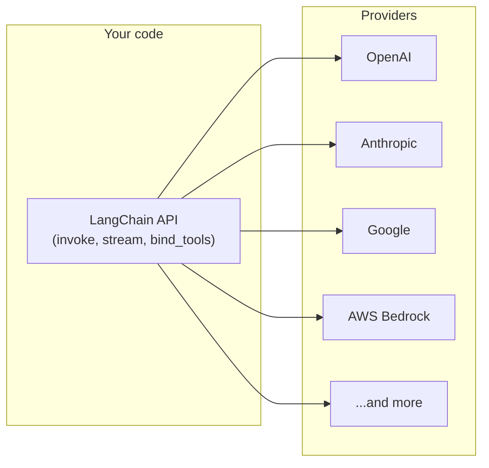

# 01 — LangChain provider delivery in TypeScript / JavaScript

**Source:** [LangChain.js — Providers and models](https://docs.langchain.com/oss/javascript/concepts/providers-and-models.md) · [Component architecture](https://docs.langchain.com/oss/javascript/langchain/component-architecture.md)

---

## The core idea

LangChain gives you **a single, unified API to work with models from any provider**. You install a provider package, pick a model name, and start building — the same code works whether you use OpenAI, Anthropic, Google, AWS Bedrock, or a router such as OpenRouter.



This means you can **swap providers without rewriting application logic**, compare models side-by-side with identical code, and use advanced features (tool calling, structured output, streaming) across all providers.

---

## Provider packages

Each provider ships a dedicated integration package with its own versioning:

```bash
npm install @langchain/openai       # OpenAI models
npm install @langchain/anthropic    # Anthropic models
npm install @langchain/google       # Google (Gemini) models
npm install langchain               # meta-package + initChatModel
npm install zod                     # schemas for structured output
```

Automatic API-key handling is done through environment variables, e.g. `OPENAI_API_KEY`, `ANTHROPIC_API_KEY`, `GEMINI_API_KEY`.

---

## Two ways to specify a model

### A) Provider-prefix format (recommended, via `initChatModel`)

```typescript
import { initChatModel } from "langchain/chat_models/universal";

const openaiModel   = await initChatModel("openai:gpt-5.5");
const anthropicModel = await initChatModel("anthropic:claude-opus-4-8");
const googleModel   = await initChatModel("google:gemini-3.1-pro-preview");

for (const model of [openaiModel, anthropicModel, googleModel]) {
    const response = await model.invoke("Explain quantum computing in one sentence.");
    console.log(response.text);
}
```

New model names work immediately as long as the provider package version supports the API version the model requires — in most cases releases are backward-compatible and need no package update.

### B) Direct class instantiation

```typescript
import { ChatOpenAI } from "@langchain/openai";

const model = new ChatOpenAI({
    configuration: { baseURL: "https://your-provider.com/v1" },
    apiKey: "your-api-key",
    model: "provider-model-name",
});
```

> `ChatOpenAI` targets the official OpenAI API spec only. Non-standard response fields from third-party providers are not extracted. Use a dedicated provider package or a router when you need non-standard features.

---

## Routers / proxies

Routers (gateways) give access to many providers through a single API key and credential — useful for unified billing, dynamic model switching, and automatic fallbacks:

```typescript
import { initChatModel } from "langchain/chat_models/universal";

const model = await initChatModel("openrouter:anthropic/claude-sonnet-4-6");
const response = await model.invoke("Hello!");
```

| Provider | Integration | Description |
|----------|-------------|-------------|
| OpenRouter | `ChatOpenRouter` | Unified access to OpenAI, Anthropic, Google, Meta, and more |

---

## What every chat model exposes

Regardless of provider, every LangChain chat model implements the same interface:

| Capability | What it does |
|------------|--------------|
| `invoke(input)` | Single call, wait for the full response |
| `stream(input)` | Token-by-token streaming |
| `batch(inputs)` | Run multiple inputs concurrently |
| `bindTools(tools)` | Declare tools the model can call |
| `withStructuredOutput(schema)` | Force structured (Zod/JSON Schema) output |

---

## Minimal runnable example (providers.ts)

```typescript
import { initChatModel } from "langchain/chat_models/universal";

async function main() {
    const model = await initChatModel("openai:gpt-5.5");

    // 1. Simple invoke
    const reply = await model.invoke("What is LangChain in one sentence?");
    console.log("Reply:", reply.text);

    // 2. Streaming
    console.log("\nStream:");
    for await (const chunk of await model.stream("Count to five.")) {
        process.stdout.write(chunk.text ?? "");
    }
    console.log("\n");
}

main().catch(console.error);
```

Run with:

```bash
export OPENAI_API_KEY="sk-..."
npx tsx src/providers.ts
```

---

## Key takeaways

- **One API, many providers** — swap providers without rewriting app logic.
- **Provider prefix** `"provider:model"` via `initChatModel` is the portable way.
- **Provider packages** (`@langchain/openai`, …) give provider-specific features.
- **Environment variables** handle API keys automatically.
- All providers share `invoke` / `stream` / `bindTools` / `withStructuredOutput`.
