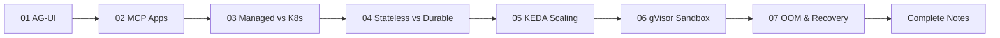

# Lecture 37 — Chapter Index

**Agent-to-User UIs (`AG-UI`, `MCP Apps`), Kubernetes & KEDA Scaling**
Phase 8 · Multimodality, Full-Stack Apps & Agent Scaling · 🔴 Expert · **7 chapters**

> Source of truth for topics, goal, build task and gate: **[../roadmap-v1.md](../roadmap-v1.md)** → *"Lecture 37"*.
> Source mapping: `FDE S22 & S23`.

---

## 📚 Chapters

| # | Chapter | One-line summary | File |
| :---: | :--- | :--- | :--- |
| 01 | **Agent-to-User Interaction (`AG-UI` Protocol)** | Structured SSE event streams for step progress, tool calls, HITL approvals, and errors | [01_Agent_to_User_Interaction_AG_UI_Protocol.md](./notes/01_Agent_to_User_Interaction_AG_UI_Protocol.md) |
| 02 | **MCP Apps: Interactive UI inside MCP Hosts** | Returning sandboxed `ui://` interactive widgets from MCP tool outputs with `postMessage` | [02_MCP_Apps_Interactive_UI_inside_MCP_Hosts.md](./notes/02_MCP_Apps_Interactive_UI_inside_MCP_Hosts.md) |
| 03 | **Managed vs. Self-Hosted Agent Runtimes** | Comparing Cloudflare Agents/Modal/Inngest vs. self-hosted Kubernetes on VPC & TCO | [03_Managed_vs_Self_Hosted_Agent_Runtimes.md](./notes/03_Managed_vs_Self_Hosted_Agent_Runtimes.md) |
| 04 | **Stateless API Services vs. Durable Worker State** | Decoupling HTTP/SSE ingress from queue-backed agent workers with Postgres checkpoints | [04_Stateless_API_Services_vs_Durable_Worker_State.md](./notes/04_Stateless_API_Services_vs_Durable_Worker_State.md) |
| 05 | **Kubernetes Pods, Queues & KEDA Autoscaling** | Scaling I/O-bound agent workers on Redis/SQS queue depth via KEDA `ScaledObject` | [05_Kubernetes_Pods_Queues_and_KEDA_Autoscaling.md](./notes/05_Kubernetes_Pods_Queues_and_KEDA_Autoscaling.md) |
| 06 | **Safe Code Execution & Sandbox Isolation** | `gVisor` / Firecracker microVMs, pod `securityContext` hardening, and `NetworkPolicy` | [06_Safe_Code_Execution_and_Sandbox_Isolation.md](./notes/06_Safe_Code_Execution_and_Sandbox_Isolation.md) |
| 07 | **Resource Limits, OOM Protection & Crash Recovery** | Pod CPU/RAM `limits`, graceful `SIGTERM` checkpointing, and visibility-timeout recovery | [07_Resource_Limits_OOM_Protection_and_Crash_Recovery.md](./notes/07_Resource_Limits_OOM_Protection_and_Crash_Recovery.md) |

---

## 📄 Complete notes

A single consolidated document with the executive summary, architecture diagram, cheat sheet, and self-check questions:

👉 **[Lecture_37_Complete_Notes.md](./notes/Lecture_37_Complete_Notes.md)**

---

## 🔗 Related

- **[./code/Basic Code](./code/Basic%20Code)** — runnable TypeScript `AG-UI` SSE streamer + KEDA scaler + isolated sandbox runner + K8s/KEDA YAML manifests, release-gate tests, and chapter-wise `implementations guide/`
- **[./Assignment/task.md](./Assignment/task.md)** — hands-on assignment & release gate checklist
- **[./README.md](./README.md)** — lecture objectives, phase, level, source mapping and checklist
- **[../roadmap-v1.md](../roadmap-v1.md)** — complete topic list, goal, build task and completion gate

---

## 🧭 Reading order

