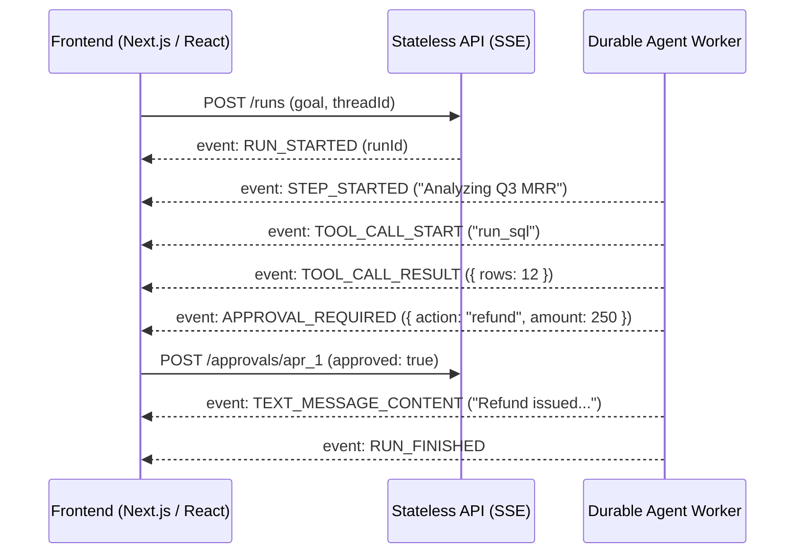
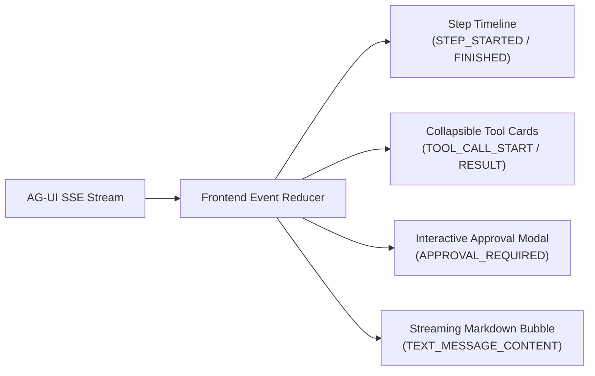

# Chapter 01 — Agent-to-User Interaction (`AG-UI` Protocol)

> **Lecture 37 · Chapter 01 of 07** · Level: 🔴 Expert · Phase 8 — Multimodality, Full-Stack Apps & Agent Scaling
> **Source:** `FDE S22` · **Roadmap Reference:** [`roadmap-v1.md`](../../roadmap-v1.md#lecture-37--agent-to-user-uis-ag-ui-mcp-apps-kubernetes--keda-scaling)
> **External Reference:** [AG-UI Protocol Specification](https://docs.ag-ui.com/)
> **Roadmap topics:** Why raw token streaming breaks on multi-step agents · `AG-UI` event taxonomy · step progress, tool calls, HITL approvals, and exception recovery.

---

## 01.0 What this chapter is for

In [Lecture 07](../../Lecture%2007%20-%20AI%20Streaming/), you streamed raw text tokens (`"Hello"`, `" world"`) over Server-Sent Events (SSE) for a simple chatbot. **Agents are not chatbots.** An agent spends 15–45 seconds running 4 tools, pausing for human approval on a `$250` refund, and recovering from a rate limit — before emitting a single final paragraph.

If you only stream text tokens, the user stares at a frozen spinner for 30 seconds and assumes the app crashed (or hits refresh and triggers a duplicate run). **`AG-UI` (Agent-User Interaction Protocol)** is the open, event-driven streaming contract that bridges an agent backend and a frontend UI.

By the end of this chapter you should be able to:

1. Explain why raw `text/event-stream` token deltas are insufficient for stateful, multi-step agents.
2. Map the **core `AG-UI` lifecycle events** (`RUN_STARTED`, `STEP_STARTED`, `TOOL_CALL_*`, `APPROVAL_REQUIRED`, `STATE_DELTA`, `TEXT_MESSAGE_*`, `RUN_FINISHED`, `RUN_ERROR`).
3. Design a frontend state reducer that renders live progress, interactive approval cards, and graceful error recovery from an `AG-UI` stream.
4. Explain how `AG-UI` separates **user-facing progress** from **internal raw tool payloads**.

---

## 01.1 Chatbot Streaming vs. `AG-UI` Agent Streaming

| Dimension | Raw Chatbot SSE | `AG-UI` Agent Protocol |
| :--- | :--- | :--- |
| **Events** | Only `token` deltas | Typed lifecycle events: **Run $\rightarrow$ Step $\rightarrow$ Tool $\rightarrow$ Approval $\rightarrow$ Message** |
| **Tool visibility** | Hidden on server (user sees a 20 s freeze) | Live *"Querying Billing API..."* and *"Running SQL AST check..."* cards |
| **Human-in-the-Loop** | Impossible mid-stream | Emits `APPROVAL_REQUIRED` with `approvalId` + payload; UI renders Approve/Reject buttons |
| **State sync** | Stateless text | Shared state deltas (`STATE_DELTA` JSON Patch) keep UI tables/charts in sync |
| **Error handling** | Connection drops silently | Emits `RUN_ERROR` with recoverable/retryable metadata |



---

## 01.2 `AG-UI` Event Taxonomy & Wire Format

Every `AG-UI` message is a typed SSE event carrying a `type` discriminator and `runId`:

```text
event: RUN_STARTED
data: {"type":"RUN_STARTED","runId":"run_42","threadId":"thr_9"}

event: STEP_STARTED
data: {"type":"STEP_STARTED","runId":"run_42","stepName":"Verify Refund Eligibility"}

event: TOOL_CALL_START
data: {"type":"TOOL_CALL_START","runId":"run_42","toolCallId":"tc_1","toolName":"get_order"}

event: TOOL_CALL_RESULT
data: {"type":"TOOL_CALL_RESULT","runId":"run_42","toolCallId":"tc_1","summary":"Order ORD-9042 eligible ($250)"}

event: APPROVAL_REQUIRED
data: {"type":"APPROVAL_REQUIRED","runId":"run_42","approvalId":"apr_1","tool":"issue_refund","amountUsd":250}
```

### Frontend State Reducer Pattern

Instead of appending strings to a single `messages` array, a React/Next.js frontend reduces `AG-UI` events into structured UI state:



```typescript
function agUiReducer(state: AgentRunState, event: AgUiEvent): AgentRunState {
  switch (event.type) {
    case "STEP_STARTED":
      return { ...state, currentStep: event.stepName, status: "running" };
    case "TOOL_CALL_START":
      return { ...state, activeTools: [...state.activeTools, event.toolName] };
    case "APPROVAL_REQUIRED":
      return { ...state, status: "awaiting_approval", pendingApproval: event };
    case "TEXT_MESSAGE_CONTENT":
      return { ...state, assistantText: state.assistantText + event.delta };
    case "RUN_ERROR":
      return { ...state, status: "error", errorMessage: event.message };
    case "RUN_FINISHED":
      return { ...state, status: "completed", activeTools: [] };
    default:
      return state;
  }
}
```

> [!IMPORTANT]
> **Never leak raw sensitive tool arguments or PII into public `TOOL_CALL_RESULT` events unless sanitized.** Keep raw SQL rows or internal API tokens on the worker; emit concise, user-safe summaries in `AG-UI` events.

> [!TIP]
> **Always render `APPROVAL_REQUIRED` as an explicit interactive card** showing the exact dollar amount, target entity, and Approve/Reject buttons — never bury a confirmation question inside plain chat text when a structured gate is required.

---

## 01.3 Common mistakes

| # | Common Mistake | Why It Hurts | What To Do Instead |
| :--- | :--- | :--- | :--- |
| **1** | **Streaming only `TEXT_MESSAGE_CONTENT` tokens** | Users stare at a blank spinner for 30 s while tools run, then refresh and double-submit | Emit `STEP_STARTED`, `TOOL_CALL_START`, and `TOOL_CALL_RESULT` events |
| **2** | **Dumping raw 14 KB JSON tool outputs over SSE** | Slows down the browser, bloats client state, and leaks internal fields | Project/redact `TOOL_CALL_RESULT` to a clean UI summary |
| **3** | **Handling HITL approvals by asking "Reply YES in chat"** | Fragile prose parsing; hard to audit or enforce in gateway code | Emit `APPROVAL_REQUIRED` with `approvalId` and `POST /approvals/:id` |
| **4** | **Dropping SSE events with no `Last-Event-ID`** | Browser refresh loses the entire run timeline | Pair `AG-UI` with Redis Streams / `Last-Event-ID` replay (Chapter 04) |

---

## 01.4 Key takeaways

1. **`AG-UI` standardizes agent-to-frontend communication** over SSE/WebSockets so any frontend can render any agent backend cleanly.
2. **Every long-running agent action must emit structured progress events** (`STEP_STARTED`, `TOOL_CALL_START`) so users never see a dead spinner.
3. **Human-in-the-Loop approvals and errors are first-class stream events** (`APPROVAL_REQUIRED`, `RUN_ERROR`), not ad-hoc JSON hacks.

---

**Next:** [Chapter 02 — MCP Apps: Interactive UI inside MCP Hosts](./02_MCP_Apps_Interactive_UI_inside_MCP_Hosts.md)
