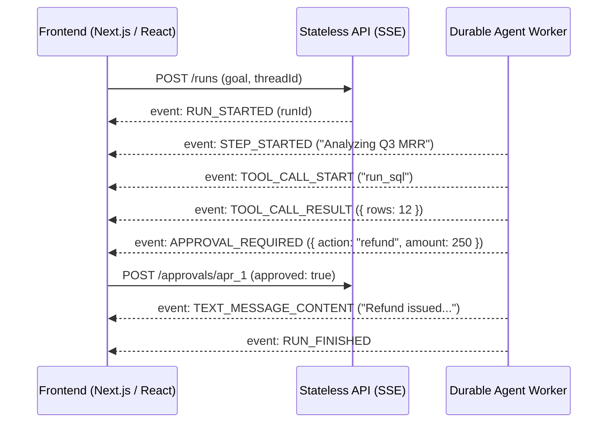

# Chapter 01 — Agent-to-User Interaction (`AG-UI` Protocol)

> **Lecture 37 · Chapter 01 of 07** · Level: 🔴 Expert · Phase 8 — Multimodality, Full-Stack Apps & Agent Scaling
> **Source:** `FDE S22` · **Roadmap Reference:** [`roadmap-v1.md`](../../roadmap-v1.md#lecture-37--agent-to-user-uis-ag-ui-mcp-apps-kubernetes--keda-scaling)
> **External Reference:** [AG-UI Protocol Specification](https://docs.ag-ui.com/)
> **Roadmap topics:** Why raw token streaming breaks on multi-step agents · `AG-UI` event taxonomy · step progress, tool calls, HITL approvals, and exception recovery.

---

## 01.0 What this chapter is for

In [Lecture 07](../../Lecture%2007%20-%20AI%20Streaming/), you streamed raw text tokens (`"Hello"`, `" world"`) over Server-Sent Events (SSE) for a simple chatbot. **Agents are not chatbots.** An agent spends 15–45 seconds running 4 tools, pausing for human approval on a `$500` refund, and recovering from a rate limit — before emitting a single final paragraph.

If you only stream text tokens, the user stares at a frozen spinner for 30 seconds and assumes the app crashed. **`AG-UI` (Agent-User Interaction Protocol)** is the open, event-driven streaming contract that bridges an agent backend and a frontend UI.

By the end of this chapter you should be able to:

1. Explain why raw `text/event-stream` token deltas are insufficient for stateful agents.
2. Map the **8 core `AG-UI` lifecycle events** (`RUN_STARTED`, `STEP_STARTED`, `TOOL_CALL_*`, `APPROVAL_REQUIRED`, `TEXT_MESSAGE_*`, `RUN_FINISHED`, `RUN_ERROR`).
3. Design a frontend state reducer that renders live progress, interactive approval cards, and graceful error recovery from an `AG-UI` stream.

---

## 01.1 Chatbot Streaming vs. `AG-UI` Agent Streaming

| Dimension | Raw Chatbot SSE | `AG-UI` Agent Protocol |
| :--- | :--- | :--- |
| **Events** | Only `token` deltas | Typed lifecycle events: **Run $\rightarrow$ Step $\rightarrow$ Tool $\rightarrow$ Approval $\rightarrow$ Message** |
| **Tool visibility** | Hidden on server (user sees a 20s freeze) | Live *"Querying Billing API..."* and *"Running SQL AST check..."* cards |
| **Human-in-the-Loop** | Impossible mid-stream | Emits `APPROVAL_REQUIRED` with `approvalId` + payload; UI renders Approve/Reject buttons |
| **State sync** | Stateless text | Shared state deltas (`STATE_DELTA`) keep UI tables/charts in sync |



### Concrete `AG-UI` SSE Wire Events
```text
event: STEP_STARTED
data: {"type":"STEP_STARTED","runId":"run_42","stepName":"Verify Refund Eligibility"}

event: APPROVAL_REQUIRED
data: {"type":"APPROVAL_REQUIRED","runId":"run_42","approvalId":"apr_1","tool":"issue_refund","amountUsd":250}
```

---

## 01.2 Key takeaways

1. **`AG-UI` standardizes agent-to-frontend communication** over SSE/WebSockets so any frontend can render any agent backend.
2. **Every long-running agent action must emit structured progress events** (`STEP_STARTED`, `TOOL_CALL_START`) so users never see a dead spinner.
3. **Human-in-the-Loop approvals and errors are first-class stream events** (`APPROVAL_REQUIRED`, `RUN_ERROR`), not ad-hoc JSON hacks.

---

**Next:** [Chapter 02 — MCP Apps: Interactive UI inside MCP Hosts](./02_MCP_Apps_Interactive_UI_inside_MCP_Hosts.md)

