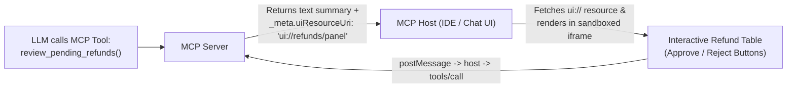

# Chapter 02 — MCP Apps: Interactive UI inside MCP Hosts

> **Lecture 37 · Chapter 02 of 07** · Level: 🔴 Expert · Phase 8 — Multimodality, Full-Stack Apps & Agent Scaling
> **Source:** `FDE S22` · **Roadmap Reference:** [`roadmap-v1.md`](../../roadmap-v1.md#lecture-37--agent-to-user-uis-ag-ui-mcp-apps-kubernetes--keda-scaling)
> **Roadmap topics:** `MCP Apps` pattern · returning interactive UI widgets from MCP tool outputs · sandboxed `iframe` / `ui://` resources · two-way UI-to-tool callbacks.

---

## 02.0 What this chapter is for

Sometimes plain Markdown text in a chat bubble is the wrong interface. If a user asks *"Adjust our Q4 forecast sliders"* or *"Review and approve these 5 pending refunds"*, forcing them to type `approve ref_1, ref_2, ref_4` in prose is slow, error-prone, and frustrating.

**MCP Apps** extend MCP tools so a tool call can return **both**:
1. **Structured text/JSON** for the LLM to reason over, and
2. **An interactive UI widget (`ui://...` HTML/React bundle)** that the MCP Host renders in a sandboxed `iframe` directly inside the conversation or side pane.

By the end of this chapter you should be able to:

1. Explain how an MCP tool attaches a `ui://` resource to its tool result (`_meta.uiResourceUri`).
2. Trace the **two-way `postMessage` bridge** between a sandboxed MCP App widget and the MCP Server.
3. Enforce the **sandboxed `iframe` security model** (CSP, no `allow-same-origin`) so untrusted widgets cannot steal host cookies or auth tokens.
4. Decide when to use **`AG-UI`** (streaming custom app UI) vs. **`MCP Apps`** (portable widgets inside third-party MCP hosts).

---

## 02.1 How MCP Apps Work



### Step-by-step protocol handshake

```mermaid
sequenceDiagram
    participant LLM
    participant Host as MCP Host (Browser / IDE)
    participant Server as MCP Server
    participant Iframe as Sandboxed Widget (iframe)

    LLM->>Host: Call tool review_pending_refunds()
    Host->>Server: tools/call("review_pending_refunds")
    Server-->>Host: { content: [...], _meta: { uiResourceUri: "ui://refunds/panel" } }
    Host->>Server: resources/read("ui://refunds/panel")
    Server-->>Host: HTML/JS bundle (text/html;profile=mcp-app)
    Host->>Iframe: Mount with sandbox="allow-scripts" + initial tool data
    Note over Iframe: User clicks "Approve ref_1"
    Iframe->>Host: window.parent.postMessage({ method: "tools/call", params: ... })
    Host->>Server: tools/call("approve_refund", { refundId: "ref_1" })
    Server-->>Host: Updated list -> pushed back to Iframe
```

---

## 02.2 Security Boundaries of MCP App Widgets

Because an MCP Host may connect to third-party or partner MCP servers, rendering raw HTML/JS from a tool output is an **XSS / credential-theft risk** unless strictly sandboxed:

1. **Sandboxed `iframe` (`sandbox="allow-scripts"`):** Never add `allow-same-origin` to a third-party MCP App iframe! Without `allow-same-origin`, the widget gets an opaque origin (`null`) and **cannot read the host app's `localStorage`, cookies, or OAuth tokens**.
2. **Typed `postMessage` Bridge:** The widget has no direct network access to your backend. It can only send typed JSON-RPC messages (`tools/call`, `ui/update-model-context`) to the Host, which validates and proxies them.
3. **Strict Content Security Policy (CSP):** Block external `<script src="...">`, `fetch()`, or image-pixel exfiltration (`connect-src 'none'`) from inside the widget unless explicitly allow-listed.

> [!WARNING]
> **Never combine `allow-scripts` and `allow-same-origin` on an untrusted `iframe`.** Doing so lets the embedded script remove its own `sandbox` attribute and take over the parent host page!

---

## 02.3 `AG-UI` vs. `MCP Apps`: When to Use Which

They are complementary, not competing:

| Dimension | `AG-UI` (Chapter 01) | `MCP Apps` (Chapter 02) |
| :--- | :--- | :--- |
| **Best For** | Your own custom full-stack AI app (Next.js / React) | Portable interactive widgets (tables, forms, charts, diff viewers) |
| **Where It Renders** | Your app's native React/Vue components | Sandboxed `iframe` inside *any* compatible MCP Host (IDE, desktop chat, web host) |
| **Transport** | SSE / WebSocket event stream (`STEP_STARTED`, `STATE_DELTA`) | MCP `resources/read` (`ui://...`) + `postMessage` bridge |
| **Isolation** | First-party trusted frontend code | Untrusted/third-party widget isolated in `sandbox="allow-scripts"` |

> [!TIP]
> **Return both text and `ui://` from the tool:** Always include a concise text summary in `content` alongside `_meta.uiResourceUri`. That way, the LLM still understands what is on screen (e.g., *"3 pending refunds shown"*) and non-UI MCP clients degrade gracefully.

---

## 02.4 Common mistakes

| # | Common Mistake | Why It Hurts | What To Do Instead |
| :--- | :--- | :--- | :--- |
| **1** | **Adding `allow-same-origin` to the widget `iframe` sandbox** | Breaks isolation; widget can read host `localStorage` and auth tokens | Use `sandbox="allow-scripts"` only (opaque origin) |
| **2** | **Returning only a `ui://` URI with empty `content` text** | The LLM has no idea what the tool returned and cannot answer follow-up questions | Return structured text/JSON in `content` *plus* `_meta.uiResourceUri` |
| **3** | **Allowing arbitrary `fetch()` inside the widget CSP** | Widget can exfiltrate sensitive table data to an external server | Lock down `Content-Security-Policy` (`default-src 'none'; script-src 'unsafe-inline'`) |
| **4** | **Building custom React components as `MCP Apps` when you own the whole app** | Unnecessary `iframe` + `postMessage` indirection for first-party UI | Use `AG-UI` (`STATE_DELTA` / `APPROVAL_REQUIRED`) for your own native app |

---

## 02.5 Key takeaways

1. **`MCP Apps` turn MCP tool outputs into rich interactive widgets** (`ui://...`) rendered inside any compatible MCP host.
2. **Always isolate widgets in a sandboxed `iframe`** (`sandbox="allow-scripts"`, no `allow-same-origin`) with strict CSP and a typed `postMessage` bridge.
3. **Use `AG-UI` for your own streaming app UI** and **`MCP Apps` for portable tool-bundled widgets** across third-party hosts.

---

**Next:** [Chapter 03 — Managed vs. Self-Hosted Agent Runtimes](./03_Managed_vs_Self_Hosted_Agent_Runtimes.md)
