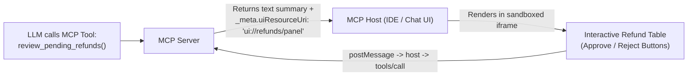

# Chapter 02 — MCP Apps: Interactive UI inside MCP Hosts

> **Lecture 37 · Chapter 02 of 07** · Level: 🔴 Expert · Phase 8 — Multimodality, Full-Stack Apps & Agent Scaling
> **Source:** `FDE S22` · **Roadmap Reference:** [`roadmap-v1.md`](../../roadmap-v1.md#lecture-37--agent-to-user-uis-ag-ui-mcp-apps-kubernetes--keda-scaling)
> **Roadmap topics:** `MCP Apps` pattern · returning interactive UI widgets from MCP tool outputs · sandboxed `iframe` / `ui://` resources · two-way UI-to-tool callbacks.

---

## 02.0 What this chapter is for

Sometimes plain Markdown text in a chat bubble is the wrong interface. If a user asks *"Adjust our Q4 forecast sliders"* or *"Approve these 3 pending refunds"*, forcing them to type `approve ref_1, ref_2` in prose is slow and error-prone.

**MCP Apps** extend MCP tools so a tool call can return **both**:
1. **Structured text/JSON** for the LLM to reason over, and
2. **An interactive UI widget (`ui://...` HTML/React bundle)** that the MCP Host renders in a sandboxed `iframe` directly inside the conversation or side pane.

By the end of this chapter you should be able to:

1. Explain how an MCP tool attaches a `ui://` resource to its tool result.
2. Describe the **sandboxed `iframe` security model** (CSP, `postMessage` bridge) that prevents untrusted MCP UI widgets from stealing host cookies or tokens.
3. Decide when to use **`AG-UI`** (streaming custom app UI) vs. **`MCP Apps`** (portable widgets inside third-party MCP hosts).

---

## 02.1 How MCP Apps Work

### Security boundaries of MCP App widgets

1. **Sandboxed `iframe` (`sandbox="allow-scripts"`):** Never give a third-party MCP App `allow-same-origin` — it must never access the host app's `localStorage`, cookies, or auth tokens.
2. **Typed `postMessage` Bridge:** The widget can only trigger host-approved actions (e.g., calling an allow-listed MCP tool or updating its own state).
3. **Strict Content Security Policy (CSP):** Block external script/image exfiltration from inside the widget.

### `AG-UI` vs. `MCP Apps`: When to Use Which

| Pattern | Best For | Where It Renders |
| :--- | :--- | :--- |
| **`AG-UI`** | Your own custom full-stack AI app (Next.js/React) | Your app's native UI components |
| **`MCP Apps`** | Portable interactive widgets (tables, forms, charts) | Sandboxed `iframe` inside *any* MCP host (IDE, ChatGPT/Claude-style host) |

---

## 02.2 Key takeaways

1. **`MCP Apps` turn MCP tool outputs into rich interactive widgets** rendered inside any compatible MCP host.
2. **Always isolate widgets in a sandboxed `iframe`** with strict CSP and a typed `postMessage` bridge.

---

**Next:** [Chapter 03 — Managed vs. Self-Hosted Agent Runtimes](./03_Managed_vs_Self_Hosted_Agent_Runtimes.md)

