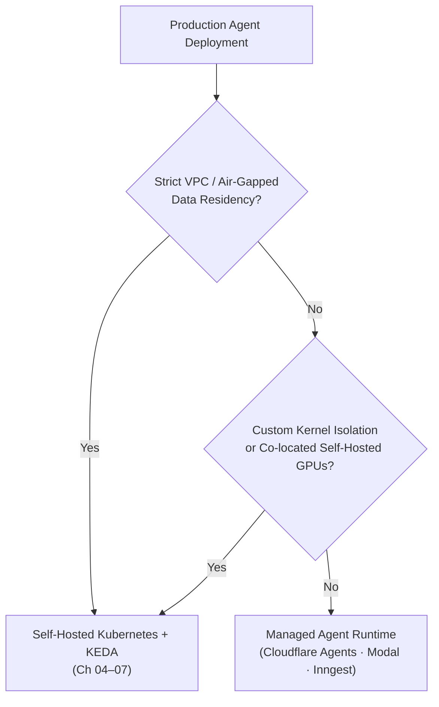
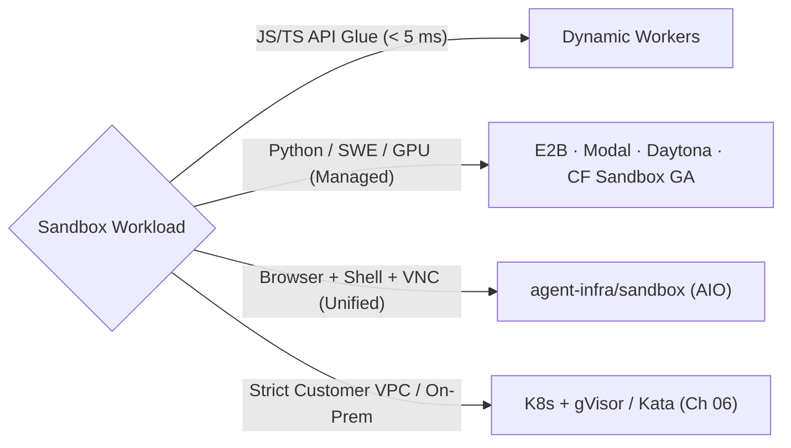

# Chapter 03 — Managed vs. Self-Hosted Agent Runtimes

> **Lecture 37 · Chapter 03 of 07** · Level: 🔴 Expert · Phase 8 — Multimodality, Full-Stack Apps & Agent Scaling
> **Source:** `FDE S22 & S23` · **Roadmap Reference:** [`roadmap-v1.md`](../../roadmap-v1.md#lecture-37--agent-to-user-uis-ag-ui-mcp-apps-kubernetes--keda-scaling)
> **Roadmap topics:** Managed agent platforms (Cloudflare Agents, Modal, Inngest Cloud) vs. self-hosted Kubernetes · data residency & VPC requirements · Managed vs. Self-Hosted Sandbox Platforms · TCO & operational complexity trade-offs.

---

## 03.0 What this chapter is for

Once your agent works on your laptop, your client asks: *"Where does this run in production?"*

You face a fundamental infrastructure fork: **Managed Serverless/Agent Platforms** (Cloudflare Workers/Agents, Inngest Cloud, Modal) vs. **Self-Hosted Kubernetes**. Choosing wrong either wastes 4 months of DevOps time on a 2-person startup or violates an enterprise bank's VPC compliance policy.

By the end of this chapter you should be able to:

1. Compare **Managed Agent Runtimes** vs. **Self-Hosted Kubernetes** across 5 decision axes.
2. Identify the **4 hard triggers** that force self-hosted Kubernetes (VPC data residency, custom microVMs/GPUs, existing K8s platform team, air-gapped compliance).
3. Select the right **code-execution sandbox platform** (E2B, Daytona, Modal, Cloudflare Sandbox GA, Docker AI Sandboxes, `agent-infra/sandbox`, or K8s `gVisor`/`Kata`).
4. Avoid the **premature Kubernetes trap** during early FDE pilots.

---

## 03.1 Decision Matrix: Managed vs. Self-Hosted Kubernetes

| Dimension | Managed (Cloudflare Agents / Modal / Inngest) | Self-Hosted Kubernetes + KEDA |
| :--- | :--- | :--- |
| **Time to Production** | **Hours** (`wrangler deploy` / `modal deploy`) | **Weeks** (cluster, ingress, KEDA, observability, RBAC) |
| **Cold Start & Scaling** | Automatic (`ms` for Workers, seconds for Modal) | Managed via KEDA `ScaledObject` (Chapter 05) |
| **Data Residency / VPC** | Cloud-hosted (enterprise VPC peering on higher tiers) | **100% inside customer VPC / on-prem** |
| **Custom Sandboxing** | Built-in (`Dynamic Workers` / Modal sandboxes) | Full control (`gVisor`, `Kata Containers`, `Firecracker`) |
| **Ops Burden** | Near zero (provider patches OS & runtime) | High (node upgrades, OOM tuning, KEDA, network policies) |
| **Best For** | Startups, rapid FDE pilots, bursty SaaS | Regulated banks/healthcare, heavy GPU/CPU pipelines, existing K8s orgs |

### The 4 Hard Triggers That Force Self-Hosted Kubernetes

1. **Strict VPC / Air-Gapped Data Residency:** Customer compliance forbids sensitive PII, medical records, or source code from leaving their AWS/GCP/on-prem VPC.
2. **Custom Kernel Sandboxing (`gVisor` / `Firecracker`):** Untrusted Python/bash execution must run inside customer-controlled nodes with custom `NetworkPolicy` egress rules.
3. **Co-located Self-Hosted GPUs:** Running vLLM/SGLang inference pods right next to agent workers over internal high-bandwidth VPC networking.
4. **Existing Platform Team:** Enterprise SREs already standardize on EKS/GKE + ArgoCD + OpenObserve and mandate all workloads deploy via Helm/GitOps.

> [!IMPORTANT]
> **Default to Managed Runtimes for speed.** As a Forward Deployed Engineer, shipping a working pilot in 48 hours on Cloudflare Agents or Modal beats spending 3 weeks writing Terraform and Helm charts before the user has even validated the agent's accuracy.

---

## 03.2 Managed vs. Self-Hosted Sandbox Platforms

Beyond general agent orchestration, production teams must pick a **code-execution sandbox platform** ([Mastra Sandbox Guide](https://mastra.ai/articles/best-ai-agent-sandbox-platforms) · [LangChain Sandbox Guide](https://www.langchain.com/blog/how-to-choose-the-right-sandbox-for-your-agent)):

| Platform | Deployment Model | Isolation | Key Strengths |
| :--- | :--- | :--- | :--- |
| **E2B** | Managed Cloud | Firecracker MicroVM | ~150 ms snapshot resume, Python/JS code-interpreter SDKs |
| **Daytona** | Managed / Self-Hosted | Container / VM | <200 ms stateful coding workspaces, native Git/LSP workflows |
| **Modal Sandboxes** | Managed Serverless | gVisor / Serverless Container | Seamless GPU attachment, batch evals, Python-native SDK |
| **Cloudflare Sandbox (GA)** | Managed Edge | Durable Object + Linux Container | Persistent disk, sleep/wake, preview URLs, Worker egress control |
| **Docker AI Sandboxes** | Local / Hybrid Dev | MicroVM + Private Dockerd | Safe `docker compose` inside agent workspace + host credential proxy |
| **`agent-infra/sandbox` (AIO)** | Self-Hosted Container / K8s Pod | Container / gVisor Pod | Unified Browser (CDP/VNC) + Shell + Filesystem + Jupyter over MCP |
| **K8s `gVisor` / `Kata`** | Self-Hosted VPC | User-space kernel / MicroVM | Full VPC residency, `NetworkPolicy`, and KEDA autoscaling |

> [!TIP]
> **Never build your own Firecracker microVM scheduler from scratch** unless VPC compliance forces it — managed sandboxes (E2B, Modal, Daytona, Cloudflare Sandbox GA) eliminate months of kernel, snapshot, and networking maintenance.

---

## 03.3 Common mistakes

| # | Common Mistake | Why It Hurts | What To Do Instead |
| :--- | :--- | :--- | :--- |
| **1** | **Standing up EKS + KEDA + gVisor for a 2-week FDE pilot** | Wastes weeks on infra before proving product value | Start on Managed Runtimes (Cloudflare Agents / Modal / Inngest) |
| **2** | **Pitching a multi-tenant cloud sandbox to an air-gapped bank** | Fails security review immediately due to VPC residency rules | Deploy self-hosted K8s with `gVisor`/`Kata` inside their VPC |
| **3** | **Rolling a custom Firecracker daemon in-house** | Massive kernel/networking/snapshot maintenance burden | Use E2B, Daytona, Modal, Cloudflare Sandbox GA, or K8s `RuntimeClass` |
| **4** | **Ignoring GPU/inference co-location needs** | Cross-internet roundtrips to self-hosted vLLM add 50–150 ms per step | Co-locate agent workers and vLLM pods in the same VPC/cluster |

---

## 03.4 Key takeaways

1. **Default to Managed Runtimes** during early FDE delivery unless compliance, VPC residency, or custom kernel sandboxing demands Kubernetes.
2. **When Kubernetes is required**, decouple stateless APIs from queue-backed worker pods (Chapter 04) and autoscale with KEDA (Chapter 05).
3. **Pick the sandbox that matches your runtime & compliance boundary:** Dynamic Workers for JS/TS, managed sandboxes (E2B/Modal/Daytona/CF Sandbox) for general Linux/Python, and K8s `gVisor`/`Kata` for strict VPC residency.

---

**Next:** [Chapter 04 — Stateless API Services vs. Durable Worker State](./04_Stateless_API_Services_vs_Durable_Worker_State.md)
