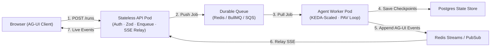
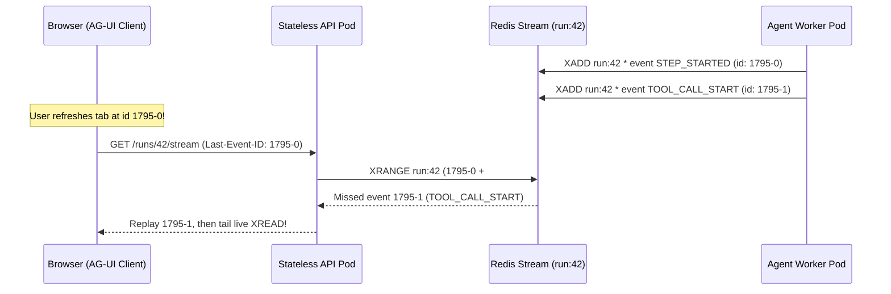

# Chapter 04 — Stateless API Services vs. Durable Worker State

> **Lecture 37 · Chapter 04 of 07** · Level: 🔴 Expert · Phase 8 — Multimodality, Full-Stack Apps & Agent Scaling
> **Source:** `FDE S23` · **Roadmap Reference:** [`roadmap-v1.md`](../../roadmap-v1.md#lecture-37--agent-to-user-uis-ag-ui-mcp-apps-kubernetes--keda-scaling)
> **Roadmap topics:** Why agents break standard HTTP request/response · separating Stateless API Ingress from Durable Queue Workers · Redis/Postgres state & pub/sub SSE fan-out · `Last-Event-ID` reconnect replay.

---

## 04.0 What this chapter is for

Standard REST APIs answer in `50 ms`. An agent workflow (fetching 5 documents, running sandboxed Python, waiting for HITL approval) can run for **45 seconds to 30 minutes**. If you run the agent loop directly inside your Next.js / Express / FastAPI HTTP handler:
- Load balancers (ALB, Cloudflare, Nginx) **time out** at 60 seconds.
- A rolling Kubernetes deploy **kills the HTTP pod** and erases the agent's in-memory state mid-loop.
- Refreshing the browser tab **aborts the connection** and leaves the user with no way to see the result.

The production pattern is **Stateless API Ingress + Durable Queue-Backed Workers**.

By the end of this chapter you should be able to:

1. Separate **Stateless API Pods** (auth, validation, enqueue, SSE relay) from **Durable Worker Pods** (long-running PAV loops, tool calls, sandboxes).
2. Wire **Redis Streams / PubSub + Postgres Checkpoints** so a user who refreshes their browser reconnects to the live `AG-UI` stream without losing progress.
3. Implement **`Last-Event-ID` reconnect replay** over `AG-UI` SSE streams.
4. Explain why this decoupling is a **prerequisite for KEDA autoscaling** (Chapter 05).

---

## 04.1 The Decoupled Agent Topology



### Why this separation scales cleanly

| Component | Responsibility | Scaling & Lifecycle |
| :--- | :--- | :--- |
| **Stateless API Pod** | Auth, Zod input validation, enqueue job, relay SSE | Lightweight; scales on HTTP RPS/connections; fast rolling restarts |
| **Durable Queue (Redis/SQS)** | Buffers bursty run requests | Decouples traffic spikes from worker capacity |
| **Agent Worker Pod** | Runs LLM loop, tool calls, sandboxes, checkpoints | Heavy; scales on **queue depth via KEDA** (Chapter 05) |
| **Postgres Checkpoint DB** | Stores step state, `idempotencyKey`s, HITL `approvalId`s | Survives worker crashes and pod evictions |

---

## 04.2 Browser Refresh Resilience: `Last-Event-ID` Replay

If a user refreshes their browser 15 seconds into a 40-second run, they should **never** restart the agent from scratch. Instead, use **Redis Streams** + the standard HTTP `Last-Event-ID` header:



### Minimal SSE Replay Handler (TypeScript)

```typescript
// GET /runs/:runId/stream
async function streamRunEvents(req: Request, res: Response) {
  const runId = req.params.runId;
  const lastId = req.header("Last-Event-ID") ?? "0-0";

  res.setHeader("Content-Type", "text/event-stream");
  res.setHeader("Cache-Control", "no-cache");

  // 1. Replay any events missed while disconnected
  const missed = await redis.xrange(`run:${runId}`, `(${lastId}`, "+");
  for (const [id, fields] of missed) {
    res.write(`id: ${id}\nevent: ${fields.type}\ndata: ${fields.data}\n\n`);
  }

  // 2. Tail live events until RUN_FINISHED / RUN_ERROR or client disconnect
  // ... XREAD BLOCK loop
}
```

> [!IMPORTANT]
> **Pub/Sub alone loses messages on disconnect.** Classic Redis `PUBLISH`/`SUBSCRIBE` is fire-and-forget — if the user refreshes their browser for 500 ms, any `TOOL_CALL_RESULT` emitted during that window is gone forever. Always persist `AG-UI` events in a **Redis Stream** (with a TTL, e.g., 24 hours) or Postgres event table so `Last-Event-ID` replay is exact.

> [!TIP]
> **Return `202 Accepted` + `{ runId }` from `POST /runs` immediately.** Never block the `POST` request waiting for the agent to finish — let the client immediately open `GET /runs/:runId/stream`.

---

## 04.3 Common mistakes

| # | Common Mistake | Why It Hurts | What To Do Instead |
| :--- | :--- | :--- | :--- |
| **1** | **Running the agent loop inside the `POST /chat` HTTP handler** | ALB/Cloudflare 60 s timeouts and rolling deploys kill in-flight runs | Return `202 { runId }` immediately and execute in a queue-backed worker |
| **2** | **Using fire-and-forget Redis Pub/Sub without persistence** | Browser refresh or mobile network blip drops `AG-UI` events permanently | Store events in Redis Streams (`XADD`) and replay from `Last-Event-ID` |
| **3** | **Keeping conversation/step checkpoints only in Worker RAM** | Pod crash or KEDA scale-in loses all progress | Persist step checkpoints to Postgres after every tool/LLM step |
| **4** | **Scaling API pods and Worker pods together in one Deployment** | Heavy Python sandboxes starve lightweight HTTP/SSE health checks | Split `agent-api` and `agent-worker` into separate Kubernetes Deployments |

---

## 04.4 Key takeaways

1. **Never run multi-minute agent loops inside stateless HTTP request handlers.**
2. **Decouple API Ingress (enqueue + SSE relay) from Worker Pods (execution)** via a durable queue and Postgres checkpoint DB.
3. **Persist `AG-UI` events in Redis Streams** so `Last-Event-ID` reconnects replay missed steps seamlessly without restarting the agent.

---

**Next:** [Chapter 05 — Kubernetes Pods, Queues & KEDA Autoscaling](./05_Kubernetes_Pods_Queues_and_KEDA_Autoscaling.md)
