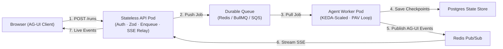

# Chapter 04 — Stateless API Services vs. Durable Worker State

> **Lecture 37 · Chapter 04 of 07** · Level: 🔴 Expert · Phase 8 — Multimodality, Full-Stack Apps & Agent Scaling
> **Source:** `FDE S23` · **Roadmap Reference:** [`roadmap-v1.md`](../../roadmap-v1.md#lecture-37--agent-to-user-uis-ag-ui-mcp-apps-kubernetes--keda-scaling)
> **Roadmap topics:** Why agents break standard HTTP request/response · separating Stateless API Ingress from Durable Queue Workers · Redis/Postgres state & pub/sub SSE fan-out.

---

## 04.0 What this chapter is for

Standard REST APIs answer in `50 ms`. An agent workflow (fetching 5 documents, running sandboxed Python, waiting for HITL approval) can run for **45 seconds to 30 minutes**. If you run the agent loop directly inside your Next.js / Express HTTP handler:
- Load balancers (ALB, Cloudflare, Nginx) **time out** at 60 seconds.
- A rolling Kubernetes deploy **kills the HTTP pod** and erases the agent's in-memory state mid-loop.

The production pattern is **Stateless API Ingress + Durable Queue-Backed Workers**.

By the end of this chapter you should be able to:

1. Separate **Stateless API Pods** (auth, validation, enqueue, SSE relay) from **Durable Worker Pods** (long-running PAV loops, tool calls, sandboxes).
2. Wire **Redis Streams / PubSub + Postgres Checkpoints** so a user who refreshes their browser reconnects to the live `AG-UI` stream without losing progress.

---

## 04.1 The Decoupled Agent Topology

### Why this separation scales cleanly

1. **API Pods stay tiny and fast:** They only handle HTTP/SSE I/O and never run heavy Python sandboxes or long loops.
2. **Worker Pods can scale to zero or 50** based on queue depth (Chapter 05) without dropping user SSE connections.
3. **Browser refresh resilience:** Because events and checkpoints are persisted, reconnecting to `GET /runs/:runId/stream` replays missed `AG-UI` events seamlessly.

### How Reconnect Replay Works (`Last-Event-ID`)
1. Every `AG-UI` event is written to a **Redis Stream** (`XADD run:42 * event ...`) with a monotonic ID (`1795-0`, `1795-1`).
2. If the user refreshes their browser at `1795-3`, the client reconnects with `Last-Event-ID: 1795-3`.
3. The stateless API pod reads `XRANGE run:42 (1795-3 +` and streams all missed events + live updates without restarting the worker!

---

## 04.2 Key takeaways

1. **Never run multi-minute agent loops inside stateless HTTP request handlers.**
2. **Decouple API Ingress (enqueue + SSE relay) from Worker Pods (execution)** via a durable queue and checkpoint DB.

---

**Next:** [Chapter 05 — Kubernetes Pods, Queues & KEDA Autoscaling](./05_Kubernetes_Pods_Queues_and_KEDA_Autoscaling.md)

