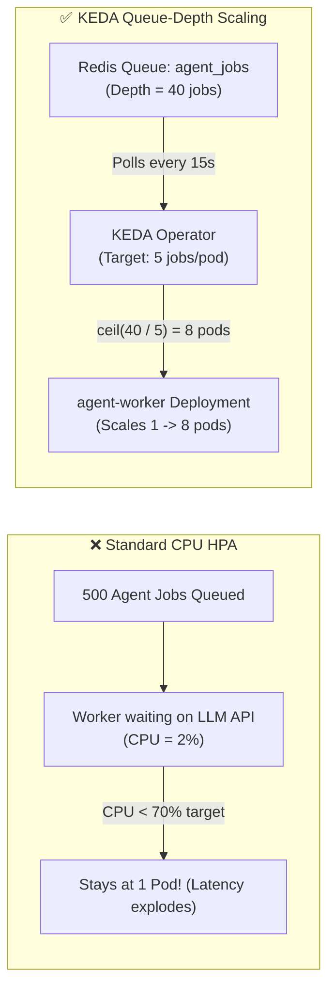

# Chapter 05 — Kubernetes Pods, Queues & KEDA Autoscaling

> **Lecture 37 · Chapter 05 of 07** · Level: 🔴 Expert · Phase 8 — Multimodality, Full-Stack Apps & Agent Scaling
> **Source:** `FDE S23` · **Roadmap Reference:** [`roadmap-v1.md`](../../roadmap-v1.md#lecture-37--agent-to-user-uis-ag-ui-mcp-apps-kubernetes--keda-scaling)
> **External Reference:** [KEDA Documentation](https://keda.sh/docs/)
> **Roadmap topics:** Why CPU/memory HPA fails for AI agents · KEDA `ScaledObject` · scaling on Redis/SQS queue depth · scale-to-zero vs. warm `minReplicaCount: 1` · `cooldownPeriod`.

---

## 05.0 What this chapter is for

Standard Kubernetes Horizontal Pod Autoscaler (HPA) scales pods based on **CPU or Memory utilization**. That completely fails for AI agent workers! Why?

An agent worker spending 20 seconds waiting on `await openai.chat.completions.create()` or an external MCP tool is **I/O-bound**: its CPU sits at **2%**, even while **500 jobs are backed up in the queue**! HPA sees 2% CPU and refuses to add pods, so user latency explodes from 10 seconds to 15 minutes.

**KEDA (Kubernetes Event-Driven Autoscaling)** solves this by scaling your `agent-worker` Deployment directly on **queue depth** (`listLength`, SQS messages, Kafka lag).

By the end of this chapter you should be able to:

1. Explain why CPU-based HPA fails for I/O-bound LLM agent workers.
2. Author a KEDA `ScaledObject` targeting a Redis queue (`listLength: "5"`).
3. Calculate `desiredReplicas` from queue depth, `minReplicaCount`, `maxReplicaCount`, and `cooldownPeriod`.
4. Choose between **`minReplicaCount: 0`** (batch/overnight) and **`minReplicaCount: 1+`** (interactive `AG-UI`).

---

## 05.1 Why CPU HPA Fails vs. How KEDA Scales



### The KEDA Scaling Formula

$$\text{desiredReplicas} = \text{clamp}\!\left(\left\lceil \frac{\text{queueDepth}}{\text{targetListLength}} \right\rceil,\ \text{minReplicaCount},\ \text{maxReplicaCount}\right)$$

Worked examples with `targetListLength = 5`, `minReplicaCount = 1`, `maxReplicaCount = 20`:
- `queueDepth = 0` $\rightarrow$ clamped to **`minReplicaCount = 1`** (warm pod ready for instant interactive response).
- `queueDepth = 40` $\rightarrow$ $\lceil 40 / 5 \rceil = \mathbf{8\text{ pods}}$.
- `queueDepth = 250` $\rightarrow$ $\lceil 250 / 5 \rceil = 50$, clamped to **`maxReplicaCount = 20`** so a queue spike cannot exhaust your cluster nodes, Postgres connection pool, or upstream LLM RPM/TPM rate limits!

---

## 05.2 Concrete KEDA `ScaledObject` YAML & Tuning

```yaml
apiVersion: keda.sh/v1alpha1
kind: ScaledObject
metadata:
  name: agent-worker-scaler
spec:
  scaleTargetRef:
    name: agent-worker
  minReplicaCount: 1       # Keep 1 warm pod for interactive AG-UI; use 0 for batch
  maxReplicaCount: 20      # Hard cap to protect LLM RPM/TPM & DB connections
  pollingInterval: 15      # Check Redis queue depth every 15s
  cooldownPeriod: 120      # Wait 120s of empty queue before scaling back down
  triggers:
    - type: redis
      metadata:
        address: redis.internal:6379
        listName: agent_jobs
        listLength: "5"    # Target 5 queued jobs per worker pod
```

### Choosing `minReplicaCount` and `cooldownPeriod`

| Workload Type | `minReplicaCount` | `cooldownPeriod` | Why |
| :--- | :---: | :---: | :--- |
| **Interactive `AG-UI` Chat/Support** | `1` (or `2` for HA) | `120–300 s` | Avoids 10–20 s container pull/cold-start lag on first user message |
| **Nightly Batch / Document Ingestion** | `0` | `60 s` | True **scale-to-zero** saves 100% of idle compute overnight |

> [!IMPORTANT]
> **Size `maxReplicaCount` against your LLM TPM/RPM quota!** If each worker pod runs 4 concurrent agent loops and your OpenAI/Anthropic tier allows 80 concurrent requests, setting `maxReplicaCount: 50` will trigger a `429 RateLimitError` storm. Cap `maxReplicaCount` to match your downstream quota.

> [!TIP]
> **Avoid scale-down thrashing with `cooldownPeriod`.** If `cooldownPeriod` is too short (e.g., `10 s`), KEDA kills pods between user turns, forcing constant cold starts. Set `120–300 s` for interactive workloads.

---

## 05.3 Common mistakes

| # | Common Mistake | Why It Hurts | What To Do Instead |
| :--- | :--- | :--- | :--- |
| **1** | **Using CPU/Memory HPA for LLM agent workers** | Workers are I/O-bound (~2% CPU while waiting on APIs), so HPA never scales up | Use KEDA `ScaledObject` triggered by Redis/SQS/Kafka queue depth |
| **2** | **Setting `minReplicaCount: 0` for interactive user-facing agents** | First user waits 15–30 s for pod scheduling + image pull | Keep `minReplicaCount: 1` for interactive `AG-UI`; reserve `0` for batch |
| **3** | **Omitting `maxReplicaCount`** | A traffic spike spawns 100 pods and overwhelms Postgres & LLM RPM quotas | Always set `maxReplicaCount` aligned with DB pool & LLM rate limits |
| **4** | **Scaling down without graceful `SIGTERM` handling** | KEDA terminates pods that are mid-tool-call | Combine KEDA with `terminationGracePeriodSeconds` & `SIGTERM` handlers (Chapter 07) |

---

## 05.4 Key takeaways

1. **Scale agent workers on queue depth (KEDA), not CPU**, because LLM-calling workers are I/O-bound.
2. **Always set `maxReplicaCount`** to protect upstream LLM RPM/TPM quotas and DB connection pools.
3. **Keep `minReplicaCount: 1` for interactive `AG-UI` workloads** (avoiding cold-start lag) and `0` for overnight batch workloads.

---

**Next:** [Chapter 06 — Safe Code Execution & Sandbox Isolation](./06_Safe_Code_Execution_and_Sandbox_Isolation.md)
