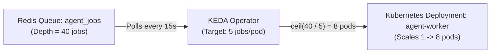

# Chapter 05 — Kubernetes Pods, Queues & KEDA Autoscaling

> **Lecture 37 · Chapter 05 of 07** · Level: 🔴 Expert · Phase 8 — Multimodality, Full-Stack Apps & Agent Scaling
> **Source:** `FDE S23` · **Roadmap Reference:** [`roadmap-v1.md`](../../roadmap-v1.md#lecture-37--agent-to-user-uis-ag-ui-mcp-apps-kubernetes--keda-scaling)
> **External Reference:** [KEDA Documentation](https://keda.sh/docs/)
> **Roadmap topics:** Why CPU/memory HPA fails for AI agents · KEDA `ScaledObject` · scaling on Redis/SQS queue depth · scale-to-zero vs. warm `minReplicaCount: 1` · `cooldownPeriod`.

---

## 05.0 What this chapter is for

Standard Kubernetes Horizontal Pod Autoscaler (HPA) scales pods based on **CPU or Memory utilization**. That completely fails for AI agent workers! Why?

An agent worker spending 20 seconds waiting on `await openai.chat.completions.create()` or an external MCP tool is **I/O-bound**: its CPU sits at **2%**, even while **500 jobs are backed up in the queue**!

**KEDA (Kubernetes Event-Driven Autoscaling)** solves this by scaling your `agent-worker` Deployment directly on **queue depth** (`listLength`, SQS messages, Kafka lag).

By the end of this chapter you should be able to:

1. Explain why CPU-based HPA fails for I/O-bound LLM agent workers.
2. Author a KEDA `ScaledObject` targeting a Redis queue (`listLength: "5"`).
3. Calculate `desiredReplicas` from queue depth, `minReplicaCount`, `maxReplicaCount`, and `cooldownPeriod`.

---

## 05.1 How KEDA scales agent workers



### The KEDA Scaling Formula

$$\text{desiredReplicas} = \text{clamp}\!\left(\left\lceil \frac{\text{queueDepth}}{\text{targetListLength}} \right\rceil,\ \text{minReplicaCount},\ \text{maxReplicaCount}\right)$$

- If `queueDepth = 40`, `targetListLength = 5`, `min = 1`, `max = 20`: $\lceil 40 / 5 \rceil = \mathbf{8\text{ pods}}$.
- If `queueDepth = 250`: $\lceil 250 / 5 \rceil = 50$, clamped to **`maxReplicaCount = 20`** so a queue spike cannot exhaust your cluster or upstream LLM rate limits!

### Concrete KEDA `ScaledObject` YAML
```yaml
apiVersion: keda.sh/v1alpha1
kind: ScaledObject
metadata:
  name: agent-worker-scaler
spec:
  scaleTargetRef:
    name: agent-worker
  minReplicaCount: 1
  maxReplicaCount: 20
  cooldownPeriod: 120
  triggers:
    - type: redis
      metadata:
        address: redis.internal:6379
        listName: agent_jobs
        listLength: "5"
```

---

## 05.2 Key takeaways

1. **Scale agent workers on queue depth (KEDA), not CPU.**
2. **Always set `maxReplicaCount`** to protect upstream LLM RPM/TPM quotas and DB connection pools.
3. **Keep `minReplicaCount: 1` for interactive `AG-UI` workloads** (avoiding cold-start lag) and `0` for overnight batch workloads.

---

**Next:** [Chapter 06 — Safe Code Execution & Sandbox Isolation](./06_Safe_Code_Execution_and_Sandbox_Isolation.md)

