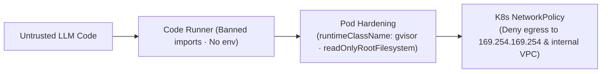

# Chapter 06 — Safe Code Execution & Sandbox Isolation

> **Lecture 37 · Chapter 06 of 07** · Level: 🔴 Expert · Phase 8 — Multimodality, Full-Stack Apps & Agent Scaling
> **Source:** `FDE S23` · **Roadmap Reference:** [`roadmap-v1.md`](../../roadmap-v1.md#lecture-37--agent-to-user-uis-ag-ui-mcp-apps-kubernetes--keda-scaling)
> **Roadmap topics:** Container escape risks · `gVisor` (`runtimeClassName: gvisor`) · Firecracker microVMs · Kubernetes `securityContext` (`runAsNonRoot`, `readOnlyRootFilesystem`, `drop: ["ALL"]`) · network policies.

---

## 06.0 What this chapter is for

When an agent worker pod executes LLM-generated Python or shell commands, a standard Docker container shares the **host Linux kernel**. A kernel vulnerability or misconfigured mount lets untrusted code read Kubernetes ServiceAccount tokens, pivot to cloud metadata (`169.254.169.254`), or compromise neighboring tenant pods.

By the end of this chapter you should be able to:

1. Compare **Standard Containers**, **`gVisor`**, and **Firecracker MicroVMs** for kernel isolation.
2. Harden a Kubernetes Pod `securityContext` (`runAsNonRoot`, `readOnlyRootFilesystem`, `allowPrivilegeEscalation: false`, `capabilities.drop: ["ALL"]`).
3. Block host network and filesystem access both at the **Kubernetes NetworkPolicy** layer and inside the **code runner**.

---

## 06.1 Isolation Boundary Comparison

| Layer | Mechanism | Isolation Strength | K8s Integration |
| :--- | :--- | :---: | :--- |
| **Standard Container (`runc`)** | Linux namespaces + cgroups (shared host kernel) | Low for untrusted code | Default |
| **gVisor (`runsc`)** | User-space kernel intercepting syscalls | **High** | `runtimeClassName: gvisor` |
| **Firecracker / Kata** | Hardware-virtualized microVM with dedicated guest kernel | **Highest** | `runtimeClassName: kata-fc` |

---

## 06.2 Key takeaways

1. **Never run untrusted LLM-generated code in a default privileged container.**
2. **Use `runtimeClassName: gvisor` (or Kata/Firecracker)** + `runAsNonRoot: true` + `readOnlyRootFilesystem: true` + `capabilities.drop: ["ALL"]`.
3. **Block egress to cloud metadata IPs and internal services** via Kubernetes `NetworkPolicy`.

---

**Next:** [Chapter 07 — Resource Limits, OOM Protection & Crash Recovery](./07_Resource_Limits_OOM_Protection_and_Crash_Recovery.md)

