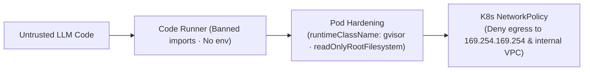
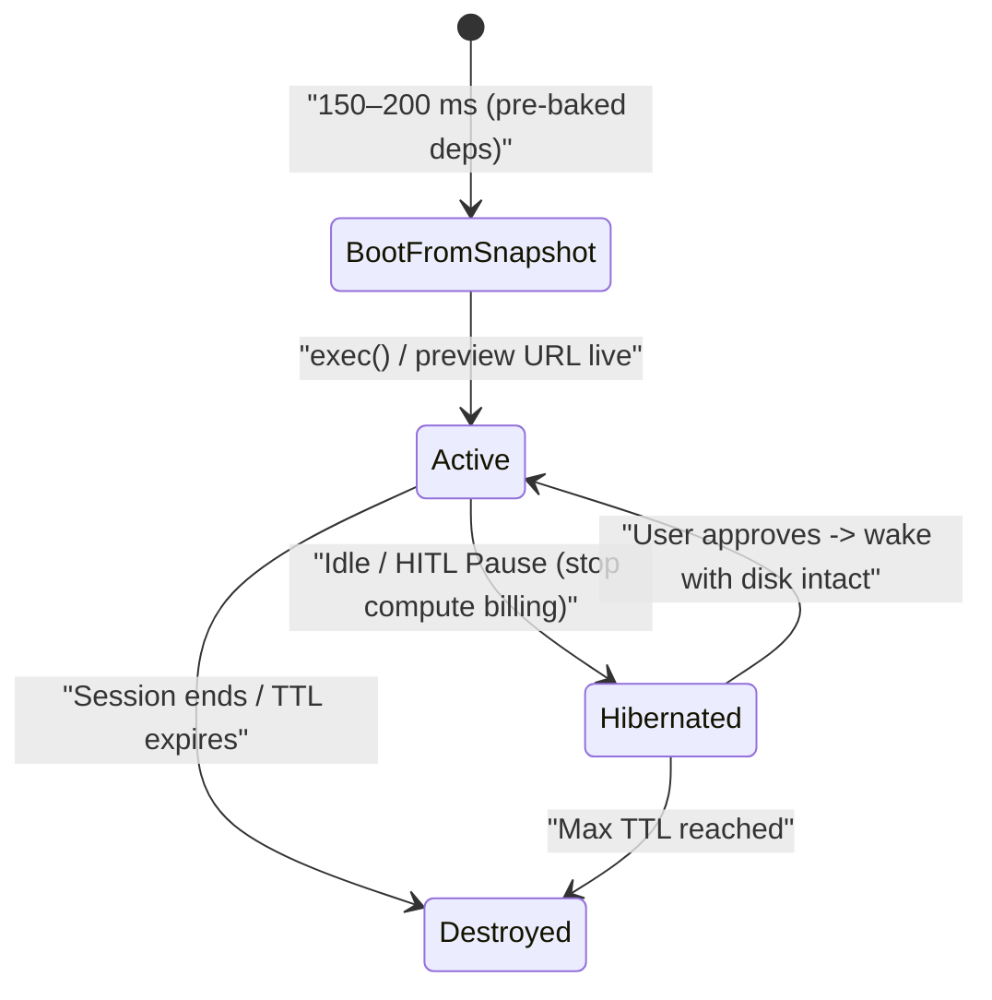

# Chapter 06 — Safe Code Execution & Sandbox Isolation

> **Lecture 37 · Chapter 06 of 07** · Level: 🔴 Expert · Phase 8 — Multimodality, Full-Stack Apps & Agent Scaling
> **Source:** `FDE S23` · **Roadmap Reference:** [`roadmap-v1.md`](../../roadmap-v1.md#lecture-37--agent-to-user-uis-ag-ui-mcp-apps-kubernetes--keda-scaling)
> **Roadmap topics:** Container escape risks · `gVisor` (`runtimeClassName: gvisor`) · Firecracker microVMs · Kubernetes `securityContext` (`runAsNonRoot`, `readOnlyRootFilesystem`, `drop: ["ALL"]`) · network policies · Stateful Sandbox Lifecycle (Snapshots, Hibernation & Preview URLs).

---

## 06.0 What this chapter is for

When an agent worker pod executes LLM-generated Python or shell commands, a standard Docker container shares the **host Linux kernel**. A kernel vulnerability or misconfigured mount lets untrusted code read Kubernetes ServiceAccount tokens, pivot to cloud metadata (`169.254.169.254`), or compromise neighboring tenant pods.

At the same time, modern production sandboxes are not just one-shot `exec()` runners — they manage **long-lived, stateful sessions** across multi-turn agent conversations and HITL pauses.

By the end of this chapter you should be able to:

1. Compare **Standard Containers (`runc`)**, **`gVisor` (`runsc`)**, and **Firecracker/Kata MicroVMs** for kernel isolation.
2. Harden a Kubernetes Pod `securityContext` (`runAsNonRoot`, `readOnlyRootFilesystem`, `allowPrivilegeEscalation: false`, `capabilities.drop: ["ALL"]`).
3. Block host network and cloud metadata access via **Kubernetes `NetworkPolicy`**.
4. Design **stateful sandbox lifecycles** using pre-baked snapshots, sleep-to-wake hibernation, and ephemeral preview URLs.

---

## 06.1 Isolation Boundary Comparison

| Layer | Mechanism | Isolation Strength | Cold Start | K8s Integration |
| :--- | :--- | :---: | :---: | :--- |
| **Standard Container (`runc`)** | Linux namespaces + cgroups (shared host kernel) | Low for untrusted code | ~200 ms | Default |
| **gVisor (`runsc`)** | User-space kernel intercepting syscalls | **High** | ~300 ms | `runtimeClassName: gvisor` |
| **Firecracker / Kata** | Hardware-virtualized microVM with dedicated guest kernel | **Highest** | ~150 ms | `runtimeClassName: kata-fc` |



### Hardened Kubernetes Sandbox Pod Spec + NetworkPolicy

```yaml
apiVersion: v1
kind: Pod
metadata:
  name: python-sandbox-pod
  labels:
    role: agent-sandbox
spec:
  runtimeClassName: gvisor              # User-space kernel syscall interception
  automountServiceAccountToken: false   # Never mount K8s API tokens!
  securityContext:
    runAsNonRoot: true
    runAsUser: 10001
  containers:
    - name: python-sandbox
      image: my-registry/python-sandbox:1.0
      securityContext:
        allowPrivilegeEscalation: false
        readOnlyRootFilesystem: true
        capabilities:
          drop: ["ALL"]
      volumeMounts:
        - name: tmp-workspace
          mountPath: /tmp               # Only writable scratch space
  volumes:
    - name: tmp-workspace
      emptyDir:
        sizeLimit: 256Mi
```

And pair the pod with a **default-deny egress `NetworkPolicy`** blocking cloud metadata (`169.254.169.254/32`) and internal VPC CIDR ranges:

```yaml
apiVersion: networking.k8s.io/v1
kind: NetworkPolicy
metadata:
  name: sandbox-egress-lockdown
spec:
  podSelector:
    matchLabels:
      role: agent-sandbox
  policyTypes: ["Egress"]
  egress:
    - to:
        - ipBlock:
            cidr: 0.0.0.0/0
            except:
              - 169.254.169.254/32   # Block AWS/GCP/Azure instance metadata!
              - 10.0.0.0/8           # Block internal VPC services
              - 172.16.0.0/12
              - 192.168.0.0/16
```

> [!IMPORTANT]
> **Always set `automountServiceAccountToken: false`.** By default, Kubernetes mounts a ServiceAccount JWT at `/var/run/secrets/kubernetes.io/serviceaccount/token` inside every pod. If LLM-generated Python runs `open(...).read()`, it could query the Kubernetes API unless you disable automounting.

---

## 06.2 Stateful Sandbox Lifecycle: Snapshots, Hibernation & Preview URLs

Modern production sandboxes are not just one-shot `exec()` runners — they manage **long-lived, stateful sessions** across multi-turn agent conversations:



1. **Snapshots & Image Caching:** Pre-bake dependencies (`node_modules`, Python venvs, repo clones) into a snapshot/manifest so new sessions boot in **150–200 ms** instead of running `npm install` on every turn.
2. **Hibernation / Sleep-to-Wake:** Idle sandboxes (e.g., waiting 10 minutes on a human HITL approval in `AG-UI`) **hibernate memory/disk** to stop compute billing, then wake cleanly with filesystem state intact when the user clicks Approve.
3. **Live Preview URLs:** Platforms like **Cloudflare Sandbox (GA)** and **E2B** expose authenticated ephemeral preview URLs for dev servers running inside the sandbox — ideal for `MCP Apps` or coding agents showing live UI previews.
4. **Per-Tenant Network Egress:** Enforce default-deny egress (`NetworkPolicy` in K8s or outbound handlers in Cloudflare/E2B) blocking `169.254.169.254` and cross-tenant internal IPs.

> [!TIP]
> **Separate the Orchestrator Pod from the Sandbox Pod.** Even if a sandbox pod is compromised, keeping your LLM API keys and Postgres credentials in the Orchestrator pod (communicating over a narrow RPC boundary) ensures the sandbox never holds secrets.

---

## 06.3 Common mistakes

| # | Common Mistake | Why It Hurts | What To Do Instead |
| :--- | :--- | :--- | :--- |
| **1** | **Running LLM-generated Python in default `runc` containers** | Shared host kernel + default ServiceAccount token enables container escape | Use `runtimeClassName: gvisor` (or `kata-fc`) + `automountServiceAccountToken: false` |
| **2** | **Leaving `169.254.169.254` reachable from sandbox pods** | Untrusted code can `curl` cloud IAM credentials from instance metadata | Block `169.254.169.254/32` and RFC1918 CIDRs in `NetworkPolicy` |
| **3** | **Running `npm install` / `pip install` on every agent session** | Adds 15–40 s cold-start lag per conversation | Pre-bake dependencies into container images or VM snapshots |
| **4** | **Keeping sandboxes billed at 100% during 15-minute HITL pauses** | Burns compute budget while waiting on a human click | Hibernate idle sandboxes to disk and wake on `APPROVAL` resume |

---

## 06.4 Key takeaways

1. **Never run untrusted LLM-generated code in a default privileged container.**
2. **Use `runtimeClassName: gvisor` (or Kata/Firecracker)** + `runAsNonRoot: true` + `readOnlyRootFilesystem: true` + `automountServiceAccountToken: false` + `capabilities.drop: ["ALL"]`.
3. **Block egress to cloud metadata IPs (`169.254.169.254/32`) and internal VPC services** via Kubernetes `NetworkPolicy`.
4. **Use snapshots and sleep-to-wake hibernation** so long-running HITL agent sessions stay fast without burning idle compute.

---

**Next:** [Chapter 07 — Resource Limits, OOM Protection & Crash Recovery](./07_Resource_Limits_OOM_Protection_and_Crash_Recovery.md)
