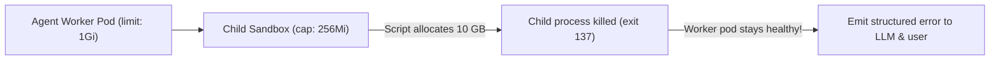
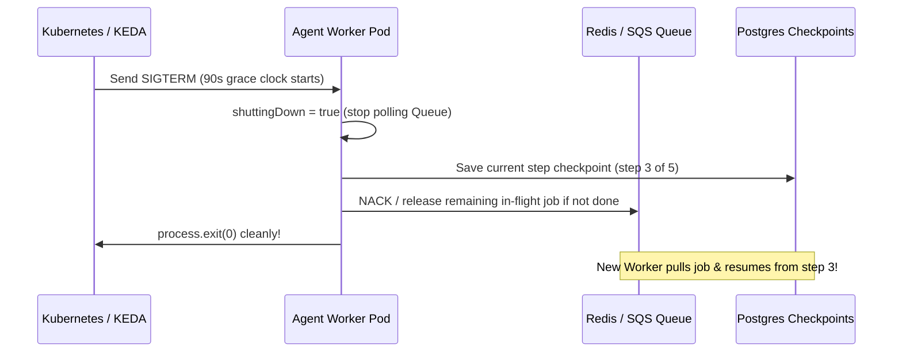

# Chapter 07 — Resource Limits, OOM Protection & Crash Recovery

> **Lecture 37 · Chapter 07 of 07** · Level: 🔴 Expert · Phase 8 — Multimodality, Full-Stack Apps & Agent Scaling
> **Source:** `FDE S23` · **Roadmap Reference:** [`roadmap-v1.md`](../../roadmap-v1.md#lecture-37--agent-to-user-uis-ag-ui-mcp-apps-kubernetes--keda-scaling)
> **Roadmap topics:** Kubernetes `requests` vs. `limits` · `OOMKilled` prevention · graceful `SIGTERM` shutdown (`terminationGracePeriodSeconds`) · dead-letter queues & checkpoint resumption.

---

## 07.0 What this chapter is for

A single LLM-generated Python script that allocates a 10 GB array (`[0] * 10**9`) inside an unbounded worker pod will trigger the Linux **OOM Killer** — crashing the entire pod and taking 4 other concurrent agent runs down with it ("noisy neighbor").

And when KEDA scales down pods or Kubernetes rolls a deployment, a pod receives `SIGTERM`. Without graceful shutdown, in-flight agent loops are **killed mid-step** — leaving users with half-finished runs and lost progress.

By the end of this chapter you should be able to:

1. Set Kubernetes **`requests` and `limits`** for CPU and Memory to prevent noisy-neighbor OOM crashes.
2. Cap child sandbox memory (`ulimit` / `maxBuffer`) below the pod's `memory.limit` so a bad script fails cleanly without killing the worker pod.
3. Configure **`terminationGracePeriodSeconds`** and `SIGTERM` handlers so workers checkpoint and exit cleanly on scale-in.
4. Recover orphaned jobs using **queue visibility timeouts**, **Dead-Letter Queues (DLQ)**, and **Postgres checkpoints**.

---

## 07.1 Pod Resource & Lifecycle Hygiene

| Setting | Purpose | Recommended Worker Value |
| :--- | :--- | :---: |
| **`resources.requests`** | Guarantees minimum CPU/RAM for K8s scheduler | `cpu: "500m", memory: "512Mi"` |
| **`resources.limits`** | Hard ceiling preventing noisy-neighbor OOM across node | `cpu: "1000m", memory: "1Gi"` |
| **Child Sandbox Cap** | Kills runaway script *before* it hits Pod `1Gi` limit | `256Mi` (`ulimit -v` / container limit) |
| **`terminationGracePeriodSeconds`** | Time K8s waits after `SIGTERM` before `SIGKILL` | `60`–`120` seconds |
| **Queue Visibility Timeout** | Auto-requeues job if a pod crashes (`OOMKilled`) without acking | `90` seconds |



### Kubernetes Deployment Resource & Grace Period YAML

```yaml
spec:
  terminationGracePeriodSeconds: 90
  containers:
    - name: agent-worker
      resources:
        requests:
          cpu: "500m"
          memory: "512Mi"
        limits:
          cpu: "1000m"
          memory: "1Gi"
```

---

## 07.2 Graceful `SIGTERM` Shutdown & Crash Recovery

When KEDA scales down or Kubernetes performs a rolling upgrade, your worker receives `SIGTERM`. It must **stop pulling new jobs**, finish or checkpoint the current step, and exit cleanly before `terminationGracePeriodSeconds` expires:



### Graceful `SIGTERM` Handler Pattern (TypeScript)

```typescript
let shuttingDown = false;

process.on("SIGTERM", async () => {
  shuttingDown = true; // Stop pulling new jobs from Redis/SQS
  await waitForCurrentStepCheckpoint(); // Finish & persist current step to Postgres
  process.exit(0);
});

async function workerLoop() {
  while (!shuttingDown) {
    const job = await queue.pop({ timeoutSeconds: 5 });
    if (!job) continue;
    await runAgentFromLastCheckpoint(job);
  }
}
```

### Dead-Letter Queues (DLQ) for Poison Pills

What if a specific job *always* triggers an OOM or uncaught exception? Without a max-retry cap, the visibility timeout will re-queue that poison pill **forever**, crashing worker pods in an infinite loop.
- Configure `maxReceiveCount: 3` on your queue.
- After 3 failed attempts, move the job to a **Dead-Letter Queue (`agent_jobs_dlq`)**, emit `RUN_ERROR` to `AG-UI`, and alert on-call engineers.

> [!IMPORTANT]
> **Combine `idempotencyKey` (Lecture 30) with Crash Recovery.** When a crashed worker's job is re-queued by visibility timeout and resumed on a new pod, `idempotencyKey` guarantees that any already-completed refund or email step is replayed safely rather than executed twice!

---

## 07.3 Common mistakes

| # | Common Mistake | Why It Hurts | What To Do Instead |
| :--- | :--- | :--- | :--- |
| **1** | **Deploying worker pods with no `resources.limits`** | One runaway Python array triggers node-level OOM, killing neighboring pods | Set explicit `requests` and `limits` on every worker and sandbox container |
| **2** | **Letting child sandboxes share the worker's full memory limit** | A 1 GB script crashes the entire worker pod (`OOMKilled`) instead of returning an error | Cap child sandbox memory below the worker limit so the worker survives |
| **3** | **Ignoring `SIGTERM` (relying on default 30 s `SIGKILL`)** | KEDA scale-in kills active LLM/tool steps mid-flight | Handle `SIGTERM`, set `shuttingDown = true`, checkpoint, and raise `terminationGracePeriodSeconds` |
| **4** | **Retrying failed jobs infinitely without a DLQ** | A single poison-pill payload crashes every worker pod in a loop | Route jobs to a Dead-Letter Queue after `maxReceiveCount = 3` and emit `RUN_ERROR` |

---

## 07.4 Key takeaways

1. **Always set `resources.limits` on agent worker pods** and cap child sandbox memory (`ulimit` / `maxBuffer`) below the pod limit.
2. **Handle `SIGTERM` gracefully** (stop pulling new jobs, checkpoint current step, let in-flight step finish within `terminationGracePeriodSeconds`).
3. **Combine queue visibility timeouts, DLQs, Postgres checkpoints, and `idempotencyKey`s** so crashed jobs resume cleanly from the last completed step without duplicating side effects.

---

**Next:** [Lecture 37 — Complete Notes (Master Consolidation)](./Lecture_37_Complete_Notes.md)
