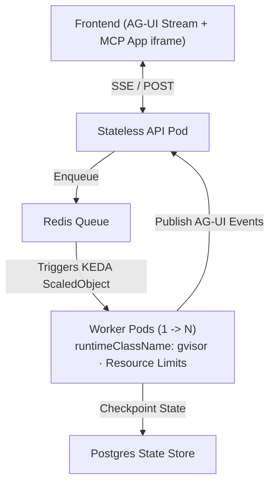

# Lecture 37 — Complete Notes
## Agent-to-User UIs (`AG-UI`, `MCP Apps`), Kubernetes & KEDA Scaling

> **Phase:** 8 · Multimodality, Full-Stack Apps & Agent Scaling · **Level:** 🔴 Expert
> **Scope:** A single-pass consolidation of the seven chapter notes in this folder.
>
> | Chapter | File |
> | :--- | :--- |
> | 01 · Agent-to-User Interaction (`AG-UI` Protocol) | [01_Agent_to_User_Interaction_AG_UI_Protocol.md](./01_Agent_to_User_Interaction_AG_UI_Protocol.md) |
> | 02 · MCP Apps: Interactive UI inside MCP Hosts | [02_MCP_Apps_Interactive_UI_inside_MCP_Hosts.md](./02_MCP_Apps_Interactive_UI_inside_MCP_Hosts.md) |
> | 03 · Managed vs. Self-Hosted Agent Runtimes | [03_Managed_vs_Self_Hosted_Agent_Runtimes.md](./03_Managed_vs_Self_Hosted_Agent_Runtimes.md) |
> | 04 · Stateless API Services vs. Durable Worker State | [04_Stateless_API_Services_vs_Durable_Worker_State.md](./04_Stateless_API_Services_vs_Durable_Worker_State.md) |
> | 05 · Kubernetes Pods, Queues & KEDA Autoscaling | [05_Kubernetes_Pods_Queues_and_KEDA_Autoscaling.md](./05_Kubernetes_Pods_Queues_and_KEDA_Autoscaling.md) |
> | 06 · Safe Code Execution & Sandbox Isolation | [06_Safe_Code_Execution_and_Sandbox_Isolation.md](./06_Safe_Code_Execution_and_Sandbox_Isolation.md) |
> | 07 · Resource Limits, OOM Protection & Crash Recovery | [07_Resource_Limits_OOM_Protection_and_Crash_Recovery.md](./07_Resource_Limits_OOM_Protection_and_Crash_Recovery.md) |

---

## 1. Executive summary

**The lecture in five sentences.**

1. **`AG-UI`** streams structured agent lifecycle events (`RUN_STARTED`, `STEP_STARTED`, `TOOL_CALL_*`, `APPROVAL_REQUIRED`, `RUN_FINISHED`) over SSE, while **`MCP Apps`** embed sandboxed interactive `iframe` widgets (`ui://...`) inside MCP hosts.
2. **Managed runtimes** (Cloudflare Agents, Modal, Inngest) ship fastest, while **Self-Hosted Kubernetes** wins when VPC data residency or custom kernel sandboxes are mandatory.
3. Production Kubernetes agent architectures decouple **Stateless API Ingress** (auth, enqueue, SSE relay) from **Durable Queue-Backed Worker Pods** (checkpoints + execution).
4. **KEDA** scales worker pods dynamically on **queue depth** (`clamp(ceil(depth / target), min, max)`) rather than CPU, because I/O-bound LLM workers sit near 2% CPU while waiting on APIs.
5. **`gVisor` / Firecracker microVMs**, hardened pod `securityContext`s, resource `limits`, and graceful `SIGTERM` checkpointing contain untrusted code execution and recover cleanly from crashes.

---

## 2. The arc of the lecture in one diagram

---

## 3. Cheat sheet

| Concept | One-line definition | Chapter |
| :--- | :--- | :--- |
| **`AG-UI` Protocol** | Event stream for step progress, tool calls, HITL approvals & errors | [01](./01_Agent_to_User_Interaction_AG_UI_Protocol.md) |
| **`MCP Apps`** | Returning sandboxed `ui://` interactive widgets from MCP tool outputs | [02](./02_MCP_Apps_Interactive_UI_inside_MCP_Hosts.md) |
| **Stateless vs. Durable** | API pods handle HTTP/SSE; queue-backed worker pods run agent loops | [04](./04_Stateless_API_Services_vs_Durable_Worker_State.md) |
| **KEDA `ScaledObject`** | Scales pods on queue depth (`ceil(depth / listLength)`), not CPU | [05](./05_Kubernetes_Pods_Queues_and_KEDA_Autoscaling.md) |
| **gVisor / MicroVM** | Isolates untrusted LLM code from the host Linux kernel | [06](./06_Safe_Code_Execution_and_Sandbox_Isolation.md) |
| **Managed Sandbox Matrix** | E2B, Daytona, Modal, Cloudflare Sandbox GA vs. Docker AI Sandboxes & `agent-infra/sandbox` | [03](./03_Managed_vs_Self_Hosted_Agent_Runtimes.md) |
| **Sandbox Hibernation** | Snapshot/restore, sleep-to-wake persistence, and live preview URLs during HITL pauses | [06](./06_Safe_Code_Execution_and_Sandbox_Isolation.md) |
| **OOM & `SIGTERM`** | Pod `limits` + graceful shutdown + queue visibility timeouts | [07](./07_Resource_Limits_OOM_Protection_and_Crash_Recovery.md) |

---

## 4. Self-check questions (Release Gate Prep)

1. Why does standard Kubernetes CPU HPA fail to scale LLM agent worker pods during a traffic spike?
2. How does `AG-UI` handle a mid-run Human-in-the-Loop approval without timing out the HTTP request?
3. Name four Kubernetes `securityContext` / runtime settings required before running untrusted LLM code in a pod.

