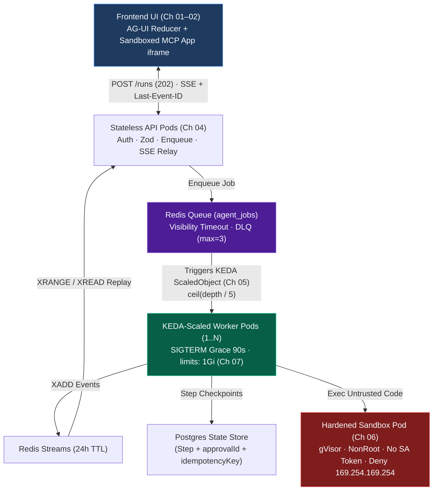

# Lecture 37 — Complete Notes
## Agent-to-User UIs (`AG-UI`, `MCP Apps`), Kubernetes & KEDA Scaling

> **Phase:** 8 · Multimodality, Full-Stack Apps & Agent Scaling · **Level:** 🔴 Expert
> **Scope:** Single-pass revision guide consolidating all seven chapter notes in this folder.
> **How to use this file:** Revise the end-to-end architecture, scaling formulas, hardening rules, and release-gate checks here; jump to any chapter file for full YAML, TypeScript, and sequence diagrams.

---

## 1. Executive Summary

**Thesis:** Production full-stack agents require two decoupled planes: an **event-driven UI plane** (`AG-UI` SSE streams + sandboxed `MCP Apps` `iframe` widgets) and a **resilient execution plane** where Stateless API pods enqueue work for **KEDA queue-scaled, `gVisor`-isolated Worker pods** with `SIGTERM` checkpointing and `Last-Event-ID` replay.

**The lecture in five sentences:**

1. **`AG-UI`** replaces raw chatbot token streaming with typed SSE lifecycle events (`RUN_STARTED`, `STEP_STARTED`, `TOOL_CALL_*`, `APPROVAL_REQUIRED`, `STATE_DELTA`, `RUN_ERROR`, `RUN_FINISHED`), while **`MCP Apps`** embed portable interactive widgets (`ui://...`) inside sandboxed `iframe`s (`sandbox="allow-scripts"`).
2. **Managed runtimes** (Cloudflare Agents, Modal, Inngest) win for speed during early FDE pilots, whereas **Self-Hosted Kubernetes** is triggered by strict VPC/air-gapped data residency, custom kernel isolation (`gVisor`/`Kata`), co-located GPUs, or existing GitOps platform mandates.
3. Production Kubernetes agent backends decouple **Stateless API Ingress** (`202 Accepted` + `Last-Event-ID` Redis Streams SSE relay) from **Durable Queue-Backed Worker Pods** (PAV loops + Postgres step checkpoints).
4. **KEDA** scales worker pods on **queue depth** (`clamp(ceil(queueDepth / listLength), minReplicaCount, maxReplicaCount)`) rather than CPU, because I/O-bound LLM workers sit near `2%` CPU while waiting on APIs.
5. **Defense-in-depth hardening** (`runtimeClassName: gvisor`, `automountServiceAccountToken: false`, `NetworkPolicy` blocking `169.254.169.254/32`), child memory caps, graceful `SIGTERM` checkpointing, and Dead-Letter Queues (`maxReceiveCount: 3`) prevent noisy-neighbor OOMs and mid-flight crashes.

| Chapter | Core Topic | Link |
| :--- | :--- | :--- |
| **01** | Agent-to-User Interaction (`AG-UI` Protocol) | [01_Agent_to_User_Interaction_AG_UI_Protocol.md](./01_Agent_to_User_Interaction_AG_UI_Protocol.md) |
| **02** | MCP Apps: Interactive UI inside MCP Hosts | [02_MCP_Apps_Interactive_UI_inside_MCP_Hosts.md](./02_MCP_Apps_Interactive_UI_inside_MCP_Hosts.md) |
| **03** | Managed vs. Self-Hosted Agent Runtimes | [03_Managed_vs_Self_Hosted_Agent_Runtimes.md](./03_Managed_vs_Self_Hosted_Agent_Runtimes.md) |
| **04** | Stateless API Services vs. Durable Worker State | [04_Stateless_API_Services_vs_Durable_Worker_State.md](./04_Stateless_API_Services_vs_Durable_Worker_State.md) |
| **05** | Kubernetes Pods, Queues & KEDA Autoscaling | [05_Kubernetes_Pods_Queues_and_KEDA_Autoscaling.md](./05_Kubernetes_Pods_Queues_and_KEDA_Autoscaling.md) |
| **06** | Safe Code Execution & Sandbox Isolation | [06_Safe_Code_Execution_and_Sandbox_Isolation.md](./06_Safe_Code_Execution_and_Sandbox_Isolation.md) |
| **07** | Resource Limits, OOM Protection & Crash Recovery | [07_Resource_Limits_OOM_Protection_and_Crash_Recovery.md](./07_Resource_Limits_OOM_Protection_and_Crash_Recovery.md) |

---

## 2. Master Architecture Diagram

---

## 3. Chapter-by-Chapter Short Revision Notes

### 3.1 Chapter 01 — Agent-to-User Interaction (`AG-UI` Protocol)

Multi-step agents spend 15–45 seconds calling tools and pausing for HITL approvals; raw token-only SSE leaves users staring at a frozen spinner and refreshing into duplicate runs. **`AG-UI`** standardizes an event-driven SSE/WebSocket stream reduced on the frontend into step timelines, collapsible tool cards, approval modals, and markdown bubbles.

- **Core Event Taxonomy:** `RUN_STARTED` $\rightarrow$ `STEP_STARTED` $\rightarrow$ `TOOL_CALL_START` / `TOOL_CALL_RESULT` $\rightarrow$ `APPROVAL_REQUIRED` (interactive `approvalId` card) $\rightarrow$ `STATE_DELTA` $\rightarrow$ `TEXT_MESSAGE_CONTENT` $\rightarrow$ `RUN_FINISHED` / `RUN_ERROR`.
- **Data Hygiene:** Never leak raw 14 KB SQL rows or PII in `TOOL_CALL_RESULT`; emit concise, sanitized UI summaries.

> 📖 **Need depth?** Read [Chapter 01 — Agent-to-User Interaction (`AG-UI` Protocol)](./01_Agent_to_User_Interaction_AG_UI_Protocol.md)

### 3.2 Chapter 02 — MCP Apps: Interactive UI inside MCP Hosts

When prose chat is the wrong interface (e.g., adjusting forecast sliders or approving 5 refunds), **MCP Apps** let an MCP tool return both structured `content` text for the LLM *and* `_meta.uiResourceUri: "ui://..."` pointing to an HTML/React bundle fetched via `resources/read`.

- **Isolation Rules:** Mount widgets in `<iframe sandbox="allow-scripts">` — **never** combine `allow-scripts` with `allow-same-origin` (which lets the widget escape and read host cookies/`localStorage`). Enforce strict CSP (`connect-src 'none'`) and proxy actions over a typed `postMessage` bridge.
- **`AG-UI` vs. `MCP Apps`:** Use `AG-UI` for your own first-party Next.js/React app; use `MCP Apps` for portable interactive widgets inside third-party MCP hosts.

> 📖 **Need depth?** Read [Chapter 02 — MCP Apps: Interactive UI inside MCP Hosts](./02_MCP_Apps_Interactive_UI_inside_MCP_Hosts.md)

### 3.3 Chapter 03 — Managed vs. Self-Hosted Agent Runtimes

Default to **Managed Runtimes** (Cloudflare Agents, Modal, Inngest) for early FDE pilots to ship in hours rather than weeks. Only adopt **Self-Hosted Kubernetes + KEDA** when hit by one of **4 Hard Triggers**: (1) strict VPC/air-gapped data residency, (2) custom kernel sandboxing (`gVisor`/`Kata`), (3) co-located self-hosted GPUs (vLLM/SGLang), or (4) an existing K8s/GitOps platform mandate.

- **Sandbox Platform Selection:** Dynamic Workers (`env.LOADER`) for JS/TS API glue; **E2B / Modal / Daytona / Cloudflare Sandbox GA** for managed Linux/Python/GPU; **Docker AI Sandboxes** for local/hybrid dev; **`agent-infra/sandbox`** for unified Browser + Shell + VNC; **K8s `gVisor`/`Kata`** for strict customer VPCs.

> 📖 **Need depth?** Read [Chapter 03 — Managed vs. Self-Hosted Agent Runtimes](./03_Managed_vs_Self_Hosted_Agent_Runtimes.md)

### 3.4 Chapter 04 — Stateless API Services vs. Durable Worker State

Running 5–30 minute agent loops inside HTTP handlers breaks on 60 s load-balancer timeouts, rolling deploys, and browser refreshes. Split the backend into **Stateless API Pods** (auth, Zod validation, `202 Accepted` enqueue, SSE relay) and **Durable Worker Pods** (PAV loop + Postgres checkpoints).

- **`Last-Event-ID` Replay:** Classic Redis Pub/Sub drops events during a 500 ms browser refresh. Persist `AG-UI` events in **Redis Streams (`XADD`)** with a 24 h TTL so `GET /runs/:id/stream` replays missed events via `XRANGE` from `Last-Event-ID` before tailing `XREAD`.

> 📖 **Need depth?** Read [Chapter 04 — Stateless API Services vs. Durable Worker State](./04_Stateless_API_Services_vs_Durable_Worker_State.md)

### 3.5 Chapter 05 — Kubernetes Pods, Queues & KEDA Autoscaling

Standard Kubernetes CPU HPA fails for AI agents because LLM-calling workers are I/O-bound (~`2%` CPU while awaiting APIs), leaving 500 queued jobs stalled on 1 pod. **KEDA** scales `agent-worker` pods directly on Redis/SQS/Kafka queue depth:

$$\text{desiredReplicas} = \text{clamp}\!\left(\left\lceil \frac{\text{queueDepth}}{\text{targetListLength}} \right\rceil,\ \text{minReplicaCount},\ \text{maxReplicaCount}\right)$$

- **Tuning Rules:** Use `minReplicaCount: 1` (with `cooldownPeriod: 120–300 s`) for interactive `AG-UI` to avoid cold-start lag, and `minReplicaCount: 0` for overnight batch. Always cap `maxReplicaCount` against your LLM RPM/TPM quota and DB connection pool.

> 📖 **Need depth?** Read [Chapter 05 — Kubernetes Pods, Queues & KEDA Autoscaling](./05_Kubernetes_Pods_Queues_and_KEDA_Autoscaling.md)

### 3.6 Chapter 06 — Safe Code Execution & Sandbox Isolation

Standard `runc` containers share the host Linux kernel and mount a Kubernetes ServiceAccount JWT by default. Isolate untrusted LLM code with **`runtimeClassName: gvisor`** (or `kata-fc` microVM), `automountServiceAccountToken: false`, `runAsNonRoot: true`, `readOnlyRootFilesystem: true`, `capabilities.drop: ["ALL"]`, and a **default-deny egress `NetworkPolicy`** blocking `169.254.169.254/32` and RFC1918 VPC CIDRs.

- **Stateful Lifecycle:** Pre-bake dependencies into snapshots (150–200 ms boot), **hibernate** idle sandboxes during 15-minute `AG-UI` HITL pauses to stop compute billing, and expose ephemeral preview URLs cleanly.

> 📖 **Need depth?** Read [Chapter 06 — Safe Code Execution & Sandbox Isolation](./06_Safe_Code_Execution_and_Sandbox_Isolation.md)

### 3.7 Chapter 07 — Resource Limits, OOM Protection & Crash Recovery

One unbounded Python allocation (`[0] * 10**9`) can trigger Linux `OOMKilled` and crash neighboring concurrent runs. Set explicit pod `requests` (`500m` / `512Mi`) and `limits` (`1000m` / `1Gi`), and cap child sandboxes *below* the pod limit (`256Mi` via `ulimit`/container limit) so the worker pod survives and emits a structured error.

- **Graceful `SIGTERM` & Poison Pills:** Set `terminationGracePeriodSeconds: 90`; on `SIGTERM`, set `shuttingDown = true`, finish/checkpoint the current step to Postgres, and exit `0`. Pair queue visibility timeouts (`90 s`) with a **Dead-Letter Queue (`maxReceiveCount: 3`)** and `idempotencyKey`s so crashed jobs resume without duplicating side effects.

> 📖 **Need depth?** Read [Chapter 07 — Resource Limits, OOM Protection & Crash Recovery](./07_Resource_Limits_OOM_Protection_and_Crash_Recovery.md)

---

## 4. Cheat Sheet & Common Traps

| Component / Control | Production Rule | Common Trap to Avoid |
| :--- | :--- | :--- |
| **`AG-UI` Streaming** | Emit `STEP_STARTED`, `TOOL_CALL_*`, `APPROVAL_REQUIRED` | Streaming only text deltas or asking `"Reply YES"` in chat prose |
| **`MCP Apps` `iframe`** | `sandbox="allow-scripts"` + strict CSP + text fallback | Adding `allow-same-origin` (breaks isolation!) or empty `content` |
| **Runtime Choice** | Managed first; K8s only for VPC/custom kernel/GPU/GitOps | Standing up EKS + KEDA + gVisor for a 2-week FDE pilot |
| **SSE Reconnects** | Redis Streams (`XADD`) + `Last-Event-ID` (`XRANGE`) | Using fire-and-forget Redis Pub/Sub (drops events on refresh) |
| **KEDA Scaling** | Scale on queue depth; `min=1` interactive / `0` batch | Using CPU HPA (stuck at 2% CPU) or omitting `maxReplicaCount` |
| **Pod Isolation** | `gVisor` + `automountServiceAccountToken: false` + `NetworkPolicy` | Running untrusted Python in `runc` or leaving `169.254.169.254` open |
| **OOM & Crashes** | Child cap `<` Pod `limits` + `SIGTERM` + DLQ (`max=3`) | No `limits`, ignoring `SIGTERM`, or infinite poison-pill retries |

---

## 5. Self-Check Questions (Release Gate Prep)

1. **KEDA vs. CPU HPA:** Why does standard Kubernetes CPU HPA fail to scale LLM agent worker pods during a traffic spike, and how do you size `maxReplicaCount` in a KEDA `ScaledObject`?
   - *Key check:* LLM workers are I/O-bound (`~2%` CPU while waiting on APIs), so CPU HPA never scales up; size `maxReplicaCount` against your upstream LLM RPM/TPM quota and Postgres connection pool to prevent `429` storms.
2. **`AG-UI` & Refresh Resilience:** How does `AG-UI` handle a mid-run HITL approval without timing out the HTTP request, and why must Redis Streams + `Last-Event-ID` be used instead of plain Redis Pub/Sub?
   - *Key check:* `POST /runs` returns `202 { runId }` immediately, the worker emits `APPROVAL_REQUIRED` with `approvalId` and checkpoints to Postgres, and Redis Streams (`XADD`/`XRANGE`) persist events so browser refreshes replay missed steps via `Last-Event-ID`.
3. **MCP Apps Security:** Why must an MCP Host never combine `sandbox="allow-scripts"` and `allow-same-origin` on a third-party `MCP App` `iframe`?
   - *Key check:* Combining both lets embedded scripts remove their own `sandbox` attribute and read the host's cookies, `localStorage`, and OAuth tokens.
4. **Pod Hardening:** Name five Kubernetes `Pod` / `NetworkPolicy` settings required before executing untrusted LLM-generated Python inside a cluster.
   - *Key check:* `runtimeClassName: gvisor` (or `kata-fc`), `automountServiceAccountToken: false`, `runAsNonRoot: true`, `readOnlyRootFilesystem: true` + `capabilities.drop: ["ALL"]`, and a default-deny egress `NetworkPolicy` blocking `169.254.169.254/32` and RFC1918 CIDRs.
5. **Crash Recovery:** Trace what happens when a worker pod receives `SIGTERM` during a KEDA scale-in—or crashes with `OOMKilled`—and how `Postgres checkpoints`, `visibilityTimeout`, `DLQ`, and `idempotencyKey` prevent lost work or double mutations.
   - *Key check:* On `SIGTERM`, the worker sets `shuttingDown = true`, checkpoints the current step to Postgres, and exits within `terminationGracePeriodSeconds`; on `OOMKilled`, queue `visibilityTimeout` re-queues the job (up to `maxReceiveCount: 3` before DLQ), and `idempotencyKey` replays already-committed mutations safely.

---

## 6. Quick Reference: Managed vs. Self-Hosted Trigger Checklist

| Trigger / Requirement | Recommended Path | Key Configuration |
| :--- | :--- | :--- |
| **Early FDE pilot / rapid SaaS** | Managed (Cloudflare Agents / Modal / Inngest) | Ship in hours; zero K8s ops |
| **Strict VPC / air-gapped residency** | Self-Hosted Kubernetes + KEDA | Stateless API (`202` + SSE) + Queue Workers |
| **Interactive `AG-UI` vs. Batch** | KEDA `ScaledObject` | `minReplicaCount: 1` (interactive) · `0` (batch) |
| **Long HITL pauses in sandboxes** | Snapshots + Sleep-to-Wake Hibernation | `150–200 ms` boot; zero idle compute billing |
