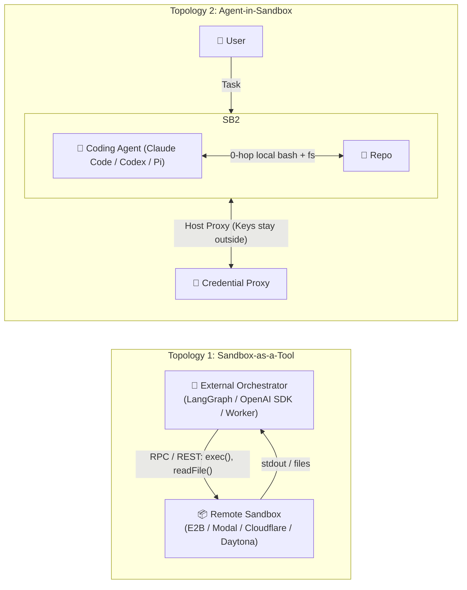

# Chapter 01 — Why Agents Need Sandboxes & Core Topologies

> **Lecture 38 · Chapter 01 of 07** · Level: 🔴 Expert · Phase 8 — Multimodality, Full-Stack Apps & Agent Scaling
> **Reference:** [LangChain — How to Choose the Right Sandbox for Your Agent](https://www.langchain.com/blog/how-to-choose-the-right-sandbox-for-your-agent)

---

## 01.1 Why In-Process Guards Are Not Enough

An in-process path check (like `safePath` in Lecture 10) protects simple `readFile`/`writeFile` tools, but collapses the moment an agent can run **arbitrary code, bash commands, package managers, or browsers**:
- Child processes can read `process.env` secrets, open raw sockets to `169.254.169.254`, exhaust RAM/CPU (fork bombs), or follow symlinks outside the directory.
- A **Sandbox** moves untrusted execution into an **OS-, kernel-, or hypervisor-enforced boundary** where even a fully prompt-injected model cannot touch the host or other tenants.

---

## 01.2 The Two Core Agent Sandbox Topologies

| Dimension | **Sandbox-as-a-Tool** | **Agent-in-Sandbox** |
| :--- | :--- | :--- |
| **Agent loop location** | Outside the sandbox | Inside the sandbox |
| **Secret safety** | **Highest** — LLM keys & DB tokens never enter the sandbox | Requires a **Host Credential Proxy** |
| **Tool latency** | Network hop (~20–100 ms per call) | Zero-hop local execution (<1 ms) |
| **Best use case** | Multi-tenant SaaS, Code Mode, data analysis | Autonomous coding agents (SWE, repo refactors, test loops) |

---

## 01.3 Key Takeaways
1. **Never rely on prompts or regexes to sandbox code execution** — use OS/VM boundaries.
2. **Choose *Sandbox-as-a-Tool*** when secret isolation and multi-tenancy dominate; choose ***Agent-in-Sandbox*** for local/autonomous SWE loops with a host credential proxy.

