# Chapter 02 — Isolation Layers: V8 Isolates, Containers, gVisor & MicroVMs

> **Lecture 38 · Chapter 02 of 07** · Level: 🔴 Expert · Phase 8 — Multimodality, Full-Stack Apps & Agent Scaling
> **References:** [Cloudflare — Dynamic Workers](https://blog.cloudflare.com/dynamic-workers/) · [LangChain — How to Choose the Right Sandbox for Your Agent](https://www.langchain.com/blog/how-to-choose-the-right-sandbox-for-your-agent)
> **Roadmap topics:** V8 Isolates · standard Docker (`runc`) shared-kernel risk · `gVisor` (`runsc`) user-space kernel · Firecracker / Kata hardware MicroVMs · the three non-negotiable sandbox axes (filesystem, network, process).

---

## 02.0 What this chapter is for

"Just put it in a Docker container" is the most common — and most dangerous — misconception in AI infrastructure. A standard Docker container is **not** a security boundary for untrusted multi-tenant code because every container on a node shares the **exact same host Linux kernel**.

This chapter compares the four real isolation technologies available to AI engineers, shows you what sits between untrusted agent code and your host hardware in each tier, and gives you the **three-axis hardening checklist** every production sandbox must pass.

By the end of this chapter you should be able to:

1. Explain **why standard `runc` Docker containers** are unsafe for multi-tenant untrusted LLM code.
2. Compare **V8 Isolates**, **Containers**, **gVisor**, and **MicroVMs** across boot time, RAM overhead, and syscall boundary.
3. Apply the **Three Sandbox Axes** (Filesystem, Network, Process) to audit any sandbox configuration.

---

## 02.1 The Four Isolation Tiers

```mermaid
flowchart TB
    subgraph L1["Tier 1: V8 Isolate (Dynamic Workers)"]
        C1["JS/TS Code"] --> V8["V8 Heap & Isolate<br/>No Linux Syscalls · ~2-5ms boot"]
    end

    subgraph L2["Tier 2: Standard Container (runc)"]
        C2["Untrusted Code"] --> NS["Namespaces & cgroups"] --> HK2["⚠️ Shared Host Linux Kernel"]
    end

    subgraph L3["Tier 3: User-Space Kernel (gVisor)"]
        C3["Untrusted Code"] --> GV["gVisor Sentry (Go User-Space Kernel)<br/>Intercepts 100% of Syscalls"] --> HK3["Host Kernel (Minimal Surface)"]
    end

    subgraph L4["Tier 4: Hardware MicroVM (Firecracker / Kata)"]
        C4["Untrusted Code"] --> GK["Dedicated Guest Linux Kernel"] --> KVM["KVM Hypervisor Boundary"] --> HW["Host Hardware"]
    end

    style L2 fill:#ffebee,stroke:#c62828,stroke-width:2px
    style L4 fill:#e8f5e9,stroke:#2e7d32,stroke-width:2px
```

| Tier | Runtime / Tech | Isolation Boundary | Cold Start | RAM Overhead | Multi-Tenant Untrusted Code? | Best Workload |
| :---: | :--- | :--- | :---: | :---: | :---: | :--- |
| **1** | **V8 Isolate** (Cloudflare Dynamic Workers) | Separate V8 heap; zero OS/filesystem access | **~2–5 ms** | **~3–10 MB** | **Yes** (JS/TS only) | High-frequency Code Mode MCP & API glue |
| **2** | **Standard Container** (Docker `runc`) | Linux namespaces + cgroups (**shared kernel**) | 500–2,000 ms | 50–256 MB | **No** (kernel escape risk) | Trusted internal microservices only |
| **3** | **User-Space Kernel** (`gVisor` / `runsc`) | Syscalls trapped & emulated in Go user-space | 500–1,500 ms | 50–150 MB | **Yes** | Kubernetes agent pods (`runtimeClassName: gvisor`) |
| **4** | **Hardware MicroVM** (`Firecracker`, `Kata`, Docker AI) | Dedicated guest kernel + KVM hypervisor | **120–250 ms** (snapshot) | 50–128 MB | **Yes (Gold Standard)** | Arbitrary Python, bash, C++, Docker-in-Docker |

> [!WARNING]
> **Why `runc` fails for untrusted code:** Hundreds of Linux syscalls (`io_uring`, `bpf`, `ptrace`, `mount`) hit the host kernel directly. One kernel CVE inside a standard container compromises every tenant on that machine. Always upgrade to **`gVisor`** or a **MicroVM** for LLM-generated code.

---

## 02.2 The Three Non-Negotiable Sandbox Axes

Every production sandbox — regardless of vendor — must enforce isolation across **all three axes**:

1. **Filesystem Axis:**
   - Ephemeral copy-on-write root or read-only root (`readOnlyRootFilesystem: true`) with a size-capped `/workspace`.
   - **Never** mount host `/`, `~/.ssh`, `~/.aws`, or `/var/run/docker.sock`.
2. **Network Axis:**
   - Default-deny egress (`globalOutbound: null` or K8s `NetworkPolicy`).
   - Explicitly block link-local cloud metadata (`169.254.169.254`) and RFC-1918 private VPC subnets (`10.0.0.0/8`, `172.16.0.0/12`, `192.168.0.0/16`).
   - Route allowed external API calls through a **host-side proxy** that injects credentials outside the sandbox.
3. **Process & Resource Axis:**
   - Run as non-root (`runAsNonRoot: true`, UID `10001`), drop all capabilities (`capabilities.drop: ["ALL"]`).
   - Enforce hard CPU, memory (OOM kill), PIDs (anti-fork-bomb), and wall-clock execution timeouts.

---

## 02.3 Common Mistakes & Key Takeaways

| # | Common Mistake | Why It Hurts | What To Do Instead |
| :---: | :--- | :--- | :--- |
| 1 | Using a 1,500 ms container for 5-line JSON filtering | Adds 1.5s latency per tool call | Use a **V8 Isolate** (~2–5 ms) for pure JS/TS data glue |
| 2 | Running `docker run` without `gVisor` or MicroVM for untrusted Python | Shared host kernel exposes all tenants | Use **Firecracker**, **Kata**, or **`gVisor`** |
| 3 | Blocking filesystem paths but leaving outbound `curl` open | Agent exfiltrates workspace data or hits `169.254.169.254` | Enforce **default-deny egress** on the Network Axis |

### Key Takeaways
1. **Standard containers (`runc`) are for trusted code; `gVisor` and MicroVMs are for untrusted LLM code.**
2. **V8 Isolates (~2–5 ms)** win whenever the agent only needs sandboxed JavaScript/TypeScript.
3. **A real sandbox locks down all three axes:** Filesystem, Network, and Process/Resources.

---

**Next:** [Chapter 03 — Docker AI Sandboxes (Local & Hybrid Workflows)](./03_Docker_AI_Sandboxes_Local_and_Hybrid_Workflows.md)
