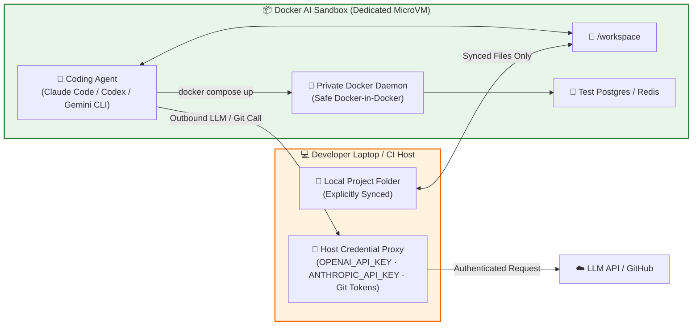

# Chapter 03 — Docker AI Sandboxes (Local & Hybrid Workflows)

> **Lecture 38 · Chapter 03 of 07** · Level: 🔴 Expert · Phase 8 — Multimodality, Full-Stack Apps & Agent Scaling
> **Reference:** [Docker AI Sandboxes Documentation](https://docs.docker.com/ai/sandboxes/)
> **Roadmap topics:** Why standard `docker run` + `docker.sock` is fatal · **Docker AI Sandboxes** (`docker sandbox run`) · dedicated MicroVM per workspace · private Docker daemon (`dockerd`) · host-side credential & network proxy.

---

## 03.0 What this chapter is for

Developers love running coding agents (Claude Code, Codex, Gemini CLI) locally on their laptops, and those agents often need to run `docker build`, `docker compose up`, or integration tests against Postgres and Redis.

If you give a normal container access to `/var/run/docker.sock` so it can run Docker commands, **you just gave the AI agent root access to your entire laptop.** Docker AI Sandboxes solve this cleanly.

By the end of this chapter you should be able to:

1. Explain why mounting `/var/run/docker.sock` breaks sandbox isolation completely.
2. Describe the **Docker AI Sandboxes** architecture (`MicroVM` + `private dockerd` + `Host Credential Proxy`).
3. Contrast **Docker AI Sandboxes** (local/hybrid SWE developer workflows) against **cloud sandboxes** (E2B, Cloudflare, Modal).

---

## 03.1 The `docker.sock` Trap vs. Docker AI Sandboxes

If an agent inside a container can talk to `/var/run/docker.sock`, it can run `docker run -v /:/host alpine cat /host/Users/you/.ssh/id_rsa` and read every file on your machine.

**[Docker AI Sandboxes](https://docs.docker.com/ai/sandboxes/)** (`docker sandbox run`) eliminate this by giving every agent workspace its own **hardware-virtualized MicroVM** with a **private Docker daemon** inside:

### Four Architectural Guarantees
1. **MicroVM per workspace:** A dedicated guest Linux kernel isolates your host OS even if the agent runs `sudo` or modifies system packages.
2. **Private `dockerd` inside the VM:** The agent can build images and spin up test databases freely without touching your host Docker daemon or other containers.
3. **Host-side Credential Proxy:** API keys live on the host proxy, *never* inside the VM's environment variables. If prompt-injected code runs `env`, your keys are not there.
4. **Scoped Workspace Sync:** Only the target project folder is synced into `/workspace` — `~/.ssh`, `~/.aws`, and browser cookies remain invisible to the agent.

---

## 03.2 Common Mistakes & Key Takeaways

| # | Common Mistake | Why It Hurts | What To Do Instead |
| :---: | :--- | :--- | :--- |
| 1 | Mounting `/var/run/docker.sock` for an agent | Equivalent to giving root on the host OS | Use **Docker AI Sandboxes** with a private `dockerd` |
| 2 | Passing `--dangerously-skip-permissions` on bare metal | One bad `rm -rf` or prompt injection wipes your laptop | Run autonomous coding agents inside a **MicroVM sandbox** |

### Key Takeaways
1. **Docker AI Sandboxes (`docker sandbox run`)** bring hardware-virtualized MicroVMs + safe Docker-in-Docker to local and CI coding agents.
2. **Host-side credential injection** keeps LLM and Git secrets completely outside the VM.

---

**Next:** [Chapter 04 — OpenAI Agents SDK Sandboxes & Abstractions](./04_OpenAI_Agents_SDK_Sandboxes_and_Abstractions.md)
