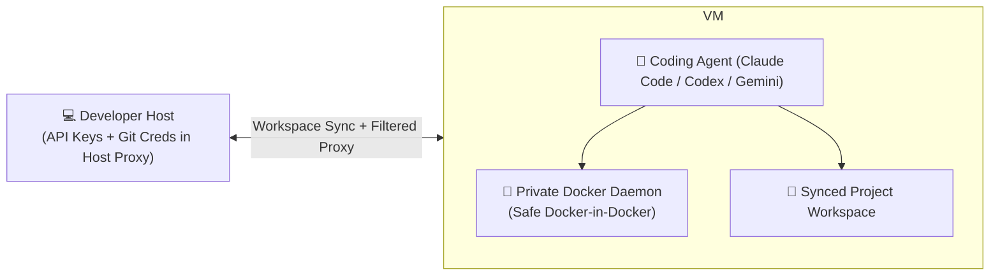

# Chapter 03 — Docker AI Sandboxes (Local & Hybrid Workflows)

> **Lecture 38 · Chapter 03 of 07** · Level: 🔴 Expert · Phase 8 — Multimodality, Full-Stack Apps & Agent Scaling
> **Reference:** [Docker AI Sandboxes Documentation](https://docs.docker.com/ai/sandboxes/)

---

## 03.1 Why `docker run` Breaks for Coding Agents

Coding agents frequently need to run `docker build`, `docker compose up`, or integration tests. Mounting `/var/run/docker.sock` into a normal container gives the agent **full root control over the host machine**.

**[Docker AI Sandboxes](https://docs.docker.com/ai/sandboxes/)** (`docker sandbox run`) solve this by wrapping each agent workspace in a **lightweight MicroVM**:

### Key Capabilities
1. **MicroVM per workspace:** Dedicated guest kernel isolates the host OS even if the agent runs `sudo` or kernel tools inside the sandbox.
2. **Private Docker daemon (`dockerd`):** Agents can build images and spin up Postgres/Redis test containers safely inside the VM.
3. **Host Credential Proxy:** API keys (`OPENAI_API_KEY`, `ANTHROPIC_API_KEY`, GitHub tokens) are injected by the host proxy *outside* the VM — prompt-injected code inside the sandbox cannot dump them via `env`.
4. **Network Egress Controls:** Restrict outbound domains while keeping package registries or approved endpoints reachable.

