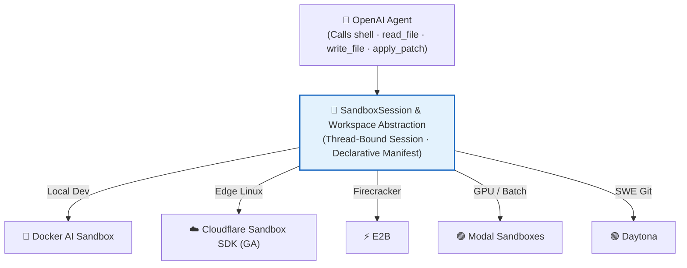

# Chapter 04 — OpenAI Agents SDK Sandboxes & Abstractions

> **Lecture 38 · Chapter 04 of 07** · Level: 🔴 Expert · Phase 8 — Multimodality, Full-Stack Apps & Agent Scaling
> **References:** [OpenAI Agents SDK — Sandboxes Guide](https://developers.openai.com/api/docs/guides/agents/sandboxes) · [Cloudflare + OpenAI Agents Sandbox Tutorial](https://developers.cloudflare.com/sandbox/sdk/tutorials/openai-agents/)
> **Roadmap topics:** Provider-agnostic `Workspace` & `SandboxSession` abstractions · `Manifest` snapshots · standardizing `shell` / `read_file` / `apply_patch` tools · swapping local Docker for cloud sandboxes (Cloudflare, E2B, Modal, Daytona).

---

## 04.0 What this chapter is for

If you hardcode E2B's SDK or `child_process.exec` directly inside your agent's tool handlers, migrating from local dev to Cloudflare Sandboxes or Modal later requires rewriting your agent's tools and prompts.

The **[OpenAI Agents SDK Sandboxes](https://developers.openai.com/api/docs/guides/agents/sandboxes)** pattern solves this with a **clean provider abstraction**: your agent talks to `SandboxSession` and `Workspace` primitives, while the underlying runtime is swappable via configuration.

By the end of this chapter you should be able to:

1. Name the three core abstractions: **`Workspace`**, **`SandboxSession`**, and **`Manifest`**.
2. Wire an OpenAI Agent to pluggable local (Docker) and cloud (**Cloudflare Sandbox**, **E2B**, **Modal**, **Daytona**) backends without changing agent logic.

---

## 04.1 The Provider-Agnostic Sandbox Architecture

### Core Primitives
- **`Workspace` & `SandboxSession`:** Binds an agent run (or `thread_id`) to a persistent filesystem and shell environment so multi-turn edits survive across turns.
- **`Manifest` (Declarative Snapshots):** Pins the base container image, OS packages (`python3`, `git`), and initial repo files so cold starts resume from a pre-built snapshot instead of running `pip install` on every user session.
- **Standardized Tool Contract:** Tools (`exec`, `read_file`, `write_file`, `apply_patch`) target the `SandboxSession` interface — allowing seamless local-to-cloud promotion.

---

## 04.2 Common Mistakes & Key Takeaways

| # | Common Mistake | Why It Hurts | What To Do Instead |
| :---: | :--- | :--- | :--- |
| 1 | Coupling agent tool schemas to one sandbox vendor API | Makes local testing slow and vendor migration expensive | Program against a **`SandboxSession` / `SandboxProvider`** interface |
| 2 | Installing `npm` / `pip` packages on every cold start | Adds 15–45 seconds to first-turn latency | Pre-bake dependencies into a **`Manifest` / Snapshot** |

### Key Takeaways
1. **Decouple agent reasoning from sandbox compute** using `Workspace` and `SandboxSession` abstractions.
2. **Use `Manifest` snapshots** to turn 30-second package installs into sub-second warm boots.

---

**Next:** [Chapter 05 — Cloudflare Sandbox SDK (GA) vs. Dynamic Workers](./05_Cloudflare_Sandbox_SDK_GA_vs_Dynamic_Workers.md)
