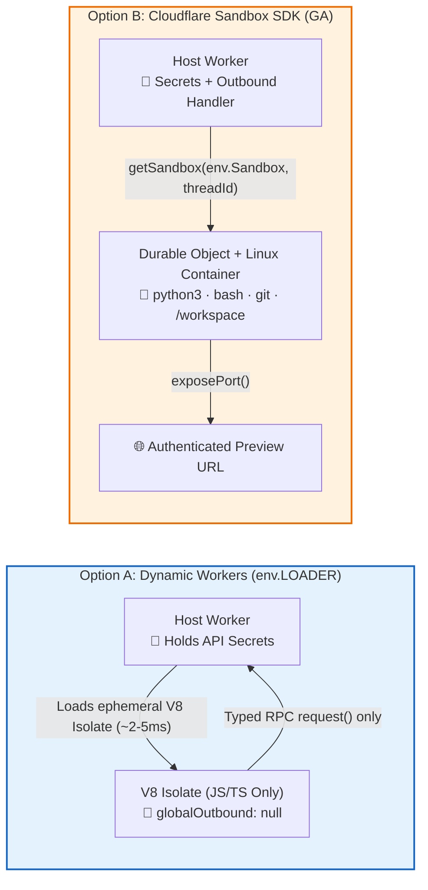

# Chapter 05 — Cloudflare Sandbox SDK (GA) vs. Dynamic Workers

> **Lecture 38 · Chapter 05 of 07** · Level: 🔴 Expert · Phase 8 — Multimodality, Full-Stack Apps & Agent Scaling
> **References:** [Cloudflare Sandbox GA](https://blog.cloudflare.com/sandbox-ga/) · [Dynamic Workers](https://blog.cloudflare.com/dynamic-workers/) · [Agents Sandbox Tools](https://developers.cloudflare.com/agents/tools/sandbox/) · [OpenAI Agents + Cloudflare Sandbox Tutorial](https://developers.cloudflare.com/sandbox/sdk/tutorials/openai-agents/)
> **Roadmap topics:** **Dynamic Workers** (`env.LOADER`, V8 isolates, ~2–5 ms boot, `globalOutbound: null`) · **Cloudflare Sandbox SDK (GA)** (`@cloudflare/sandbox`, Durable Objects + Linux containers, `exec()`, preview URLs, sleep/wake) · decision matrix · wiring `@cloudflare/sandbox` to OpenAI Agents SDK.

---

## 05.0 What this chapter is for

Cloudflare ships **two completely different sandbox runtimes** on its edge network. Picking the wrong one either limits your agent to JavaScript when it needs `python3` and `git`, or pays a 1–2 second container boot penalty when a 3 ms V8 isolate would have been 300× faster.

This chapter compares **Dynamic Workers** and **Cloudflare Sandbox SDK (GA)** side by side, shows how both keep secrets out of untrusted code, and walks through wiring `@cloudflare/sandbox` as an OpenAI Agents SDK backend.

By the end of this chapter you should be able to:

1. Contrast **Dynamic Workers** (V8 Isolates) with **Cloudflare Sandbox SDK (GA)** (Durable Objects + Linux Containers).
2. Explain how `globalOutbound: null` + Host Worker RPC proxies prevent secret exfiltration in Dynamic Workers.
3. Explain the stable `@cloudflare/sandbox` contract (`getSandbox`, `sandbox.exec`, `exposePort` preview URLs, sleep/wake).

---

## 05.1 Two Edge Sandbox Primitives Compared



| Dimension | **Dynamic Workers** (`env.LOADER`) | **Cloudflare Sandbox SDK (GA)** (`@cloudflare/sandbox`) |
| :--- | :--- | :--- |
| **Runtime** | V8 Isolate | Durable Object + Linux Container |
| **Cold Start** | **~2–5 ms** | **~1–2 s** (with warm sleep/wake persistence) |
| **Languages & Binaries** | JavaScript / TypeScript only | Full Linux (`python3`, `bash`, `git`, `pip`, `npm`, CLI binaries) |
| **Filesystem & Storage** | Ephemeral / in-memory | Persistent disk, bucket mounts, backups |
| **Processes & Ports** | Single short-lived `execute()` call | `exec()`, `startProcess()`, `terminal()`, **preview URLs** (`exposePort`) |
| **Network & Secret Safety** | `globalOutbound: null` + Host RPC proxy | Non-secret config in container env; live secrets & outbound handlers in Worker |
| **Best Workload** | High-frequency Code Mode MCP (`openApiMcpServer`) | SWE coding agents, Python data analysis, git workflows, OpenAI Agents SDK |

---

## 05.2 Wiring `@cloudflare/sandbox` to OpenAI Agents SDK

When an OpenAI Agent needs a persistent Linux workspace (`exec`, files, git, dev server previews), bind a Durable Object `Sandbox` namespace using the stable `@cloudflare/sandbox` API:

```ts
import { getSandbox, Sandbox } from "@cloudflare/sandbox";

// Required Durable Object export
export { Sandbox };

export async function runAgentShellCommand(env: { Sandbox: DurableObjectNamespace }, threadId: string, command: string) {
  // 1. One isolated Linux container per conversation thread (sleeps when idle, wakes with disk intact)
  const sandbox = getSandbox(env.Sandbox, `thread-${threadId}`);

  // 2. Execute command and receive buffered stdout / stderr / exitCode
  const result = await sandbox.exec(command);
  return {
    stdout: result.stdout,
    stderr: result.stderr,
    exitCode: result.exitCode,
    success: result.success,
  };
}
```

> [!IMPORTANT]
> **Contract rule for `@cloudflare/sandbox`:** Keep **live secrets in the Host Worker**, never inside the container's `env`. Use Worker outbound handlers when sandboxed processes need authenticated external API calls.

---

## 05.3 Common Mistakes & Key Takeaways

| # | Common Mistake | Why It Hurts | What To Do Instead |
| :---: | :--- | :--- | :--- |
| 1 | Booting a Linux container just to filter 200 API JSON items | Adds ~1.5s latency per call | Use **Dynamic Workers** (~2–5 ms V8 isolate) for JS/TS API glue |
| 2 | Putting `OPENAI_API_KEY` inside the container's environment | Untrusted Python/bash can read `os.environ` | Keep secrets in the **Host Worker** and proxy outbound calls |

### Key Takeaways
1. **Dynamic Workers (~2–5 ms)** are ideal for JS/TS Code Mode; **Cloudflare Sandbox SDK (GA)** is ideal for full Linux OS + Python/bash/git workspaces.
2. **Thread-bound Durable Objects** give every agent session persistent disk and automatic sleep/wake lifecycle.

---

**Next:** [Chapter 06 — All-in-One (AIO) Multimodal Sandboxes (`agent-infra/sandbox`)](./06_AIO_Multimodal_Sandboxes_Browser_Shell_MCP.md)
