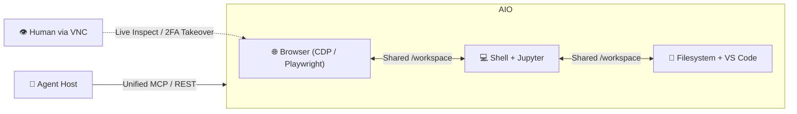

# Chapter 06 — All-in-One (AIO) Multimodal Sandboxes (`agent-infra/sandbox`)

> **Lecture 38 · Chapter 06 of 07** · Level: 🔴 Expert · Phase 8 — Multimodality, Full-Stack Apps & Agent Scaling
> **Reference:** [agent-infra/sandbox (GitHub)](https://github.com/agent-infra/sandbox)

---

## 06.1 Unified Browser + Shell + Filesystem + VNC over MCP

When an agent must browse a web app, download a file, transform it with Python, and inspect the result, splitting Browser and Shell into separate containers strands files and cookies across boundaries.

**[AIO Sandbox (`agent-infra/sandbox`)](https://github.com/agent-infra/sandbox)** packages **Browser (CDP/Playwright) + Shell/Terminal + Filesystem + Jupyter + VS Code Server + VNC** inside **one container**, exposed via **unified MCP & REST endpoints**:

- **Shared `/workspace`:** Browser downloads are immediately readable by `bash` / `python3`.
- **VNC Human Takeover:** Humans can view or take over the browser via VNC for 2FA or sensitive approvals.
- **Single Isolation Boundary:** Run with `gVisor` / `NetworkPolicy` in Kubernetes and destroy on session completion.

