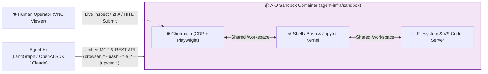

# Chapter 06 — All-in-One (AIO) Multimodal Sandboxes (`agent-infra/sandbox`)

> **Lecture 38 · Chapter 06 of 07** · Level: 🔴 Expert · Phase 8 — Multimodality, Full-Stack Apps & Agent Scaling
> **Reference:** [agent-infra/sandbox (GitHub)](https://github.com/agent-infra/sandbox)
> **Roadmap topics:** Why separate Browser & Shell containers break workflows · **AIO Sandbox (`agent-infra/sandbox`)** architecture · Browser (CDP/Playwright) + Shell + Filesystem + Jupyter + VS Code + VNC in one shared `/workspace` · unified MCP & REST exposure · VNC human-in-the-loop takeover.

---

## 06.0 What this chapter is for

Real-world enterprise workflows rarely stay inside a single tool category. Consider a typical task:

1. Log into a legacy vendor portal via **Browser (Playwright / Computer-Use)** and download `monthly_invoices.csv`.
2. Clean and reconcile the CSV using **`python3` / `pandas`** in the shell.
3. Render a summary chart in **Jupyter** or edit a script in **VS Code**, then upload the result back through the browser.

If your browser runs in one container and your Python shell runs in another, **files and session cookies are stranded across two separate filesystems.** **`agent-infra/sandbox` (AIO Sandbox)** solves this by unifying all of them inside one isolated container.

By the end of this chapter you should be able to:

1. Explain the **stranded-artifact problem** when Browser and Shell run in separate sandboxes.
2. Draw the **AIO Sandbox** architecture (Browser + Shell + Filesystem + Jupyter + VS Code + VNC over unified MCP/REST).
3. Explain how **VNC human takeover** enables clean HITL approval for 2FA, CAPTCHAs, and high-risk form submissions.

---

## 06.1 Unified Browser + Shell + Filesystem + VNC Architecture

### Why One Shared Container Matters
- **Zero-copy handoff:** Anything downloaded by Chromium lands directly in `/workspace`, immediately readable by `bash`, `python3`, or `jupyter`.
- **Unified MCP Surface:** The agent connects to **one MCP/REST endpoint** to drive browser clicks, run shell commands, and edit files — no S3 sync glue required.
- **VNC Human-in-the-Loop:** When a Computer-Use agent hits a login screen, 2FA prompt, or `"Wire Funds"` button, a human can open the live VNC stream, verify or complete the step, and hand control back.

> [!TIP]
> **Hardening AIO Sandboxes in Production:** Because Chromium + Shell + Node/Python run in one container, always run the AIO pod under **`gVisor` (`runtimeClassName: gvisor`)** or **Kata/Firecracker** with a strict **`NetworkPolicy`** blocking `169.254.169.254` and internal VPC subnets.

---

## 06.2 Common Mistakes & Key Takeaways

| # | Common Mistake | Why It Hurts | What To Do Instead |
| :---: | :--- | :--- | :--- |
| 1 | Running Playwright and Python in separate pods without shared storage | Agent downloads a file in the browser, then `python3` gets `FileNotFoundError` | Use an **AIO Sandbox (`agent-infra/sandbox`)** with a shared `/workspace` |
| 2 | Exposing VNC publicly without auth | Anyone on the internet can control the agent's browser session | Gate VNC behind authenticated RBAC / VPN / ephemeral session tokens |

### Key Takeaways
1. **AIO Sandbox (`agent-infra/sandbox`)** unifies Browser (CDP/Playwright) + Shell + Filesystem + Jupyter + VS Code + VNC behind a single MCP/REST interface.
2. **VNC streaming** gives Computer-Use workflows a built-in human takeover and audit channel.

---

**Next:** [Chapter 07 — Managed Platforms (`E2B`, `Modal`, `Daytona`) & Selection Matrix](./07_Managed_Platforms_E2B_Modal_Daytona_and_Selection_Matrix.md)
